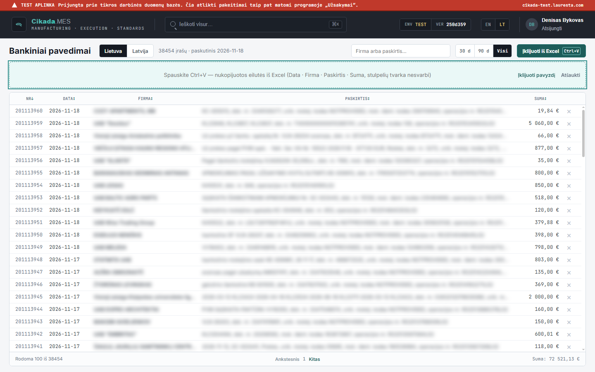

# Banko pavedimų įkėlimas iš Excel

**Būsena:** veikia

## Kam skirta
Finansų modulio ekrane „Bankiniai pavedimai“ (UI: Įklijuoti iš Excel) galima įkelti naujus banko pavedimus: nukopijuojate eilutes iš Excel, sistema parodo peržiūrą su dublikatų patikra, jūs pažymite, ką įkelti, ir pavedimai gauna naujus Nr senosios sistemos lentelėje.

## Prieš pradedant
- Finansų prieiga ([apžvalga](index.md)).
- Pasirinkta teisinga šalis (UI: Lietuva) arba (UI: Latvija) – importas rašomas į pasirinktą šalį.
- Excel eilutėse turi būti data, firma (mokėtojas), paskirtis ir suma; stulpelių tvarka nesvarbi. Viena eilutė – vienas pavedimas, stulpeliai atskirti Tab (taip kopijuojama iš Excel). Iki 1500 eilučių ir 500 000 simbolių.

## Žingsniai
### 1. Įklijuoti
1. Excel pažymėkite eilutes ir nukopijuokite (`Ctrl+C`).
2. Ekrane paspauskite (UI: Įklijuoti iš Excel) ir `Ctrl+V` (arba tiesiog `Ctrl+V` puslapyje, kai neįrašinėjate į kitą lauką). Atsiranda laukas su užuomina „Spauskite Ctrl+V – nukopijuotos eilutės iš Excel (Data · Firma · Paskirtis · Suma, stulpelių tvarka nesvarbi)“.
3. Norėdami nutraukti, paspauskite (UI: Atšaukti).
4. Ne gamybos aplinkoje yra mygtukas (UI: Įklijuoti pavyzdį) su pavyzdinėmis eilutėmis; gamyboje jo nėra.

### 2. Peržiūrėti
1. Atsidaro (UI: Įklijuota iš Excel – peržiūra). Santrauka: „{n} eilučių: {x} nauj. · {y} dublik. · {z} galimi dublik. · {k} klaid.“ ir numeracija „Paskutinis Nr {a} · nauji Nr {b}–{c}“.
2. Kiekviena eilutė turi būseną:
   - (UI: Naujas) – pažymėta automatiškai;
   - (UI: Dublikatas) – lentelėje jau yra tokia pat data, firma ir suma (arba pasikartoja tame pačiame įklijavime); nepažymėta;
   - (UI: Dublikatas?) – tokia pat data ir suma, bet kita firma; nepažymėta ir rodoma „Galimas atitikmuo: NR … · firma“. Prieš pažymėdami patikrinkite atitinkamą NR;
   - (UI: Klaida) – eilutės įkelti negalima; pažymėti negalima. Priežastys: „Nerasta data“, „Nerasta suma“, „Nerasta firma“, „Nėra stulpelių (laukiama Tab tarp stulpelių)“, „Netinkama reikšmė“.
3. Datos formatai: `2026.10.30`, `30.10.2026`, `30/10/2026`, `30-10-2026` (metai 2000–2100). Sumos: `1 020,01 €`, `1020.01`, `-50,00`.

### 3. Įkelti
1. Pažymėkite arba nuimkite žymėjimus; apačioje rodoma „Pažymėta suma“.
2. Paspauskite (UI: Įkelti {n} į {LT/LV}).
3. Rodoma „Įkelta {n} pavedimų į {šalis} · Nr {nuo}–{iki}“; sąrašas persikrauna, nauji įrašai paryškinti.

### 4. Atšaukti įkėlimą
1. Pranešime paspauskite (UI: Atšaukti įkėlimą) ir patvirtinkite „Atšaukti paskutinį įkėlimą? Visi įkelti pavedimai turi būti nepakeisti ir nepriskirti.“
2. Atšaukti galima tik paskutinį jūsų įkėlimą per 30 minučių ir tik jei nė vienas įkeltas pavedimas nepasikeitė ar nebuvo priskirtas.

## Ką reiškia būsenos ir spalvos
Eilutės su „Dublikatas?“ paryškintos kitaip nei „Naujas“ ir pagal nutylėjimą neįkeliamos. Išjungti (pilki) žymėjimai – eilutės su klaida.

## Dažnos klaidos
| Pranešimas | Priežastis | Ką daryti |
|---|---|---|
| „Pavedimas jau yra, pasikeitė arba buvo priskirtas. Atnaujinkite ir patikrinkite.“ (409) | Peržiūra pasenusi (galioja 15 min.), kitas naudotojas įkėlė naują Nr arba pavedimas jau yra | Įklijuokite iš naujo |
| „Patikrinkite pasirinktų pavedimų duomenis ir bandykite dar kartą.“ (400) | Per daug eilučių, tuščias pasirinkimas | Pataisykite ir pakartokite |
| Eilutė su klaida „Nėra stulpelių…“ | Tekstas nukopijuotas ne iš Excel | Kopijuokite lentelę su stulpeliais |

## Dar neįgyvendinta
Failo (CSV, PDF, MT940) tiesioginio įkėlimo ekrane nėra – tik įklijavimas iš Excel. Kitų formatų išrašus gali perskaityti AI asistentas: [AI asistentas – banko išrašų įkėlimas](../mcp/bankas.md).
