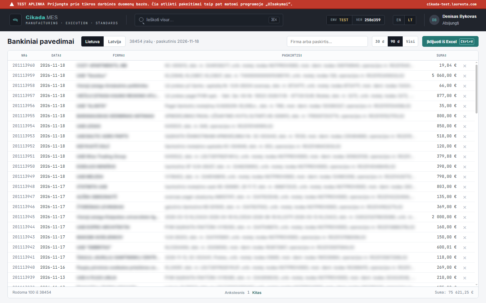

# Bankiniai pavedimai

**Būsena:** veikia

## Kam skirta
Finansų modulio ekranas „Bankiniai pavedimai“ (UI: Bankiniai pavedimai) rodo senosios sistemos banko pavedimų lentelę: numerį, datą, mokėtoją (firmą), paskirtį ir sumą. Čia ieškoma pavedimų, rūšiuojama, šalinami per klaidą įkelti nepriskirti pavedimai. Naujų pavedimų įkėlimas aprašytas [kitame puslapyje](bankiniai-pavedimai-ikelimas.md).

## Prieš pradedant
- Paskyra turi turėti Finansų prieigą (žr. [apžvalgą](index.md)): jūsų Cikada paskyra susieta su leidžiamu senosios sistemos SQL prisijungimu.
- Duomenys rodomi iš gyvos gamybos lentelės; ekrano viršuje yra gamybos duomenų įspėjimas.

## Žingsniai
### 1. Atidaryti sąrašą
1. Eikite į `/finance/` arba `/finance/bank-payments`.
2. Pasirinkite šalį: (UI: Lietuva) arba (UI: Latvija). Šalia matote „{n} įrašų · paskutinis {data}“.
3. Lentelėje stulpeliai: (UI: Nr), (UI: Data), (UI: Firma), (UI: Paskirtis), (UI: Suma). Pagal numatytąją rūšiavimą naujausi (didžiausias Nr) viršuje.

### 2. Ieškoti ir filtruoti
1. Lauke (UI: Firma arba paskirtis) įveskite tekstą (ne daugiau 100 simbolių); ieškoma po 0,3 sekundės.
2. Laikotarpio mygtukai: (UI: 30 d), (UI: 90 d), (UI: Visi).
3. Paspauskite stulpelio antraštę, kad rūšiuotumėte; pakartotinis paspaudimas keičia kryptį (Nr ir Data – pirmiausia mažėjančiai, kiti – didėjančiai).
4. Puslapiavimas: (UI: Ankstesnis) / (UI: Kitas) rodomi, kai įrašų daugiau nei puslapyje. Apačioje: „Rodoma X iš Y“ ir matomų eilučių „Suma“.

### 3. Pašalinti pavedimą
1. Eilutės gale paspauskite × („Šalinti įrašą {nr}“).
2. Patvirtinkite: „Ištrinti pavedimą {nr}? Šio veiksmo atšaukti negalima.“
3. Pavedimas ištrinamas tik jei jis dar nepriskirtas jokiam užsakymo mokėjimui (priskirta suma lygi nuliui ir nėra mokėjimo įrašo). Priešingu atveju: „Pavedimas jau yra, pasikeitė arba buvo priskirtas. Atnaujinkite ir patikrinkite.“

## Ką reiškia būsenos ir spalvos
Naujai ką tik įkeltos eilutės trumpam paryškinamos (kol sąrašas neperkraunamas).

## Dažnos klaidos
| Pranešimas | Priežastis | Ką daryti |
|---|---|---|
| „Prisijungimo sesija baigėsi. Prisijunkite iš naujo.“ | Pasibaigė sesija (401) | Prisijunkite per portalą |
| „Šiai paskyrai Finansų prieiga nesuteikta.“ | Paskyra ne Finansų sąraše arba nesusieta su SQL (403) | Kreipkitės į administratorių |
| „Finansų paslauga laikinai nepasiekiama.“ | Paslauga neatsako (503) | Bandykite vėliau |
| „Pagal pasirinktą filtrą pavedimų nėra.“ | Filtras per siauras | Pasirinkite „Visi“, išvalykite paiešką |
| „Veiksmas nepavyko.“ | Kita klaida | Perkraukite ir pakartokite |

## Dar neįgyvendinta
- Pavedimo redagavimo ar priskyrimo užsakymui ekrano nėra: priskyrimas daromas Pardavimų modulio mokėjimo formoje.
- Eksporto ir spausdinimo nėra.
