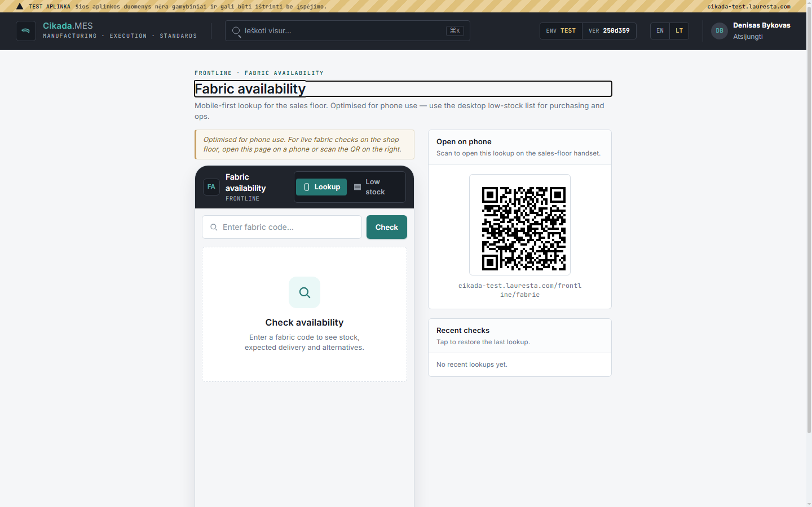

# Audinio patikra (Fabric availability)

**Būsena:** dalinai

Veikia: kodo paieška, pločių pasirinkimas, likučio būsena, kainos, alternatyvos, paskutinių patikrų sąrašas, QR kodas. Neveikia: mygtukas (UI: Reserve) (išjungtas, „SOON“), taip pat kodo perdavimas per nuorodą `?code=` (žr. skyrių „Dar neįgyvendinta“).

## Kam skirta
Frontline ekranas „Fabric availability“ skirtas pardavėjui, kuris salėje telefonu turi greitai pasakyti klientui, ar audinys yra sandėlyje, kokiu pločiu, kada laukiamas naujas atvežimas ir kuo jį galima pakeisti. Kompiuteryje tas pats ekranas rodomas telefono rėmelyje, o dešinėje yra pagalbinė skiltis su QR kodu ir paskutinėmis patikromis.

## Prieš pradedant
Prisijungti nereikia, specialių rolių nėra. Reikia žinoti audinio kodą (pavyzdžiui, `R104`). Kodą galima rašyti didžiosiomis ar mažosiomis raidėmis: sistema pati paverčia jį didžiosiomis.

## Žingsniai
### 1. Atidaryti patikrą
1. Atidarykite Frontline adresą (testinėje aplinkoje `/frontline`) arba Portale paspauskite plytelę „Frontline“.
2. Atsidarys ekranas „Fabric availability“ su tuščia būsena „Check availability“ ir užrašu „Enter a fabric code to see stock, expected delivery and alternatives.“

### 2. Įvesti kodą ir patikrinti
1. Lauke (UI: Enter fabric code…) įveskite audinio kodą.
2. Paspauskite (UI: Check) arba klavišą Enter. Mygtuko užraše trumpam rodomas „…“.
3. Jei kodo laukas tuščias, rezultatas išvalomas ir nieko neieškoma.

Kiekviena patikra, taip pat nerasto kodo paieška, užfiksuojama duomenų bazėje (procedūra `dbo.mes_Fabric_RecordLookup`), kad pirkimai matytų, kokių audinių klausiama. Užfiksuojamas kodas ir, jei vartotojas prisijungęs, jo vardas.

### 3. Perskaityti audinio kortelę
Kortelėje rodoma:
1. Nuotrauka. Jei nuotraukos nėra, rodomas užrašas „No photo“. Esant akcijai, ant nuotraukos rodomas ženklas „−N % · CAMPAIGN“.
2. Audinio kodas, pasirinktas plotis (mm) ir pavadinimas.
3. Plotis (UI: Width): kiekvienam pločiui yra mygtukas su likučiu metrais. Paspaudus kitą plotį, būsenos blokas perskaičiuojamas. Pradžioje parenkamas mažiausias plotis arba tas, kurį grąžina serveris.
4. Jei yra, skiltis „Kainos · Orientacinė kaina“ (UI: Kainos) su kainos tipu, kaina eurais ir matavimo vienetu. Priešdėlis „nuo“ reiškia, kad kaina yra „nuo“.
5. Būsenos blokas su pavadinimu („In stock“, „Low stock“, „Out of stock“, „Discontinued“) ir likučiu metrais. Jei yra, rodoma „Next delivery“ data ir „+ N m incoming“.
6. Pastabos, jei jos yra pas audinį.
7. Mygtukas (UI: Reserve) su žyma „SOON“ yra išjungtas.

### 4. Pasižiūrėti alternatyvas
1. Skiltyje (UI: Alternatives) slinkite į šoną („swipe →“).
2. Kiekviena alternatyva rodo kodą, plotį, likutį ir datą (mėnuo-diena) arba „ready“, jei laukti nereikia.
3. Paspaudus alternatyvą, ji atidaroma toje pačioje kortelėje su jos pločiu.

### 5. Grįžti prie ankstesnių patikrų
1. Tuščioje būsenoje apačioje rodoma skiltis (UI: Recent) su ne daugiau kaip 5 paskutinėmis patikromis (kodas, plotis, likutis).
2. Kompiuteryje ta pati informacija yra dešinėje skiltyje (UI: Recent checks) su paaiškinimu „Tap to restore the last lookup.“
3. Paspaudus įrašą, patikra pakartojama su tuo pačiu pločiu.

Sąrašas saugomas tik atidarytame naršyklės lange; užvėrus ar perkrovus puslapį jis dingsta („No recent lookups yet.“).

### 6. Atidaryti telefone per QR
1. Kompiuteryje dešinėje skiltyje (UI: Open on phone) rodomas QR kodas ir nuorodos adresas.
2. Nuskenavus telefonu atidaromas tas pats ekranas. Kai kortelė jau atidaryta, nuorodoje yra `?code=...&width=...`, tačiau žr. „Dar neįgyvendinta“.
3. Ši dešinė skiltis rodoma tik plačiame ekrane (nuo 980 px).

## Ką reiškia būsenos ir spalvos
Frontline ekrane „Fabric availability“ būsena rodoma žymomis ir spalvotais blokais.

| Būsena ekrane | Reikšmė | Žyma sąraše „Recent“ |
|---------------|---------|----------------------|
| In stock | Likutis pakankamas | OK · N m |
| Low stock | Likutis mažas, bet yra | Low · N m |
| Out of stock | Likučio nėra, gali būti numatyta atvežimo data | Out |
| Discontinued | Audinys nebegaminamas | Disc |

Likučio ribos serveryje numatytos: mažas likutis nuo 10 m, pakankamas nuo 25 m (jas gali pakeisti API parametrai `lowThreshold` ir `enoughThreshold`, ekrane jų keisti negalima).

## Dažnos klaidos
- **„Fabric 'X' not found“ / „Check the code or scan again.“**: tokio kodo duomenų bazėje nėra. Patikrinkite kodą arba nuskenuokite iš naujo.
- **„Frontline API unreachable“ / „Try again in a moment, or check the API container.“**: Frontline API neatsakė arba grąžino klaidą. Bandykite po kelių sekundžių. Tą patį pranešimą pamatysite ir įvedus kodą su netinkamais simboliais (leidžiamos raidės, skaitmenys ir `- _ . /`, bent 2 simboliai), nes API tokį kodą atmeta.
- Nuotraukos vietoje „No photo“: audiniui nėra pagrindinės nuotraukos arba nuotrauka neįkeliama.

## Dar neįgyvendinta
- Mygtukas (UI: Reserve) išjungtas, jo paaiškinime nurodyta, kad rezervavimas atsiras vėlesniame etape.
- Kodas iš nuorodos (`?code=` ir `width`) puslapio kode neperskaitomas, todėl nuskenavus QR kodą ar paspaudus nuorodą iš mažų likučių sąrašo atsidaro tuščia patikra, ir kodą reikia įvesti ranka.
- Paskutinių patikrų sąrašas kol kas saugomas tik atmintyje, ne bendroje lentelėje, todėl jis nesutampa tarp įrenginių.
