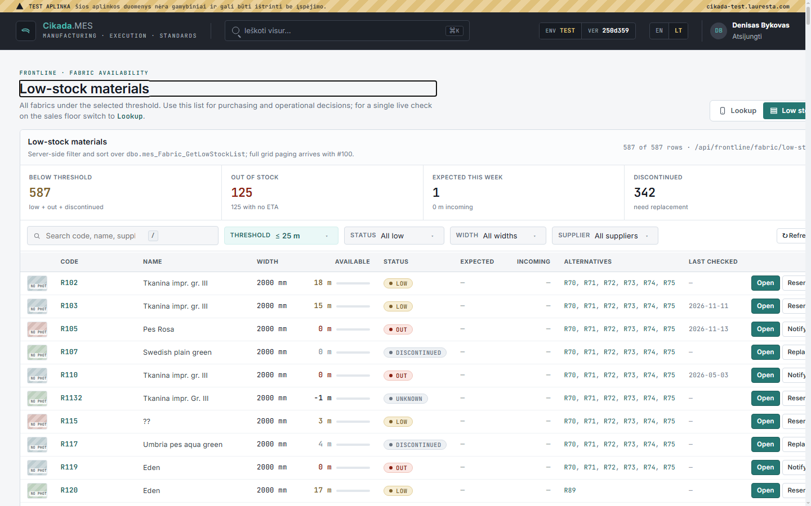

# Mažų likučių sąrašas (Low-stock materials)

**Būsena:** dalinai

Veikia: sąrašas, paieška, keturi filtrai, suvestinės plytelės, atnaujinimas, nuorodos. Neveikia: eilutės mygtukai (UI: Replace), (UI: Notify), (UI: Reserve) (nieko nedaro), taip pat nuoroda (UI: Open) neįveda kodo į patikros ekraną.

## Kam skirta
Frontline ekranas „Low-stock materials“ skirtas pirkimų ir operacijų darbuotojams, kurie kompiuteryje nori matyti visus audinius, kurių likutis žemiau pasirinktos ribos, ir spręsti, ką užsakyti ar kuo keisti. Pardavėjams salėje skirta vieno audinio patikra, žr. [Audinio patikra](audinio-patikra.md).

## Prieš pradedant
Prisijungti nereikia, rolių nėra. Ekranas atidaromas antraštės perjungikliu (UI: Low stock) arba adresu `/frontline/fabric/low-stock`.

## Žingsniai
### 1. Atidaryti sąrašą
1. Frontline ekrane „Fabric availability“ paspauskite (UI: Low stock).
2. Ekranas užkrauna iki 1000 eilučių vienu kartu. Kol krauna, rodomos pilkos laikinos eilutės ir užrašas „Loading…“.
3. Viršuje dešinėje rodoma „N of M rows“ ir API adresas.

### 2. Perskaityti suvestines plyteles
Ekrane „Low-stock materials“ viršuje yra keturios plytelės, skaičiuojamos iš šiuo metu užkrautų eilučių:
1. (UI: Below threshold): bendras rastų eilučių skaičius (mažas, nėra, nebegaminamas).
2. (UI: Out of stock): kiek audinių visai nėra, ir kiek iš jų „with no ETA“ (be numatomos datos).
3. (UI: Expected this week): kiek audinių laukiama per artimiausias 7 dienas ir kiek metrų atvyks („m incoming“).
4. (UI: Discontinued): nebegaminamų audinių skaičius, užrašas „need replacement“.

### 3. Filtruoti ir ieškoti
1. Lauke (UI: Search code, name, supplier…) rašykite kodo, pavadinimo ar tiekėjo dalį. Sąrašas atsinaujina po maždaug 0,25 s, o Enter atnaujina iš karto.
2. (UI: Threshold): `Any (all)`, `≤ 10 m`, `≤ 25 m` (numatyta), `≤ 50 m`, `Out of stock only`.
3. (UI: Status): `All low`, `Low`, `Out`, `Discontinued`.
4. (UI: Width): `All widths` arba vienas iš pločių, kurie yra užkrautame sąraše.
5. (UI: Supplier): `All suppliers` arba vienas iš sąraše esančių tiekėjų.
6. Paspauskite (UI: ↻ Refresh), jei reikia perkrauti duomenis.

Jei pasirinktas pločio ar tiekėjo filtras nebeatitinka naujų duomenų, jis tyliai išvalomas.

### 4. Skaityti lentelę
Lentelės stulpeliai (UI: Code), (UI: Name), (UI: Width), (UI: Available), (UI: Status), (UI: Expected), (UI: Incoming), (UI: Alternatives), (UI: Last checked):
1. Pirmame stulpelyje rodoma nuotrauka (arba „No photo“).
2. (UI: Available): likutis metrais su juosta, parodančia likutį palyginti su riba.
3. (UI: Expected): numatoma atvežimo data, (UI: Incoming): kiek metrų atvyks.
4. (UI: Last checked): kada paskutinį kartą šis audinys buvo tikrintas ekrane „Fabric availability“: „today HH:mm“, „yesterday HH:mm“ arba data. Laikas rodomas pagal UTC.
5. Apačioje parašyta, ar rodomos visos eilutės, ar pirmos N iš M.

### 5. Pereiti prie audinio
1. Paspaudus kodą, alternatyvos kodą arba (UI: Open), atidaromas ekranas „Fabric availability“.
2. Šiuo metu kodas ten neįvedamas automatiškai, jį reikia įvesti ranka (žr. skyrių „Dar neįgyvendinta“).

## Ką reiškia būsenos ir spalvos
Frontline ekrane „Low-stock materials“ stulpelyje (UI: Status) rodomos žymos:

| Žyma | Reikšmė |
|------|---------|
| OK | Likutis pakankamas |
| Low | Likutis mažas |
| Out | Likučio nėra |
| Discontinued | Nebegaminamas |

Likučio juosta tuščia, kai likučio nėra, o kitais atvejais užpildyta proporcingai likučiui ir ribai.

## Dažnos klaidos
- **„Frontline API unreachable. Try Refresh in a moment.“**: API neatsakė. Palaukite ir paspauskite (UI: ↻ Refresh).
- **„No fabrics match the current filters.“**: pagal filtrus nieko nerasta. Pakeiskite ribą į `Any (all)` arba išvalykite paiešką.
- „Showing first N of M matching fabrics. Narrow the filters…“: rasta daugiau nei 1000 eilučių. Susiaurinkite filtrus; suvestinės plytelės skaičiuojamos tik iš rodomų eilučių.

## Dar neįgyvendinta
- Eilutės mygtukai (UI: Replace), (UI: Notify), (UI: Reserve) atsiranda pagal eilutės galimybes, bet jiems nepriskirtas joks veiksmas: paspaudus nieko neįvyksta.
- Nuorodos `fabric?code=...` atidaro patikros ekraną, bet kodo neperduoda, nes patikros puslapis užklausos parametro neskaito.
- Lentelė neturi puslapiavimo (ekrano kode jis pažymėtas kaip būsimas darbas, #100), todėl ribą viršijančios eilutės nerodomos.
- Stulpelių rikiavimo valdiklių nėra.
