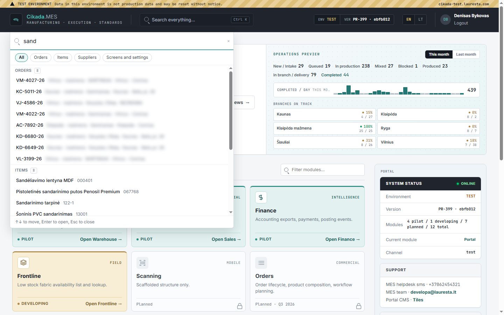

# Darbo pradžia Portale

**Būsena:** veikia

Prisijungimas, kalbos keitimas, aplinkos juosta, bendra paieška viršutinėje juostoje ir atsijungimas veikia. Bendra paieška kol kas randa užsakymus, klientus, prekes, tiekėjus ir modulių langus; kitų duomenų dar neieško.

## Kam skirta
Šis Portalo puslapis paaiškina, kaip prisijungti prie Cikada.MES, pakeisti kalbą, judėti tarp modulių ir atsijungti. Tai pirmas dalykas, kurį daro kiekvienas naujas naudotojas.

## Prieš pradedant
Reikia Lauresta SSO paskyros (sso.lauresta.com). Prieigos prie kiekvieno modulio teises nustato administratorius; Portalo pradžios puslapis atidaromas bet kuriam prisijungusiam naudotojui.

## Žingsniai
### 1. Prisijungti per Lauresta SSO
1. Atidarykite Cikada.MES adresą. Testinėje aplinkoje tai `https://cikada-test.lauresta.com/`, kuris nukreipia į Portalą.
2. Jei dar neprisijungę, sistema automatiškai nukreipia į Lauresta SSO (`sso.lauresta.com`). Jei SSO įjungtas tik kaip vienintelis būdas, parodomas Portalo prisijungimo puslapis „Portal sign in“ su mygtuku (UI: Sign in with Lauresta SSO).
3. Prisijunkite SSO puslapyje savo Lauresta paskyra.
4. Po sėkmingo prisijungimo grįžtama į puslapį, kurio prašėte (arba į Portalo pradžią).

### 2. Prisijungti vietine paskyra (jei leidžiama)
Jei SSO nėra vienintelis būdas, atidarius `login.html?local=1` rodoma forma:
1. Įveskite (UI: Username) ir (UI: Password).
2. Paspauskite (UI: Login).
3. Prisijungimo patikra vykdoma per Warehouse API; klaidos žr. žemiau.

### 3. Pakeisti kalbą EN / LT
1. Viršutinėje juostoje, tarp aplinkos ženklo ir vartotojo bloko, paspauskite (UI: EN) arba (UI: LT). Aktyvi kalba paryškinta.
2. Puslapis persikrauna pasirinkta kalba.
3. Pasirinkimas įrašomas į bendrą slapuką ir galioja visiems moduliams (Portalui, Sales, Frontline, Warehouse ir kitiems). Numatyta kalba yra anglų. Keičiasi tik užrašai; datų ir skaičių formatas nesikeičia.

### 4. Judėti tarp modulių
1. Portalo pradžioje paspauskite modulio plytelę arba mygtuką (UI: Open Warehouse) (lietuviškai „Atidaryti: ...“). Plytelės aprašytos puslapyje [Pradžios puslapis](pradzios-puslapis.md).
2. Iš bet kurio modulio grįžti į Portalą galima paspaudus prekės ženklą „Cikada.MES“ viršutinės juostos kairėje.

### 5. Suprasti geltoną aplinkos juostą
1. Pačiame viršuje rodoma geltona juosta „TEST ENVIRONMENT“ (lietuviškai „TEST APLINKA“) ir dešinėje serverio adresas.
2. Tekstas po užrašu: „Data in this environment is not production data and may be reset without notice.“ Tai reiškia, kad testinės aplinkos duomenys nėra gamybiniai ir gali būti ištrinti be įspėjimo.
3. Juosta pasikeičia pagal aplinką: vietinėje kūrimo aplinkoje rašoma „Local or private-network environment...“. Moduliams, prijungtiems prie tikros duomenų bazės, juosta raudona su įspėjimu, kad pakeitimai matomi ir programoje „Užsakymai“. Portale ir Frontline šis raudonas įspėjimas neįjungtas.
4. Dešinėje esantis ženklas „ENV / VER“ rodo aplinkos sutrumpinimą (pavyzdžiui, TEST) ir versiją.

### 6. Bendra paieška viršutinėje juostoje
Bendra paieška yra viršutinėje Cikada.MES juostoje ir veikia vienodai kiekviename modulyje (Portale, Sales, Sandėlyje ir kituose).

1. Paspauskite mygtuką (UI: Search everything…), lietuviškai „Ieškoti visur…“, arba klaviatūroje Ctrl+K („Mac“ kompiuteryje ⌘K). Po juosta atsidaro paieškos langas.
2. Įveskite bent 2 simbolius. Rezultatai atsiranda rašant, mygtuko spausti nereikia.
3. Rezultatai sugrupuoti: (UI: Orders) užsakymai, (UI: Customers) klientai, (UI: Items) prekės, (UI: Suppliers) tiekėjai, (UI: Screens and settings) langai ir nustatymai. Prie grupės pavadinimo rodomas rastų eilučių skaičius, vienoje grupėje rodoma iki 8 eilučių.
4. Rodyklėmis ↑ ir ↓ pasirinkite eilutę ir spauskite Enter arba spustelėkite eilutę pele. Atsidaro įrašas ar langas savo modulyje.
5. Langą uždaro Esc, mygtukas × arba spustelėjimas šalia lango.

Ko galima ieškoti:

- Užsakymo pagal numerį, pavyzdžiui „TS-123“, taip pat pagal klientą ar adresą. Atidaroma užsakymo kortelė Sales modulyje.
- Kliento pagal pavadinimo dalį. Atidaromas Sales užsakymų sąrašas, jau atrinktas pagal tą klientą.
- Prekės pagal vidinį kodą, pavadinimą, visą brūkšninį kodą arba tiekėjo prekės kodą. Atidaroma prekės kortelė Sandėlyje.
- Tiekėjo pagal kodą ar pavadinimą. Atidaromas Sandėlio tiekėjų sąrašas, atrinktas pagal tą tiekėją.
- Lango pagal meniu pavadinimą lietuviškai arba angliškai, pavyzdžiui „Tiekėjų atitikmenys“ arba „Users“. Langų pavadinimus galima rašyti be lietuviškų raidžių: „tiekeju“ randa „Tiekėjų“.

Paieška rodo tik tai, ką pats naudotojas gali atidaryti. Sales duomenys rodomi tik naudotojo filialų, kaip ir Sales užsakymų sąraše. Jei naudotojas neturi teisių į modulį, to modulio grupių nėra.

### 7. Atsijungti
1. Viršutiniame dešiniajame kampe, po vardu, paspauskite (UI: Logout) (lietuviškai „Atsijungti“).
2. Sistema nutraukia sesiją, o jei prisijungta per SSO, atjungia ir iš sso.lauresta.com. Po to rodomas prisijungimo puslapis.

## Dažnos klaidos bendroje paieškoje
Šie pranešimai rodomi bendros paieškos lango apačioje, viršutinėje Cikada.MES juostoje.

- „Nothing found.“ (lietuviškai „Nieko nerasta.“): pagal įvestą tekstą nėra nei įrašų, nei langų, kuriuos naudotojas gali atidaryti. Patikrinkite rašybą arba įveskite kitą pavadinimo ar kodo dalį.
- „Some results could not be loaded.“ (lietuviškai „Dalies rezultatų nepavyko gauti.“): vienas iš modulių neatsakė per 2 sekundes arba grąžino klaidą. Kitų modulių rezultatai rodomi. Pakartokite paiešką po kelių sekundžių.
- Įrašas nerandamas be lietuviškų raidžių: be jų visada randami tik langų pavadinimai. Užsakymų, klientų, prekių ir tiekėjų ieškokite taip, kaip jie įrašyti, kaip ir modulio sąraše.

## Dažnos klaidos
Prisijungimo puslapyje „Portal sign in“ virš formos gali atsirasti pranešimas:
- **„Invalid username or password.“**: neteisingas vartotojo vardas ar slaptažodis. Patikrinkite duomenis.
- **„Could not reach the authentication server. Please try again in a moment.“**: autentifikavimo serveris nepasiekiamas. Pabandykite vėliau.
- **„Authentication server returned an error. Contact an administrator if it keeps happening.“**: serverio klaida. Jei kartojasi, kreipkitės į administratorių.
- **„SSO sign in did not complete. Please try again.“**: SSO prisijungimas neįvyko iki galo. Bandykite dar kartą.

Jei vietoje vardo viršuje matote „Signed in“ ir raidę „U“, sesijoje nėra vardo duomenų; tai nereiškia, kad neprisijungta.
