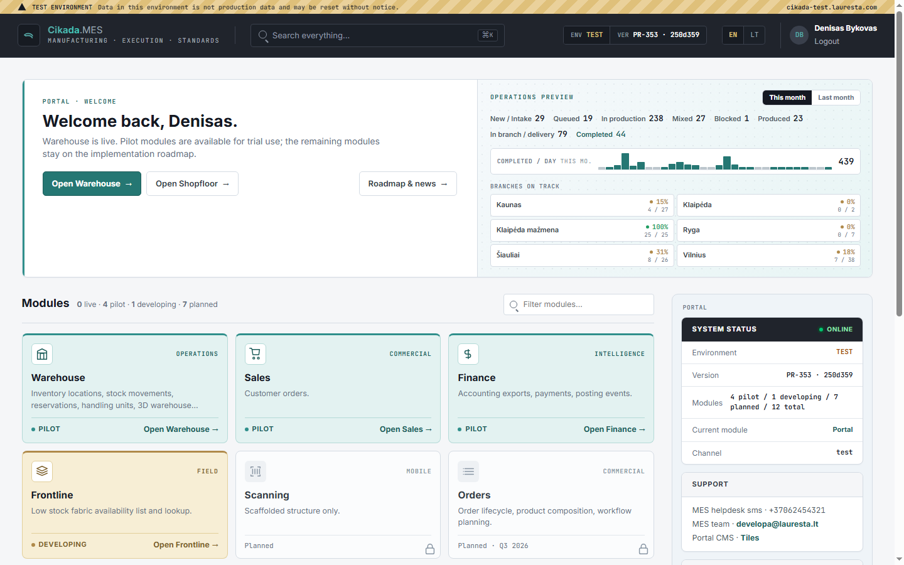

# Darbo pradžia Portale

**Būsena:** veikia

Prisijungimas, kalbos keitimas, aplinkos juosta ir atsijungimas veikia. Vienintelis laikinas elementas šioje dalyje yra viršutinės juostos paieška, kuri kol kas tik rodo pranešimą „coming soon“.

## Kam skirta
Šis Portalo puslapis paaiškina, kaip prisijungti prie Cikada.MES, pakeisti kalbą, judėti tarp modulių ir atsijungti. Tai pirmas dalykas, kurį daro kiekvienas naujas naudotojas.

## Prieš pradedant
Reikia Lauresta SSO paskyros (sso.lauresta.com). Prieigos prie kiekvieno modulio teises nustato administratorius; Portalo pradžios puslapis atidaromas bet kuriam prisijungusiam naudotojui.

## Žingsniai
### 1. Prisijungti per Lauresta SSO
1. Atidarykite Cikada.MES adresą. Testinėje aplinkoje tai `https://cikada-test.lauresta.com/`, kuris nukreipia į Portalą.
2. Jei dar neprisijungę, sistema automatiškai nukreipia į Lauresta SSO (`sso.lauresta.com`). Jei SSO įjungtas tik kaip vienintelis būdas, parodomas Portalo prisijungimo puslapis „Portal sign in“ su mygtuku (UI: Sign in with Lauresta SSO).
3. Prisijunkite SSO puslapyje savo Lauresta paskyra.
4. Po sėkmingo prisijungimo grįžtama į puslapį, kurio prašėte (arba į Portalo pradžią).

### 2. Prisijungti vietine paskyra (jei leidžiama)
Jei SSO nėra vienintelis būdas, atidarius `login.html?local=1` rodoma forma:
1. Įveskite (UI: Username) ir (UI: Password).
2. Paspauskite (UI: Login).
3. Prisijungimo patikra vykdoma per Warehouse API; klaidos žr. žemiau.

### 3. Pakeisti kalbą EN / LT
1. Viršutinėje juostoje, tarp aplinkos ženklo ir vartotojo bloko, paspauskite (UI: EN) arba (UI: LT). Aktyvi kalba paryškinta.
2. Puslapis persikrauna pasirinkta kalba.
3. Pasirinkimas įrašomas į bendrą slapuką ir galioja visiems moduliams (Portalui, Sales, Frontline, Warehouse ir kitiems). Numatyta kalba yra anglų. Keičiasi tik užrašai; datų ir skaičių formatas nesikeičia.

### 4. Judėti tarp modulių
1. Portalo pradžioje paspauskite modulio plytelę arba mygtuką (UI: Open Warehouse) (lietuviškai „Atidaryti: ...“). Plytelės aprašytos puslapyje [Pradžios puslapis](pradzios-puslapis.md).
2. Iš bet kurio modulio grįžti į Portalą galima paspaudus prekės ženklą „Cikada.MES“ viršutinės juostos kairėje.

### 5. Suprasti geltoną aplinkos juostą
1. Pačiame viršuje rodoma geltona juosta „TEST ENVIRONMENT“ (lietuviškai „TEST APLINKA“) ir dešinėje serverio adresas.
2. Tekstas po užrašu: „Data in this environment is not production data and may be reset without notice.“ Tai reiškia, kad testinės aplinkos duomenys nėra gamybiniai ir gali būti ištrinti be įspėjimo.
3. Juosta pasikeičia pagal aplinką: vietinėje kūrimo aplinkoje rašoma „Local or private-network environment...“. Moduliams, prijungtiems prie tikros duomenų bazės, juosta raudona su įspėjimu, kad pakeitimai matomi ir programoje „Užsakymai“. Portale ir Frontline šis raudonas įspėjimas neįjungtas.
4. Dešinėje esantis ženklas „ENV / VER“ rodo aplinkos sutrumpinimą (pavyzdžiui, TEST) ir versiją.

### 6. Paieška viršutinėje juostoje
1. Mygtukas (UI: Search everything…) su žyma ⌘K atidaro langelį „Universal search“.
2. Jame parašyta: „Search across orders, fabrics, modules and more — coming soon. For now use module-level filters inside each section.“ Iki šiol tai tik pranešimas, ieškoti negalima.
3. Langelį uždarykite (UI: Dismiss) arba ×. Modulių filtravimui naudokite lauką (UI: Filter modules…) pradžios puslapyje.

### 7. Atsijungti
1. Viršutiniame dešiniajame kampe, po vardu, paspauskite (UI: Logout) (lietuviškai „Atsijungti“).
2. Sistema nutraukia sesiją, o jei prisijungta per SSO, atjungia ir iš sso.lauresta.com. Po to rodomas prisijungimo puslapis.

## Dažnos klaidos
Prisijungimo puslapyje „Portal sign in“ virš formos gali atsirasti pranešimas:
- **„Invalid username or password.“**: neteisingas vartotojo vardas ar slaptažodis. Patikrinkite duomenis.
- **„Could not reach the authentication server. Please try again in a moment.“**: autentifikavimo serveris nepasiekiamas. Pabandykite vėliau.
- **„Authentication server returned an error. Contact an administrator if it keeps happening.“**: serverio klaida. Jei kartojasi, kreipkitės į administratorių.
- **„SSO sign in did not complete. Please try again.“**: SSO prisijungimas neįvyko iki galo. Bandykite dar kartą.

Jei vietoje vardo viršuje matote „Signed in“ ir raidę „U“, sesijoje nėra vardo duomenų; tai nereiškia, kad neprisijungta.
