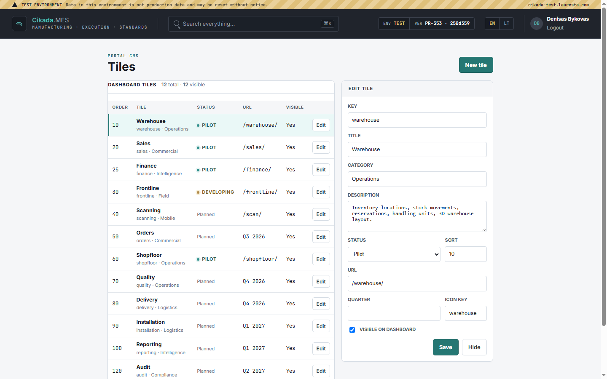

# Plytelių valdymas (Portal CMS)

**Būsena:** veikia

## Kam skirta
Portalo ekranas „Portal CMS · Tiles“ (adresas `/cms/tiles`) skirtas administratoriams, kurie tvarko modulių plyteles Portalo pradžios puslapyje: sukuria naują plytelę, pakeičia pavadinimą, būseną, adresą ar eilės tvarką, arba paslepia plytelę. Pakeitimai iš karto matomi pradžios puslapyje.

## Prieš pradedant
Reikia vienos iš rolių: `Admin`, `WarehouseAdmin` arba `PortalAdmin`. Be jų ekrane rodomas tik pranešimas „Admin access required“ (lietuviškai „Reikalingos administratoriaus teisės“) su paaiškinimu, o plytelių sąrašas neužkraunamas. API šias užklausas taip pat atmeta be minėtų rolių.

Į ekraną patenkama iš pradžios puslapio dešiniojo stulpelio, skiltyje (UI: Support) paspaudus (UI: Tiles), arba tiesiogiai adresu `/portal/cms/tiles`.

## Žingsniai
### 1. Peržiūrėti plyteles
1. Atidarykite `/cms/tiles`. Kairėje rodoma lentelė „Dashboard tiles“ su stulpeliais (UI: Order), (UI: Tile), (UI: Status), (UI: URL), (UI: Visible).
2. Virš lentelės rodomas bendras plytelių skaičius ir kiek jų matomos („total · visible“).
3. Stulpelyje (UI: Tile) po pavadinimu pateikiamas raktas ir kategorija. Stulpelyje (UI: URL) rodomas adresas, o jei jo nėra, planuojamas ketvirtis.
4. Lentelėje rodomos ir paslėptos plytelės.

### 2. Sukurti naują plytelę
1. Paspauskite (UI: New tile) viršuje dešinėje. Dešinėje esantis redaktorius gauna pavadinimą „New tile“ ir išvalomas.
2. Užpildykite laukus: (UI: Key) (raktas, unikalus, sistema paverčia jį mažosiomis raidėmis), (UI: Title), (UI: Category), (UI: Description), (UI: Status) (Planned, Developing, Pilot arba Live), (UI: Sort) (eilės numeris, numatyta 999), (UI: URL), (UI: Quarter), (UI: Icon key) (numatyta `orders`).
3. Pažymėkite arba nuimkite (UI: Visible on dashboard). Numatyta pažymėta.
4. Paspauskite (UI: Save). Sėkmės atveju lentelė atsinaujina, o išsaugota plytelė atveriama redagavimui (pranešimas „Saved.“ kode nustatomas, bet iškart išvalomas, todėl jo nepamatysite).

Privalomi laukai: Key, Title, Category, Description, Icon key. Piktogramos raktai, kuriems yra paveikslėlis: `warehouse`, `sales`, `frontline`, `scanning`, `orders`, `shopfloor`, `quality`, `delivery`, `installation`, `reporting`, `finance`, `audit`.

### 3. Redaguoti plytelę
1. Eilutėje paspauskite (UI: Edit). Redaktoriaus pavadinimas tampa „Edit tile“, o laukai užsipildo.
2. Pakeiskite reikiamus laukus.
3. Paspauskite (UI: Save).

Kad plytelė atsidarytų paspaudus, jos būsena turi būti Live, Pilot arba Developing ir turi būti nurodytas (UI: URL) (pavyzdžiui, `/sales/`). Planned plytelė tik parodo pranešimą.

### 4. Paslėpti plytelę
1. Atidarykite plytelę per (UI: Edit).
2. Paspauskite (UI: Hide) (rodomas tik redaguojant esamą plytelę).
3. Plytelė pažymima kaip nematoma, redaktorius išvalomas (pranešimas „Hidden.“ kode iškart išvalomas, todėl jo nepamatysite). Ji lieka lentelėje su (UI: Visible) = „No“, bet pradžios puslapyje nebematoma. Tai ne ištrynimas.
4. Norėdami grąžinti, paspauskite (UI: Edit), pažymėkite (UI: Visible on dashboard) ir (UI: Save).

## Ką reiškia būsenos ir spalvos
Stulpelyje (UI: Status) rodoma plytelės būsena (Live, Pilot, Developing, Planned; lietuviškai Veikia, Bandomasis, Kuriamas, Planuojamas). Jos reikšmės aprašytos puslapyje [Pradžios puslapis](pradzios-puslapis.md).

## Dažnos klaidos
- **„Admin access required“**: neturite Admin, WarehouseAdmin ar PortalAdmin rolės. Kreipkitės į administratorių.
- **„Save failed. Check required fields and permissions.“**: neužpildytas privalomas laukas, toks raktas jau egzistuoja kitoje plytelėje arba trūksta teisių. Patikrinkite, ar raktas unikalus.
- **„Hide failed.“**: plytelė nerasta arba nėra teisių. Atnaujinkite puslapį.

## Pastabos
Lauko „Required roles“ ekrane nėra: kuriant plytelę per šį ekraną, ankstesnės reikšmės išsaugomos, bet jų redaguoti negalima. Be to, pradžios puslapis rolių pagal plytelę neapriboja.
