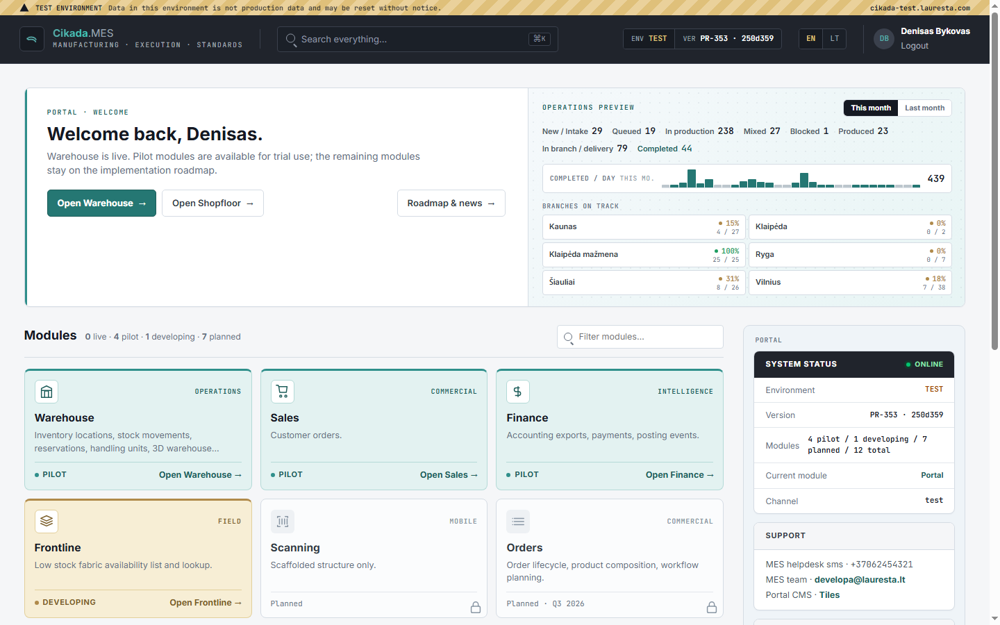

# Portalo pradžios puslapis

**Būsena:** dalinai

Veikia: modulių plytelės ir jų filtras, paskutinių modulių nuorodos, sistemos būsenos ir versijos skiltys. Dalinai: skiltis „Operations preview“ rodo tikrus duomenis tik kai pasiekiama duomenų bazė, kitaip pavyzdinius; naujienos imamos iš leidimų sąrašo arba iš atsarginio sąrašo; kelios nuorodos neaktyvios.

## Kam skirta
Portalo pradžios puslapis (adresas `/`) skirtas pasirinkti modulį, pamatyti trumpą veiklos apžvalgą, naujienas ir sistemos būseną. Jį mato kiekvienas prisijungęs naudotojas.

## Prieš pradedant
Reikia prisijungti, žr. [Darbo pradžia](darbo-pradzia.md). Neprisijungus sistema nukreipia į prisijungimą. Rolių apribojimų puslapis neturi.

## Žingsniai
### 1. Atidaryti modulį iš plytelės
1. Skiltyje (UI: Modules) pasirinkite plytelę. Plytelės apačioje rodoma būsena: (UI: Live), (UI: Pilot), (UI: Developing) arba (UI: Planned) (lietuviškai Veikia, Bandomasis, Kuriamas, Planuojamas).
2. Plytelės, kurių būsena Live, Pilot arba Developing ir kurios turi adresą, atsidaro paspaudus. Tokių plytelių apačioje rodoma „Open ... →“.
3. Plytelė su būsena Planned neatsidaro: paspaudus trumpam parodomas pranešimas „<Modulis> — planned for <ketvirtis>. Not available yet.“
4. Skaičiai skilties antraštėje („live · pilot · developing · planned“) rodo, kiek modulių yra kiekvienoje būsenoje.

Pradinis plytelių rinkinys: Warehouse (Live), Sales, Frontline, Scanning, Shopfloor, Finance (visi Pilot), o Orders, Quality, Delivery, Installation, Reporting, Audit pažymėti Planned. Sąrašą gali keisti administratorius, žr. [Plytelių valdymas](plyteliu-valdymas.md).

### 2. Filtruoti modulius
1. Skilties „Modules“ dešinėje esančiame lauke (UI: Filter modules…) rašykite pavadinimo, kategorijos ar aprašymo dalį.
2. Sąrašas filtruojamas rašant. Jei nieko nerasta, rodoma „No matches“ ir „No modules match“ su jūsų tekstu.

### 3. Naudoti greitus mygtukus viršuje
1. Pirmame bloke (UI: Open Warehouse) ir (UI: Open Shopfloor) atidaro šiuos modulius. Šiems mygtukams adresai užkoduoti kode (`/warehouse/`, `/shopfloor/`).
2. Kai naršyklėje yra istorija, vietoje to rodomi iki trijų paskutinių atidarytų modulių; pirmasis paryškintas. Istorija saugoma jūsų naršyklėje.
3. Mygtukas (UI: Roadmap & news) nuveda žemyn prie modulių skilties.
4. Sveikinimas „Welcome back, <vardas>.“ rodo pirmąjį jūsų vardą, jei jis yra paskyroje.

### 4. Peržiūrėti veiklos apžvalgą
1. Skiltyje (UI: Operations preview) pasirinkite laikotarpį (UI: This month) arba (UI: Last month).
2. Rodoma etapų skaičiai (Registered, Accepted, Manufacturing, Shipped, Completed), diagrama „Completed / day“ ir „Branches on track“ su procentais.
3. Jei antraštėje rodomas užrašas „Sample data“, tai pavyzdiniai, o ne tikri duomenys.

### 5. Skaityti naujienas ir sistemos būseną
1. Skiltyje (UI: News) rodomi iki 6 naujausių leidimų aprašymų iš GitHub; jei jų gauti nepavyksta, rodomos iš konfigūracijos paimtos naujienos.
2. Dešinėje skiltis (UI: System status): aplinka, versija, modulių skaičiai, kanalas. Skiltis (UI: Support) rodo MES pagalbos SMS numerį ir komandos el. paštą, nuorodą (UI: Tiles) į plytelių valdymą. Skiltis (UI: Build) rodo versiją, commit ir surinkimo datą.

## Ką reiškia būsenos ir spalvos
Portalo pradžios puslapyje modulių plytelių būsenos reiškia:
- **Live (Veikia)**: modulis naudojamas darbui.
- **Pilot (Bandomasis)**: modulis atidaromas išbandyti.
- **Developing (Kuriamas)**: modulis kuriamas, bet plytelė atsidaro, jei turi adresą.
- **Planned (Planuojamas)**: modulio dar nėra, rodomas planuojamas ketvirtis ir spyna.

## Dažnos klaidos
- Plytelių sąrašas tuščias: Portalo API nepasiekiamas arba nėra matomų plytelių. Perkraukite puslapį; jei kartojasi, pasakykite administratoriui.
- Skiltyje „Operations preview“ rodomas „Sample data“: duomenų bazė nepasiekiama, rodomi pavyzdiniai skaičiai, jais remtis negalima.

## Dar neįgyvendinta
- Skiltis „Operations preview“ turi užkoduotus pavyzdinius skaičius, kurie rodomi, kai tikri duomenys negaunami (užrašas „Sample data“).
- Nuorodos (UI: All updates), (UI: Release notes), (UI: Documentation), (UI: Support) apačioje vedama į `#`, t. y. jos neatidaro jokio puslapio.
- Apačioje esantis užrašas „v0.1.0“ yra pastovus tekstas, ne tikra versija. Tikra versija rodoma viršutinėje juostoje ir skiltyje „System status“.
- Bendra paieška viršutinėje juostoje yra tik pranešimas „coming soon“.
- Plytelių lauke „RequiredRoles“ (reikalingos rolės) pradžios puslapis plytelių pagal roles neslepia: rodomos visos matomos plytelės.
