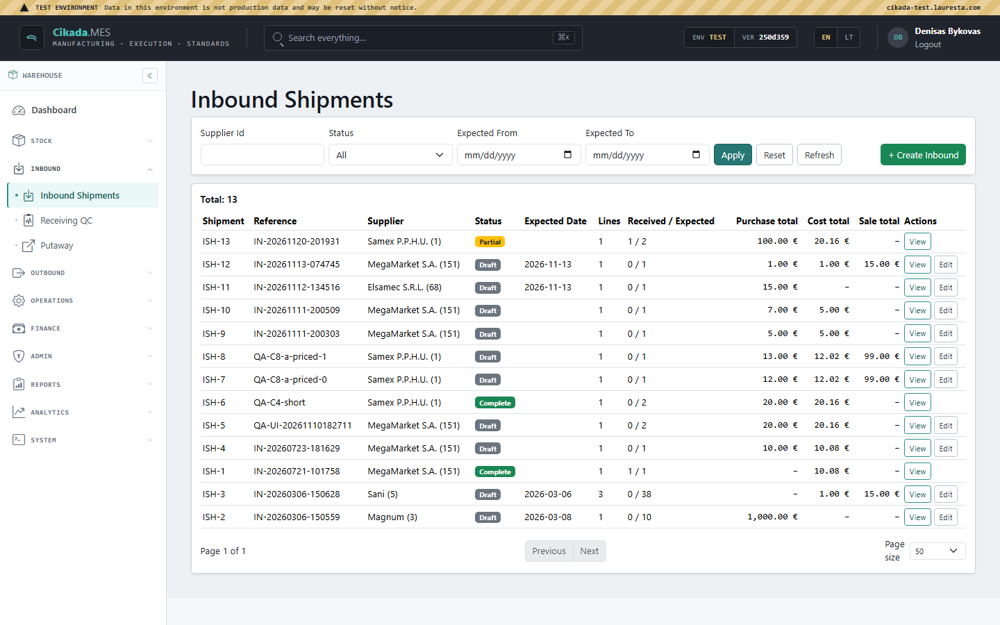
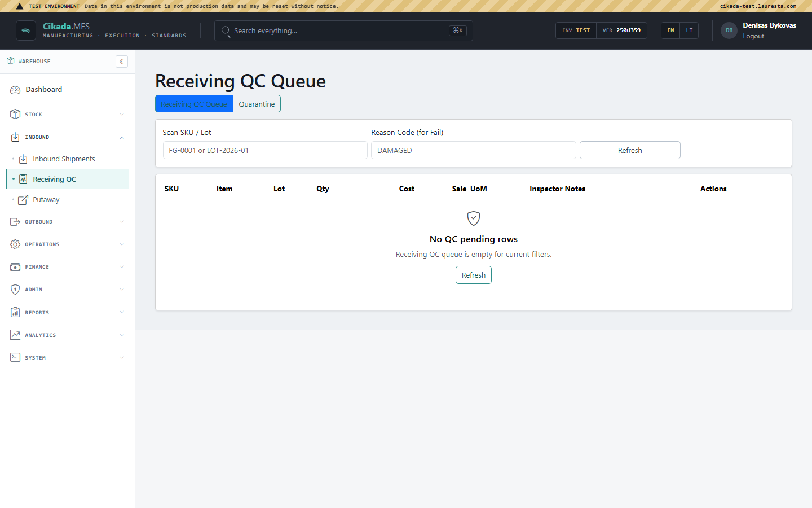

# Prekių priėmimas ir kokybės patikra (Inbound)

**Būsena:** veikia

## Kam skirta
Sandėlio modulio ekranai (UI: Inbound > Inbound Shipments) ir (UI: Inbound > Receiving QC) skirti priimti iš tiekėjo atvežtas prekes, užregistruoti jas atsargose ir patikrinti kokybę. Sąrašą mato sandėlio operatoriai, o prekes priima ir kokybę tikrina kokybės inspektorius arba sandėlio vadovas. Paties pirkimo dokumento (valiuta, PVM, užregistravimas) aprašymas yra puslapyje [P-16 Pirkimo dokumentas](P-16-pirkimo-dokumentas.md).

## Prieš pradedant
- Tiekėjas ir prekės turi būti sukurti pagrindiniuose duomenyse, o siunta sukurta per (UI: + Create Inbound) – žr. [P-16 Pirkimo dokumentas](P-16-pirkimo-dokumentas.md).
- Siuntų sąrašą mato rolės Operator, QCInspector, WarehouseManager, WarehouseAdmin.
- Siuntos kūrimas, taisymas, prekių priėmimas (UI: Receive), (UI: Close with shortage) ir visas kokybės patikros ekranas leidžiami tik rolėms QCInspector, WarehouseManager, WarehouseAdmin. Rolė Operator gali tik peržiūrėti siuntas.
- Kokybės patikros nesėkmei reikia priežasties kodo, kuris yra sukurtas ir aktyvus administravimo priežasčių sąraše.
- Sistemoje turi būti sukurtos sandėlio vietos RECEIVING, QC_HOLD ir QUARANTINE; kitaip priėmimas ar patikra grąžins klaidą.

## Žingsniai
### 1. Rasti siuntą sąraše
1. Meniu pasirinkite (UI: Inbound > Inbound Shipments). Atsidaro ekranas (UI: Inbound Shipments).
2. Naudokite filtrus (UI: Supplier Id), (UI: Status) (All, Draft, Partial, Complete), (UI: Expected From), (UI: Expected To) ir spauskite (UI: Apply). (UI: Reset) išvalo filtrus, (UI: Refresh) perkrauna sąrašą.
3. Eilutėje matote siuntos numerį (ISH-…), (UI: Reference), tiekėją, būseną, (UI: Expected Date), (UI: Lines), (UI: Received / Expected) ir sumas (UI: Purchase total), (UI: Cost total), (UI: Sale total).
4. Mygtukas (UI: View) atidaro siuntos kortelę, o (UI: Edit) rodomas tik juodraščio (Draft) siuntoms. Mygtukas (UI: + Create Inbound) atidaro naują dokumentą.

### 2. Priimti prekes siuntos kortelėje
1. Sąraše spauskite (UI: View). Kortelės viršuje rodoma (UI: Received:) priimta ir tikėtina suma bei procentas.
2. Pasirinkite eilutę: įveskite brūkšninį kodą į (UI: Scan Barcode) ir spauskite (UI: Resolve) arba pasirinkite iš sąrašo (UI: Line).
3. Įveskite (UI: Receive Qty). Jei eilutė neturi pirkimo kainos, pasirodo įspėjimas ir laukas (UI: Unit Price (required)) – kainą būtina įvesti.
4. Prekėms su partijų apskaita (žyma LOT) įveskite (UI: Lot Number); pasirinktinai (UI: Production Date), (UI: Expiry Date), (UI: Notes).
5. Spauskite (UI: Receive). Pranešime matote, kiek vienetų ir į kurią vietą priimta.
6. Prekės, pažymėtos QC, patenka į vietą QC_HOLD ir laukia patikros; visos kitos – į vietą RECEIVING, iš kurios jas reikia padėti į lentyną pagal [P-02 Padėjimas į vietą](P-02-padeti-i-lokacija-putaway.md).
7. Jei tiekėjas atvežė mažiau, nei laukta, ir daugiau nebus, spauskite (UI: Close with shortage). Siunta tampa baigta, atsargos nekeičiamos. Po užregistravimo trūkumas tvarkomas kreditine pastaba.
8. Mygtukas (UI: Open QC Queue) nuveda į kokybės patikros eilę.

### 3. Patikrinti kokybę
1. Meniu pasirinkite (UI: Inbound > Receiving QC). Atsidaro (UI: Receiving QC Queue) su prekėmis, esančiomis vietoje QC_HOLD.
2. Lauke (UI: Scan SKU / Lot) filtruokite eilutes pagal SKU, pavadinimą ar partiją.
3. Prie eilutės galite įrašyti (UI: Inspector Notes).
4. Spauskite (UI: Pass) – visas eilutės kiekis perkeliamas iš QC_HOLD į RECEIVING.
5. Spauskite (UI: Fail) – prieš tai įveskite (UI: Reason Code (for Fail)) (pvz., DAMAGED). Visas eilutės kiekis perkeliamas į QUARANTINE.
6. Patikra visada taikoma visam eilutės kiekiui; dalinės patikros ekrane nėra.

### 4. Sutvarkyti karantino prekes
1. Ekrane (UI: Receiving QC Queue) spauskite (UI: Quarantine).
2. Prie eilutės pasirinkite vieną sprendimą: (UI: Return to stock) (į RECEIVING), (UI: Return to supplier) arba (UI: Scrap) (nurašymas).
3. Prieš spausdami galite įrašyti (UI: Inspector Notes) – jos išsaugomos kaip judėjimo priežastis.

## Ką reiškia būsenos ir spalvos
Sandėlio modulio ekrane (UI: Inbound Shipments) siuntos būsena rodoma spalvota žyma.
- Draft (pilka) – nieko dar nepriimta; siuntą galima taisyti.
- Partial (geltona) – dalis eilučių priimta.
- Complete (žalia) – visi kiekiai priimti arba siunta uždaryta su trūkumu.
Siuntos kortelės eilutėse žyma LOT reiškia privalomą partijos numerį, QC – privalomą kokybės patikrą, SERVICE – paslaugos eilutę, kurios fiziškai priimti nereikia.

## Dažnos klaidos
- „Enter the unit price before receiving this line." – eilutė neturi kainos. Įveskite (UI: Unit Price) ir bandykite dar kartą.
- „Select line to receive." – nepasirinkta eilutė. Pasirinkite (UI: Line) arba nuskaitykite kodą.
- „Barcode not found in this shipment lines." – kodas nepriklauso nė vienai šios siuntos eilutei. Patikrinkite prekę.
- „Received quantity would exceed expected quantity" – bandoma priimti daugiau, nei užsakyta. Priimkite tik likusį kiekį.
- „requires lot tracking. LotNumber must be provided" – prekei privalomas partijos numeris.
- „Shipment is closed and cannot receive more stock." – siunta jau baigta arba atšaukta.
- „There is no exchange rate for …" – nėra valiutos kurso; kreipkitės į vadovą ar buhalterį (žr. P-16).
- „Reason code is required for QC fail." – prieš spausdami (UI: Fail) įveskite priežasties kodą.
- „ReasonCode '…' does not exist." – tokio aktyvaus priežasties kodo nėra; paprašykite administratoriaus jį sukurti.
- „Insufficient stock in QC_HOLD" – kiekis vietoje QC_HOLD jau pasikeitė; perkraukite eilę.
- Prieigos klaida paspaudus (UI: Receive) ar (UI: Pass) – trūksta rolės QCInspector, WarehouseManager arba WarehouseAdmin.

## Susiję procesai
- [P-16 Pirkimo dokumentas](P-16-pirkimo-dokumentas.md) – siuntos kūrimas, valiuta, PVM, užregistravimas.
- [P-02 Padėjimas į vietą](P-02-padeti-i-lokacija-putaway.md) – kita priėmimo dalis.
- [P-23 Etikečių stotelė](P-23-etikeciu-stotele.md) – etikečių spausdinimas.
- [P-15 Pagrindinių duomenų valdymas](P-15-pagrindinis-duomenu-valdymas.md) – tiekėjai, prekės, priežasčių kodai.
