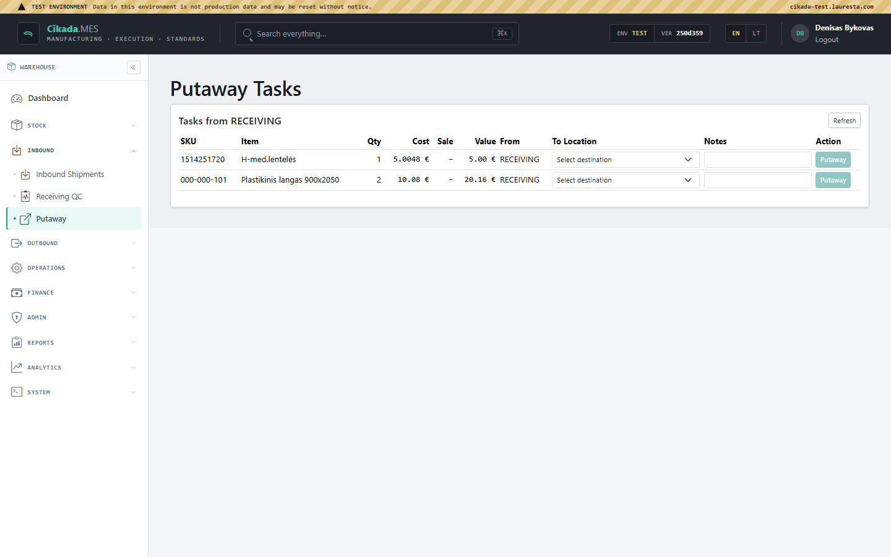

# Padėjimas į sandėlio vietą (Putaway)

**Būsena:** veikia

## Kam skirta
Sandėlio modulio ekranas (UI: Inbound > Putaway) rodo prekes, kurios laukia priėmimo zonoje RECEIVING, ir leidžia kiekvieną iš jų perkelti į galutinę lentynos vietą. Ekraną atidaro visi sandėlio darbuotojai, bet perkelti gali tik kokybės inspektorius ir sandėlio vadovas.

## Prieš pradedant
- Prekės turi būti priimtos (žr. [P-01 Prekių priėmimas](P-01-priemimas-inbound.md)) ir, jei reikia, praėjusios kokybės patikrą – tada jos matomos vietoje RECEIVING.
- Ekraną matyti leidžiama rolėms Operator, QCInspector, WarehouseManager, WarehouseAdmin. Mygtukas (UI: Putaway) veikia tik rolėms QCInspector, WarehouseManager, WarehouseAdmin.
- Tikslo vietos turi būti sukurtos ir aktyvios (žr. [P-15 Pagrindinių duomenų valdymas](P-15-pagrindinis-duomenu-valdymas.md)).

## Žingsniai
### 1. Atidaryti užduočių sąrašą
1. Meniu pasirinkite (UI: Inbound > Putaway). Atsidaro ekranas (UI: Putaway Tasks) su blokeliu (UI: Tasks from RECEIVING).
2. Lentelėje matote SKU, prekę, (UI: Qty), (UI: Cost), (UI: Sale), (UI: Value) ir vietą (UI: From). Sąrašą atnaujina (UI: Refresh).
3. Jei sąrašas tuščias, rodoma „No putaway tasks available." – priėmimo zonoje prekių nėra.

### 2. Perkelti prekę į lentyną
1. Eilutėje stulpelyje (UI: To Location) pasirinkite tikslo vietą (pradinė reikšmė (UI: Select destination)). Sąraše yra aktyvios vietos, išskyrus RECEIVING.
2. Pasirinktinai įrašykite (UI: Notes).
3. Spauskite (UI: Putaway). Mygtukas neaktyvus, kol nepasirinkta vieta.
4. Pranešime „Putaway completed for … to …" matote, kur prekė padėta. Eilutė iš sąrašo dingsta.
5. Jei tikslo vietai nustatytas didžiausias svoris ar tūris ir jis būtų viršytas, po sėkmingo perkėlimo po lentele rodomas geltonas įspėjimas. Perkėlimas vis tiek įvyksta.

Perkeliamas visas eilutėje rodomas kiekis; dalinio perkėlimo šiame ekrane nėra.

## Dažnos klaidos
- „Putaway source location must be RECEIVING." – šaltinis nėra RECEIVING; šis ekranas dirba tik su priėmimo zona.
- „Putaway destination must be a physical storage location." – pasirinkta virtuali vieta; parinkite fizinę lentynos vietą.
- „Item … at location RECEIVING has only … available." – kiekis jau pasikeitė (kitas darbuotojas perkėlė); atnaujinkite sąrašą.
- Mygtukas (UI: Putaway) neaktyvus – nepasirinkta tikslo vieta arba sistemoje nėra vietos RECEIVING.
- Prieigos klaida – trūksta rolės QCInspector, WarehouseManager ar WarehouseAdmin.

## Susiję procesai
- [P-01 Prekių priėmimas](P-01-priemimas-inbound.md)
- [P-04 Perkėlimas tarp vietų](P-04-perkelimas-transfer.md) – vėlesni perkėlimai tarp lentynų.
- [P-23 Etikečių stotelė](P-23-etikeciu-stotele.md) – vietų etikečių spausdinimas.
