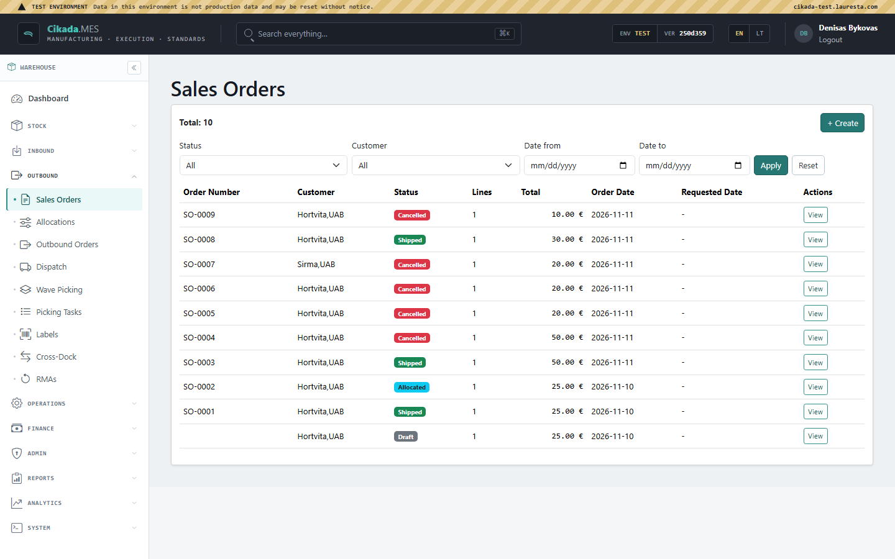
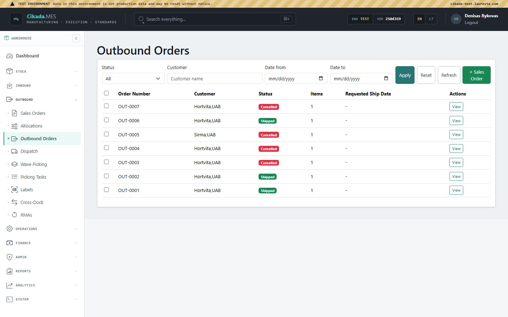
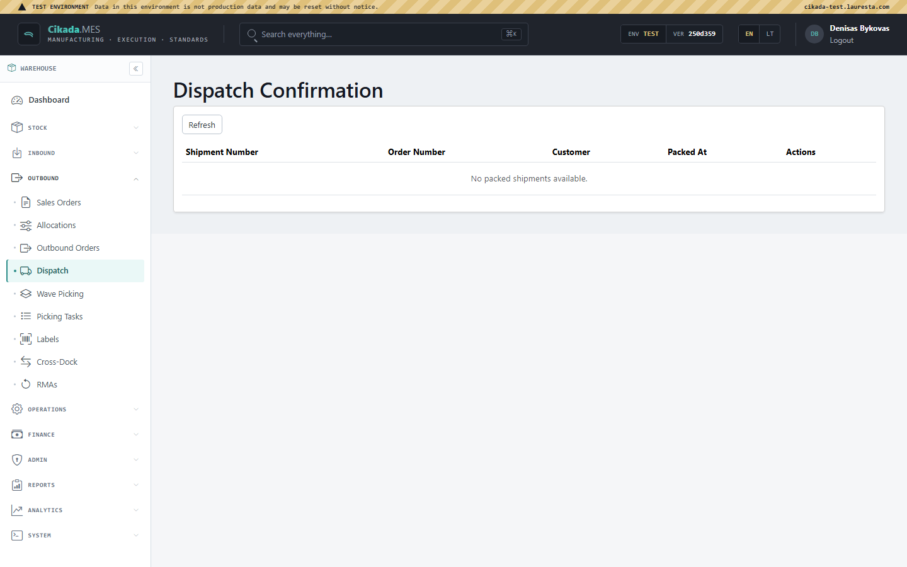

# Pardavimo užsakymai, pakavimas ir išsiuntimas (Outbound)

**Būsena:** dalinai

Veikia visi žingsniai nuo pardavimo užsakymo sukūrimo iki išsiuntimo. Neveikia tik mygtukas (UI: Reallocate) ekrane (UI: Allocation & Release Dashboard) – jis išjungtas, nes ranka perskirstyti atsargų API neturi.

## Kam skirta
Sandėlio modulio skyrius (UI: Outbound) skirtas pardavimo užsakymą pervesti per visus etapus: sukurti, patvirtinti, rezervuoti atsargas, atiduoti komplektuoti, supakuoti ir išsiųsti. Užsakymus kuria pardavimų administratorius, tvirtina ir paleidžia komplektuoti sandėlio vadovas, pakuoja pakuotojas, išsiuntimą patvirtina ekspedicijos darbuotojas.

## Prieš pradedant
- Klientas turi būti sukurtas ir aktyvus; prekės – sukurtos pagrindiniuose duomenyse (žr. [P-15 Pagrindinių duomenų valdymas](P-15-pagrindinis-duomenu-valdymas.md)).
- Pardavimo užsakymų ekranai ir veiksmai (kurti, pateikti, rezervuoti, atšaukti) leidžiami rolėms SalesAdmin, WarehouseManager, WarehouseAdmin. Patvirtinti (UI: Approve) ir paleisti komplektuoti (UI: Release to Picking) gali tik WarehouseManager ir WarehouseAdmin.
- Išsiunčiamų užsakymų sąrašą ir kortelę (UI: Outbound Orders) atidaro rolės Operator, QCInspector, WarehouseManager, WarehouseAdmin. Pakavimą (UI: Pack) vykdo PackingOperator, WarehouseManager, WarehouseAdmin, o išsiuntimą (UI: Dispatch) – DispatchClerk, WarehouseManager, WarehouseAdmin. Sąrašų skaitymas pakavimo ir išsiuntimo ekranuose reikalauja rolių Operator ar aukštesnių, todėl rolės PackingOperator ir DispatchClerk viena savimi gali negalėti užkrauti ekrano; praktiškai joms reikia ir rolės Operator.
- Atsargos turi būti sandėlyje, kad rezervavimas pavyktų.

## Žingsniai
### 1. Sukurti pardavimo užsakymą
1. Meniu pasirinkite (UI: Outbound > Sales Orders) ir spauskite (UI: + Create). Atsidaro (UI: Create Sales Order).
2. Pasirinkite (UI: Customer) (iš sąrašo „Select customer"). Pagal klientą užpildomas pristatymo adresas (UI: Street), (UI: City), (UI: State), (UI: Zip), (UI: Country); jį galima pataisyti.
3. Jei reikia, nurodykite (UI: Requested Delivery Date).
4. Blokelyje (UI: Order Lines) spauskite (UI: + Add Line), pasirinkite prekę, įveskite (UI: Qty). (UI: Unit Price) užpildoma pagal kliento kainų grupę arba prekės bazinę kainą ir ją galima keisti. (UI: Remove) pašalina eilutę.
5. Spauskite (UI: Create Sales Order). Pranešime „Sales order … created" matote numerį, atsidaro užsakymo kortelė su būsena Draft.

### 2. Pateikti, patvirtinti ir rezervuoti
1. Ekrane (UI: Sales Order Detail) juodraščiui (Draft) spauskite (UI: Submit). Jei užsakymo suma viršija kliento kredito limitą, būsena tampa Pending approval; kitu atveju sistema iškart rezervuoja atsargas (Allocated), o jei jų trūksta – Pending stock.
2. Užsakymą su būsena Pending approval patvirtina vadovas: (UI: Approve) kortelėje arba lentelėje (UI: Pending Approvals) ekrane (UI: Outbound > Allocations). Patvirtinus atsargos rezervuojamos.
3. Užsakymui su būsena Draft arba Pending stock galima spausti (UI: Allocate) ir pakartoti rezervavimą, kai atsargų atsirado.
4. Kortelėje rodomi (UI: Reservation) ir (UI: Outbound Order) numeriai bei kiekiai (UI: Ordered), (UI: Allocated), (UI: Picked), (UI: Shipped).

### 3. Atiduoti komplektuoti
1. Užsakymo kortelėje su būsena Allocated spauskite (UI: Release to Picking), arba ekrane (UI: Allocation & Release Dashboard) lentelėje (UI: Allocated Orders) spauskite (UI: Release to Picking).
2. Sistema sukuria išsiunčiamą užsakymą ir komplektavimo užduotis. Toliau – [P-26 Bangos ir komplektavimo užduotys](P-26-bangos-ir-komplektavimas.md).
3. Užsakymą atšaukti galima iki išsiuntimo: įrašykite (UI: Cancel reason) ir spauskite (UI: Cancel Order). Išsiųsto užsakymo atšaukti negalima – daroma grąžinimas ([P-09 Grąžinimai](P-09-grazinimai-rma.md)).

### 4. Sekti išsiunčiamus užsakymus
1. Meniu pasirinkite (UI: Outbound > Outbound Orders). Sąrašas atsinaujina kas 30 sekundžių.
2. Filtruokite pagal (UI: Status), klientą (UI: Customer name) ir datas (UI: Date from), (UI: Date to); spauskite (UI: Apply).
3. Pažymėję kelias eilutes galite spausti (UI: Bulk Cancel) arba (UI: Export CSV). Masinis atšaukimas atšaukia susietus pardavimo užsakymus su priežastimi „Bulk cancel".
4. (UI: View) arba užsakymo numeris atidaro kortelę su eilutėmis, pakuotės numeriu ir sekimo numeriu. Kortelėje (UI: Release) paleidžia užsakymą su būsena Allocated, o (UI: Cancel) atšaukia.
5. Užsakymams su būsena Picked rodomas (UI: Pack) (sąraše) arba (UI: Open Packing Station) (kortelėje).

### 5. Supakuoti
1. Ekrane (UI: Packing Station) lentelėje (UI: Order Items) matote reikalingą kiekį (UI: Required) ir nuskaitytą kiekį (UI: Scanned).
2. Lauke (UI: Scan barcode) nuskaitykite arba įveskite kiekvienos prekės brūkšninį kodą ar SKU ir spauskite Enter – kiekvienas nuskaitymas prideda vienetą.
3. Pasirinkite (UI: Packaging type): BOX arba PALLET.
4. Kai visų eilučių nuskaityta lygiai tiek, kiek reikia (žyma Ready), spauskite (UI: Pack). Pranešime „Order packed successfully", ekranas pereina į (UI: Dispatch Confirmation).
5. (UI: Clear Scans) išvalo nuskaitymus.

### 6. Patvirtinti išsiuntimą
1. Meniu pasirinkite (UI: Outbound > Dispatch). Ekrane (UI: Dispatch Confirmation) pateikiamos supakuotos siuntos: (UI: Shipment Number), užsakymas, klientas, (UI: Packed At).
2. Prie siuntos spauskite (UI: Dispatch). Lange įveskite (UI: Carrier) (pradinė reikšmė FEDEX), (UI: Tracking number) ir, jei reikia, (UI: Vehicle ID).
3. Spauskite (UI: Confirm Dispatch). Pranešime „Shipment dispatched successfully"; atsargos perkeliamos iš pakavimo vietos SHIPPING į virtualią vietą CUSTOMER, siunta dingsta iš sąrašo.

## Ką reiškia būsenos ir spalvos
Pardavimo užsakymų ekranuose (UI: Sales Orders) ir (UI: Outbound Orders) būsena rodoma spalvota žyma.
- Draft (pilka) – užsakymas sukurtas, nepateiktas.
- Pending approval (geltona) – laukia vadovo patvirtinimo dėl kredito limito.
- Allocated (šviesiai mėlyna) – atsargos rezervuotos, galima paleisti komplektuoti.
- Pending stock (geltona) – atsargų nepakanka; laukia atsargų.
- Picking (mėlyna) – komplektuojama.
- Picked (pilka) – surinkta, galima pakuoti (rodoma išsiunčiamų užsakymų ekrane).
- Packed – supakuota, laukia išsiuntimo (išsiunčiamų užsakymų sąraše geltona).
- Shipped, Delivered (žalia) – išsiųsta ir pristatyta.
- Invoiced (juoda) – išrašyta sąskaita.
- Cancelled (raudona) – atšaukta.

## Dažnos klaidos
- „Cancel reason is required." – prieš (UI: Cancel Order) įrašykite priežastį.
- „Enter a selling price for every selected item." – kuriant užsakymą trūksta eilutės kainos.
- „Add at least one valid line (item, qty > 0)." – nėra nė vienos tinkamos eilutės.
- „Customer is not active." – klientas išjungtas; pasirinkite kitą.
- „Invalid status transition" – veiksmas neleidžiamas esamai būsenai; atnaujinkite kortelę.
- „Dispatched orders cannot be cancelled; use a return." – užsakymas išsiųstas, naudokite grąžinimą.
- „Every order line must be fully picked before packing." – pirmiausia baikite komplektavimą.
- „Barcode … not found in order." – nuskaitytas kodas nepriklauso užsakymui.
- „Enter the carrier and tracking number." – (UI: Carrier) ir (UI: Tracking number) privalomi.

## Dar neįgyvendinta
- Sandėlio modulio ekrane (UI: Allocation & Release Dashboard), lentelėje (UI: Pending Stock), mygtukas (UI: Reallocate) visada išjungtas (užuomina „Manual reallocate endpoint is not available in current API surface."). Pakartotinai rezervuoti galima tik kortelės mygtuku (UI: Allocate).

## Susiję procesai
- [P-26 Bangos ir komplektavimo užduotys](P-26-bangos-ir-komplektavimas.md)
- [P-09 Grąžinimai (RMA)](P-09-grazinimai-rma.md)
- [P-25 Rezervacijos](P-25-rezervacijos.md)
- [P-23 Etikečių stotelė](P-23-etikeciu-stotele.md)
