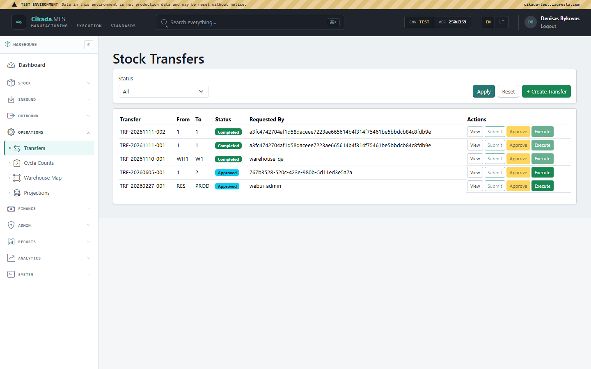

# Atsargų perkėlimas tarp vietų (Transfers)

**Būsena:** veikia

## Kam skirta
Sandėlio modulio ekranai (UI: Operations > Transfers) skirti perkelti prekes iš vienos sandėlio vietos į kitą: sukurti perkėlimo prašymą, jį pateikti, prireikus patvirtinti ir įvykdyti. Ekranus naudoja sandėlio darbuotojai, o patvirtina sandėlio vadovas.

## Prieš pradedant
- Prekės turi būti sandėlyje išeinamojoje vietoje, o abi vietos – sukurtos ir aktyvios.
- Sąrašą, kūrimą, pateikimą (UI: Submit) ir vykdymą (UI: Execute) leidžiama naudoti rolėms Operator, QCInspector, WarehouseManager, WarehouseAdmin.
- Patvirtinti (UI: Approve) gali tik WarehouseManager ir WarehouseAdmin.

## Žingsniai
### 1. Sukurti perkėlimą
1. Meniu pasirinkite (UI: Operations > Transfers). Atsidaro (UI: Stock Transfers). Spauskite (UI: + Create Transfer).
2. Ekrane (UI: Create Transfer) laukas (UI: Warehouse) tik rodomas – perkėlimas vyksta to paties sandėlio viduje.
3. Spauskite (UI: + Add Line), pasirinkite prekę, įveskite (UI: Qty), (UI: From Location) ir (UI: To Location). Šalia matote kainą, pardavimo kainą ir vertę pagal dabartinę savikainą. (UI: Remove) pašalina eilutę.
4. Spauskite (UI: Submit). Perkėlimas sukuriamas su būsena Draft („Transfer … created"), sąraše atsiranda naujas įrašas.

### 2. Pateikti ir patvirtinti
1. Sąraše prie Draft įrašo spauskite (UI: Submit). Perkėlimas tampa Approved („Transfer submitted for approval").
2. Perkėlimas laukia vadovo (būsena Pending approval) tik tada, kai paskirties sandėlis yra SCRAP. Tada vadovas spaudžia (UI: Approve), lange (UI: Approve Transfer) gali įrašyti (UI: Reason (optional)) ir patvirtina.

### 3. Įvykdyti
1. Prie įrašo su būsena Approved spauskite (UI: Execute) (arba (UI: View) ir tada (UI: Execute) kortelėje (UI: Execute Transfer)). Kortelėje matote eilutes, vietas ir būseną.
2. Lange (UI: Confirm Execution) skaitote „Execute transfer? Stock will be moved." ir spauskite (UI: Confirm).
3. Pranešime „Transfer executed successfully." Atsargos perkeliamos iš pasirinktos vietos į paskirties vietą, perkėlimas tampa Completed.
4. Sąraše galima filtruoti pagal (UI: Status) ir spausti (UI: Apply) arba (UI: Reset).

## Ką reiškia būsenos ir spalvos
Sandėlio modulio ekrane (UI: Stock Transfers) perkėlimo būsena rodoma žyma.
- Draft – sukurtas, dar nepateiktas.
- Pending approval – laukia vadovo (tik SCRAP paskirties atveju).
- Approved – galima vykdyti.
- In transit – vykdomas; tarpinė būsena vykdymo metu.
- Completed – atsargos perkeltos.
- Cancelled – atšauktas.
Mygtukai eilutėje būna neaktyvūs, kai veiksmas esamai būsenai netinka (pvz., (UI: Execute) neaktyvus, kol perkėlimas nėra Approved).

## Dažnos klaidos
- „Add at least one valid transfer line." – nėra nė vienos užpildytos eilutės.
- „Transfer line cannot move to same location." – (UI: From Location) ir (UI: To Location) sutampa.
- „Insufficient stock at location …" – išeinamojoje vietoje nepakanka atsargų.
- „Transfer requires approval before execution." – perkėlimas dar nepatvirtintas.
- „Manager approval is required for SCRAP transfers." – patvirtinti gali tik vadovas.
- „Invalid status transition" – veiksmas neleidžiamas šiai būsenai; atnaujinkite sąrašą.
- „Transfer not found" / „Transfer does not exist or is unavailable." – įrašas pašalintas arba adresas neteisingas.

## Dar neįgyvendinta
- Perkėlimo atšaukti ekrane negalima: mygtuko nėra, nors būsena Cancelled yra filtre.
- Ekrane (UI: Create Transfer) paskirties sandėlis visada lygus esamam, todėl perkėlimai į kitą sandėlį ar SCRAP iš šio ekrano nekuriami ir šio ekrano perkėlimams vadovo patvirtinimas nereikalingas.

## Susiję procesai
- [P-02 Padėjimas į vietą](P-02-padeti-i-lokacija-putaway.md)
- [P-06 Atsargų koregavimas](P-06-atsargu-koregavimas-adjustments.md)
- [P-24 Atsargų peržiūra](P-24-atsargu-perziura.md)
