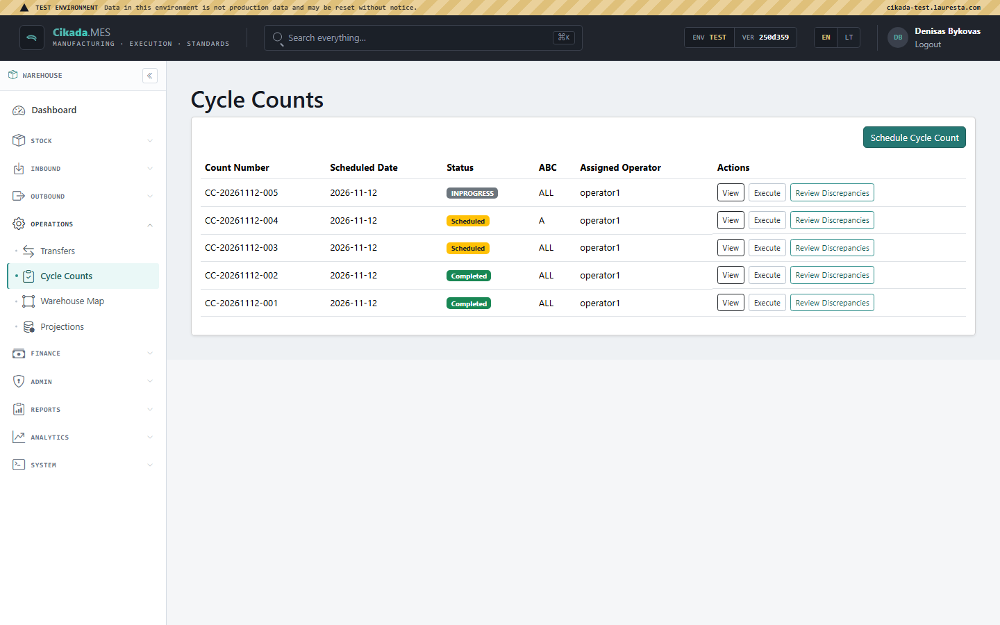
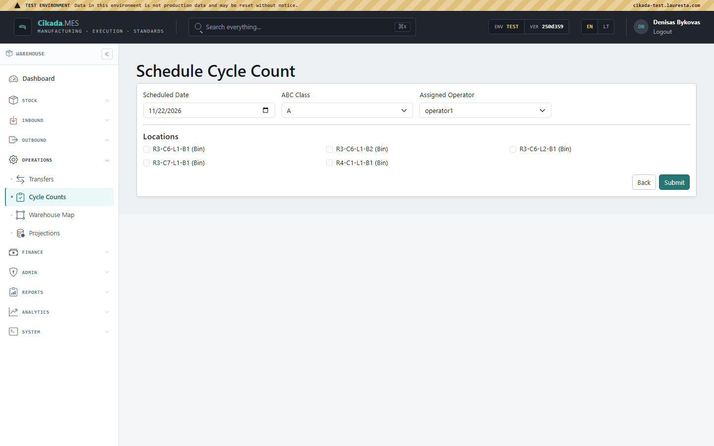

# Inventorizacija (Cycle Counts)

**Būsena:** dalinai

Veikia visas procesas nuo suplanavimo iki korekcijos patvirtinimo; netobula tik operatoriaus parinkimas (žr. „Dar neįgyvendinta").

## Kam skirta
Sandėlio modulio ekranai (UI: Operations > Cycle Counts) skirti suplanuoti pasirinktų sandėlio vietų skaičiavimą, suvesti faktinius kiekius ir patvirtinti atsargų pataisymus, kai faktinis kiekis skiriasi nuo sistemos. Planuoja ir skaičiuoja sandėlio darbuotojai, o dideles korekcijas tvirtina finansų direktorius.

## Prieš pradedant
- Visus šio proceso ekranus ir veiksmus leidžiama naudoti rolėms Operator, QCInspector, WarehouseManager, WarehouseAdmin.
- Korekcija, kurios vertė (skirtumas × savikaina) viršija 1000, patvirtinama tik naudotojui su role CFO; kitam naudotojui rodoma klaida.
- Sistemoje turi būti aktyvių sandėlio vietų ir aktyvių prekių. Rūšiuojant pagal ABC klasę, pasirenkamos prekės, kurių kategorijos kodas prasideda atitinkama raide (A, B ar C).

## Žingsniai
### 1. Suplanuoti skaičiavimą
1. Meniu pasirinkite (UI: Operations > Cycle Counts). Atsidaro (UI: Cycle Counts) su suplanuotais skaičiavimais. Spauskite (UI: Schedule Cycle Count).
2. Ekrane (UI: Schedule Cycle Count) pasirinkite (UI: Scheduled Date) (negali būti ankstesnė už šiandien), (UI: ABC Class) (A, B, C arba ALL) ir (UI: Assigned Operator).
3. Blokelyje (UI: Locations) pažymėkite vietas, kuriose skaičiuosite. Būtina pažymėti bent vieną.
4. Spauskite (UI: Submit). Pranešime „Cycle count … scheduled" pateikiamas numeris ir ekranas grįžta į sąrašą.
5. Sąraše matote (UI: Count Number), (UI: Scheduled Date), (UI: Status), ABC, (UI: Assigned Operator).

### 2. Suvesti faktinius kiekius
1. Sąraše prie skaičiavimo spauskite (UI: Execute) (mygtukas (UI: View) atidaro tą patį ekraną). Atsidaro (UI: Execute Cycle Count).
2. Viršuje matote eigą „Progress: … of … locations counted" ir lentelę: (UI: Location), (UI: SKU), (UI: Item), (UI: Discrepancy). Spustelėjus eilutę, jos vieta ir SKU įrašomi į laukus.
3. Laukuose (UI: Location Barcode) ir (UI: Item Barcode) įveskite vietos kodą ir prekės kodą (SKU), o (UI: Physical Qty) – suskaičiuotą kiekį.
4. Spauskite (UI: Submit). Pranešime „Count recorded for …". Jei skirtumas didesnis nei 10 vienetų arba 5 procentai, rodomas įspėjimas apie neatitikimą.
5. Kartokite kiekvienai vietos ir prekės porai.

### 3. Peržiūrėti neatitikimus ir patvirtinti korekciją
1. Sąraše prie skaičiavimo spauskite (UI: Review Discrepancies). Atsidaro (UI: Cycle Count Discrepancies).
2. Lentelėje matote (UI: System Qty), (UI: Physical Qty), (UI: Variance), (UI: Variance %), kainą ir (UI: Value Impact). Rodomos tik eilutės, kurių skirtumas didesnis nei 10 vienetų arba 5 procentai.
3. Prie eilutės spauskite (UI: Approve). Lange (UI: Approve Adjustment) matote (UI: Approved By), įrašykite (UI: Reason) (pradinė reikšmė „Cycle count correction") ir spauskite (UI: Confirm).
4. Pranešime „Adjustment approved." Sistema sukuria atsargų korekciją su priežasties kodu CYCLE_COUNT ir eilutė tampa patvirtinta.
5. Mygtuku (UI: Back) grįžtate į sąrašą.

## Ką reiškia būsenos ir spalvos
Ekrane (UI: Cycle Counts) skaičiavimo būsena rodoma žyma: Scheduled (geltona) – suplanuota; In progress (mėlyna) – skaičiuojama; Completed (žalia) – baigta; Cancelled (raudona) – atšaukta.

## Dažnos klaidos
- „Scheduled date must be today or later." – parinkite šiandienos ar vėlesnę datą.
- „Assigned operator is required." – pasirinkite operatorių.
- „Select at least one location." – pažymėkite vietą.
- „No active items found for ABC class …" – jokia prekė neatitinka pasirinktos ABC klasės; pasirinkite ALL arba kitą klasę.
- „Location and item barcode are required." – užpildykite abu kodus.
- „Physical quantity must be >= 0." – kiekis negali būti neigiamas.
- „Cycle count line not found for location and item." – tokios vietos ir prekės poros šiame skaičiavime nėra.
- „Reason is required." – prieš (UI: Confirm) įrašykite priežastį.
- „CFO approval required for adjustments > $1000." – korekcijos vertė didelė; ją turi patvirtinti naudotojas su role CFO.
- „Failed to load schedule lookups. Please verify API connectivity." – nepavyko užkrauti vietų; perkraukite puslapį.

## Dar neįgyvendinta
- Ekrane (UI: Schedule Cycle Count) sąraše (UI: Assigned Operator) siūlomi tik operatoriai, jau esantys ankstesniuose skaičiavimuose, ir pavyzdiniai operator1 bei operator2, kai skaičiavimų dar nėra; sąrašas neimamas iš naudotojų lentelės.
- Ekrane (UI: Cycle Count Discrepancies) patvirtinimo langas lauką (UI: Approved By) rodo tik skaitymui iš nustatymų; kito patvirtintojo parinkti negalima.

## Susiję procesai
- [P-06 Atsargų koregavimas](P-06-atsargu-koregavimas-adjustments.md)
- [P-24 Atsargų peržiūra](P-24-atsargu-perziura.md)
