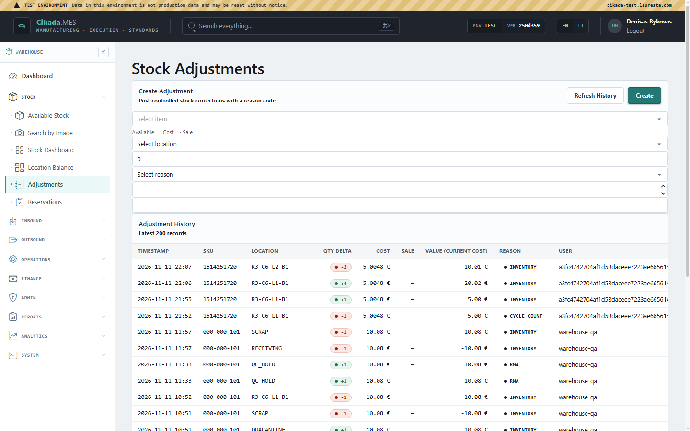

# Atsargų koregavimas (Stock Adjustments)

**Būsena:** veikia

## Kam skirta
Sandėlio modulio ekranas (UI: Stock > Adjustments) skirtas ranka pakeisti prekės kiekį sandėlio vietoje: pridėti ar nuimti atsargas su privaloma priežastimi (pvz., sugadinimas, rasta perteklių). Tai kontroliuojamas pataisymas, todėl jį gali atlikti tik sandėlio vadovas ar administratorius. Pataisymus pagal inventorizaciją sukuria ekranas [P-05 Inventorizacija](P-05-inventorizacija-cycle-count.md).

## Prieš pradedant
- Ekraną atidaryti ir pataisyti gali tik rolės WarehouseManager ir WarehouseAdmin. Kitoms rolėms ekranas neįkelia istorijos.
- Priežasties kodas turi būti sukurtas administravimo priežasčių sąraše su kategorija ADJUSTMENT ir būti aktyvus. Jį gali sukurti tik rolė WarehouseAdmin ekrane (UI: Admin > Reason Codes) – žr. [P-14 Sistemos administravimas](P-14-sistemos-administravimas.md).
- Prekė ir sandėlio vieta turi būti sukurtos.

## Žingsniai
### 1. Sukurti pataisymą
1. Meniu pasirinkite (UI: Stock > Adjustments). Atsidaro (UI: Stock Adjustments) su blokeliu (UI: Create Adjustment).
2. Lauke (UI: Item) susiraskite ir pasirinkite prekę.
3. Sąraše (UI: Location) pasirinkite sandėlio vietą (pradinė reikšmė (UI: Select location)).
4. Lauke (UI: Qty Delta) įveskite kiekio pokytį: teigiamas skaičius atsargas padidina, neigiamas – sumažina. Nulis netinka.
5. Sąraše (UI: Reason) pasirinkite priežasties kodą (pradinė reikšmė (UI: Select reason)).
6. Jei reikia, įveskite (UI: Lot Id) (partijos numerį iš sistemos) ir (UI: Notes).
7. Spauskite (UI: Create). Pranešime „Adjustment created: …" matote pataisymo numerį, o istorijoje atsiranda nauja eilutė.
8. Jei po pataisymo kiekis vietoje taptų neigiamas, virš istorijos rodomas geltonas įspėjimas „Negative stock warning …". Pataisymas vis tiek išsaugomas; patikrinkite įvestą skaičių ir, jei klydote, sukurkite priešingą pataisymą.

### 2. Peržiūrėti istoriją
1. Blokelyje (UI: Adjustment History) rodomi paskutiniai 200 įrašų.
2. Lentelėje matote (UI: Timestamp), SKU, (UI: Location), (UI: Qty Delta) su ženklu (+ arba –), (UI: Cost), (UI: Sale), (UI: Value (current cost)), (UI: Reason), (UI: User), (UI: Notes).
3. Spauskite (UI: Refresh History), jei norite atnaujinti sąrašą.

## Ką reiškia būsenos ir spalvos
Sandėlio modulio ekrano (UI: Stock Adjustments) istorijoje stulpelis (UI: Qty Delta) rodo kiekį su ženklu: pridėjimas pažymėtas žalia, nuėmimas – raudona žyma. Stulpelyje (UI: Reason) rodomas priežasties kodas.

## Dažnos klaidos
- „Item, location, qty delta and reason are required." – užpildykite visus privalomus laukus; (UI: Qty Delta) negali būti 0.
- „ReasonCode '…' does not exist or is inactive." – tokio aktyvaus kodo nėra; pasirinkite kitą arba paprašykite administratoriaus jį sukurti.
- „Lot '…' does not exist for Item '…'." – (UI: Lot Id) nepriklauso pasirinktai prekei.
- „Negative stock warning …" – rezultatas vietoje bus neigiamas (tai įspėjimas, ne klaida).
- Prieigos klaida – jūsų rolė nėra WarehouseManager ar WarehouseAdmin.

## Susiję procesai
- [P-05 Inventorizacija](P-05-inventorizacija-cycle-count.md) – korekcijos pagal skaičiavimą.
- [P-24 Atsargų peržiūra](P-24-atsargu-perziura.md) – kiekių patikrinimas prieš ir po pataisymo.
- [P-14 Sistemos administravimas](P-14-sistemos-administravimas.md) – priežasčių kodai.
