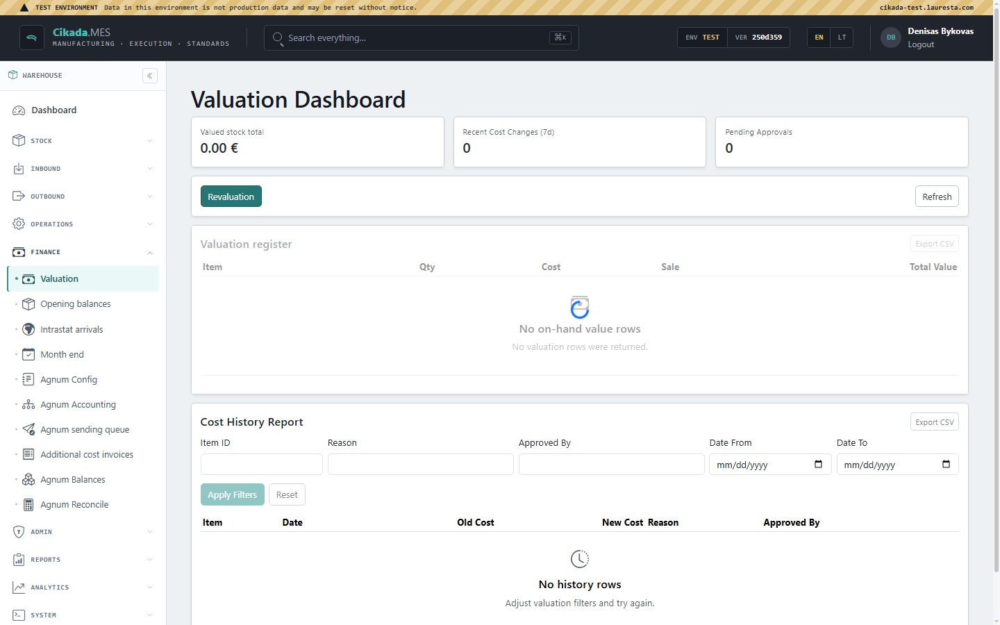
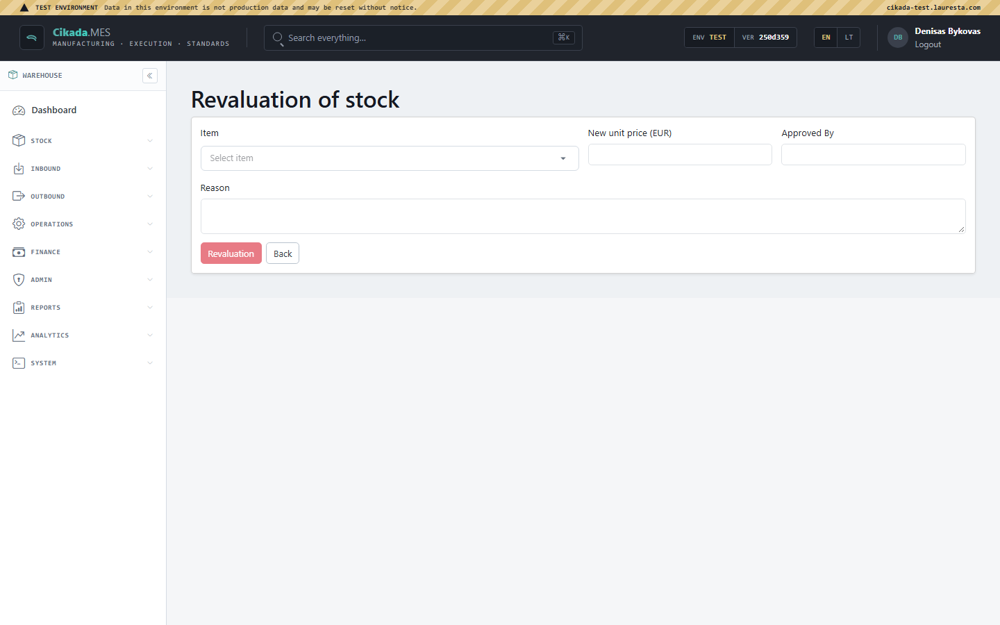

# Atsargų vertinimas ir nukainojimas

**Būsena:** veikia

## Kam skirta
Sandėlio modulio ekranai (UI: Valuation Dashboard) ir (UI: Revaluation of stock) skirti matyti atsargų vertę ir ją sumažinti nukainojimo dokumentu. Sandėlis vertę laiko sumomis eurais: kiekvienas judėjimas (priėmimas, išdavimas, nurašymas, korekcija) keičia prekės likučio vertę, o vieneto savikaina yra vertė, padalinta iš kiekio. Savikainos redagavimo ir papildomų išlaidų paskirstymo ekranų nebėra: išlaidos įvedamos pirkimo dokumente (žr. [P-16](P-16-pirkimo-dokumentas.md)), o mėnesio vertė tikrinama [P-22](P-22-menesio-uzdarymas.md).

## Prieš pradedant
- Prieiga prie nukainojimo: InventoryAccountant, WarehouseManager, WarehouseAdmin. Vertės ataskaitas gali žiūrėti visos Warehouse rolės.
- Prekė turi turėti vertinamų atsargų (kitaip „There is no valued stock to revalue.“).
- Nukainojimo data neturi patekti į uždarytą mėnesį.

## Žingsniai
### 1. Peržiūrėti atsargų vertę
1. Meniu pasirinkite (UI: Finance > Valuation). Atsidaro (UI: Valuation Dashboard).
2. Viršuje matote kortelės (UI: Valued stock total), (UI: Recent Cost Changes (7d)) ir (UI: Pending Approvals) (didelių savikainos pokyčių be patvirtinusio asmens skaičius; skaičiuojamas iš istorijos lentelės: pokytis didesnis kaip 1000 be patvirtinusio asmens).
3. Skiltyje (UI: Valuation register) matote prekę, kiekį, savikainą, pardavimo kainą ir bendrą vertę; (UI: Export CSV) eksportuoja lentelę.
4. Skiltyje (UI: Cost History Report) filtruokite pagal (UI: Item ID), (UI: Reason), (UI: Approved By), datas ir spauskite (UI: Apply Filters); (UI: Reset) išvalo filtrus.

### 2. Nukainoti prekę
1. Suvestinėje spauskite (UI: Revaluation). Atsidaro (UI: Revaluation of stock).
2. Pasirinkite (UI: Item), įveskite (UI: New unit price (EUR)) ir (UI: Reason) (bent 3 simboliai). Jei nukainojimas sumažina vertę daugiau kaip 1000 EUR, įveskite (UI: Approved By) (el. pašto formatu) – tokį nukainojimą gali patvirtinti tik vadovo rolė.
3. Spauskite (UI: Revaluation). Pranešimas „Write-down completed successfully.“ ir grįžtama į suvestinę. Dokumentas gauna numerį UC-data-kodas.
4. Nukainojimas gali tik sumažinti vertę: nauja kaina turi būti mažesnė už dabartinę vidutinę.

### 3. Kaip vertė keičiasi kitur
- Priėmimas pagal pirkimo dokumentą įvertinamas preliminaria kaina, o užregistravus – galutine suma (žr. P-16).
- Išdavimai, grąžinimai, nurašymai ir korekcijos keičia vertę pagal vidutinę savikainą; mėnesio vertės ataskaita – [P-22](P-22-menesio-uzdarymas.md).
- Pradinė vertė įkeliama iš CSV – [P-20](P-20-pradiniai-likuciai.md).

## Ką reiškia būsenos ir spalvos
Ekrane (UI: Valuation Dashboard) skiltyje (UI: Cost History Report) rodomi senos ir naujos savikainos pokyčiai bei patvirtinęs asmuo; tuščias „Approved By“ pažymimas brūkšniu.

## Dažnos klaidos
- „Approval required for revaluation > 1000 EUR.“ – įveskite (UI: Approved By).
- „Manager approval is required for revaluation > 1000 EUR.“ – tokį nukainojimą gali atlikti tik vadovas ar administratorius.
- „Revaluation must reduce the stock value.“ – nauja kaina turi būti mažesnė.
- „There is no valued stock to revalue.“ – prekė neturi vertinamų atsargų.
- „Reason is required.“ / „NewUnitPrice must be >= 0.“ – užpildykite laukus.
- Uždarytas mėnuo – nukainojimas atmetamas; atidarykite mėnesį pagal P-22.

## Susiję procesai
- [P-16 Pirkimo dokumentas](P-16-pirkimo-dokumentas.md)
- [P-22 Mėnesio uždarymas](P-22-menesio-uzdarymas.md)
- [P-08 Agnum integracija](P-08-agnum-integracija.md)
- [P-13 Ataskaitos](P-13-ataskaitos-analize-reports.md)
