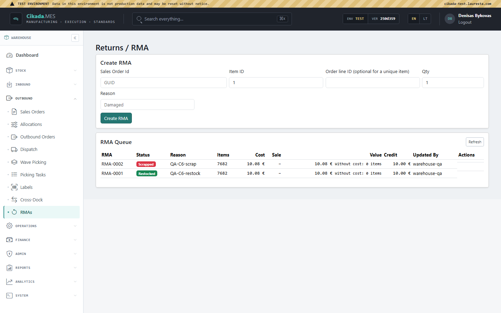

# Klientų grąžinimai (RMA)

**Būsena:** dalinai

Veikia grąžinimo sukūrimas, priėmimas ir sprendimas (grąžinti į atsargas arba nurašyti). Nepabaigta kredito suma ir patogus užsakymo bei prekės pasirinkimas – žr. „Dar neįgyvendinta".

## Kam skirta
Sandėlio modulio ekranas (UI: Outbound > RMAs), kurio antraštė (UI: Returns / RMA), skirtas registruoti klientų grąžinamas prekes pagal pardavimo užsakymą, priimti jas į sandėlį ir nuspręsti, ar grąžintą prekę dėti atgal į atsargas, ar nurašyti. Grąžinimą sukuria pardavimų administratorius arba vadovas, priima sandėlio darbuotojas, sprendimą priima kokybės inspektorius ar vadovas.

## Prieš pradedant
- Pardavimo užsakymas turi būti sukurtas ([P-03 Pardavimo užsakymai ir išsiuntimas](P-03-israsymas-isuntimas-outbound.md)). Jo GUID matomas naršyklės adreso eilutėje atidarius užsakymo kortelę ekrane (UI: Sales Orders).
- Reikia žinoti prekės numerį (Id), o jei užsakyme ta pati prekė yra keliose eilutėse – ir užsakymo eilutės GUID.
- Grąžinimą sukurti (UI: Create RMA) gali SalesAdmin, WarehouseManager, WarehouseAdmin. Sąrašą ir (UI: Receive) leidžiama naudoti rolėms Operator, QCInspector, WarehouseManager, WarehouseAdmin. (UI: Restock) ir (UI: Scrap) leidžiami tik QCInspector, WarehouseManager, WarehouseAdmin.
- Sistemoje turi būti sandėlio vietos QC_HOLD, RECEIVING ir SCRAP.

## Žingsniai
### 1. Sukurti grąžinimą
1. Meniu pasirinkite (UI: Outbound > RMAs). Atsidaro (UI: Returns / RMA) su blokeliu (UI: Create RMA).
2. Įveskite (UI: Sales Order Id) (GUID), (UI: Item ID), (UI: Qty) ir (UI: Reason). Pradinė (UI: Item ID) reikšmė 1 yra pavyzdinė – pakeiskite ją.
3. (UI: Order line ID (optional for a unique item)) palikite tuščią, jei prekė užsakyme yra vienoje eilutėje.
4. Spauskite (UI: Create RMA). Pranešime „RMA created." Eilutė su numeriu RMA-… ir būsena Pending receipt atsiranda eilėje.
5. Vienu grąžinimu ekrane registruojama viena prekių eilutė; kelioms prekėms kurkite kelis grąžinimus.

### 2. Priimti grąžintą prekę
1. Blokelyje (UI: RMA Queue) raskite eilutę su būsena Pending receipt ir spauskite (UI: Receive).
2. Prekė įrašoma į vietą QC_HOLD su priežasties kodu RMA, būsena tampa Received.

### 3. Priimti sprendimą
1. Eilutei su būsena Received spauskite (UI: Restock) arba (UI: Scrap).
2. (UI: Restock) perkelia prekę iš QC_HOLD į RECEIVING (toliau ją reikia padėti į lentyną – [P-02 Padėjimas į vietą](P-02-padeti-i-lokacija-putaway.md)); būsena tampa Restocked.
3. (UI: Scrap) perkelia prekę į SCRAP ir nurašo; būsena tampa Scrapped.
4. Lentelėje matote (UI: Reason), prekių numerius, kainą, vertę, (UI: Credit) ir (UI: Updated By). (UI: Refresh) atnaujina eilę.

## Ką reiškia būsenos ir spalvos
Ekrane (UI: Returns / RMA) grąžinimo būsena rodoma žyma.
- Pending receipt – grąžinimas užregistruotas, prekė dar neatvežta.
- Received – prekė priimta ir laukia sprendimo vietoje QC_HOLD.
- Restocked – prekė grąžinta į atsargas (RECEIVING).
- Scrapped – prekė nurašyta.

## Dažnos klaidos
- „SalesOrderId must be a valid GUID." – (UI: Sales Order Id) turi būti GUID.
- „Sales order not found." – tokio užsakymo nėra.
- „Select a specific line belonging to this order and item." – prekė nepriklauso užsakymui arba yra keliose eilutėse; įrašykite (UI: Order line ID (optional for a unique item)).
- „Return quantity exceeds the order line, including previous RMAs." – grąžinama daugiau, nei užsakyta, įskaitant ankstesnius grąžinimus.
- „Return reason is required." / „Positive return quantities are required." – užpildykite (UI: Reason) ir teigiamą (UI: Qty).
- „Invalid RMA transition." – veiksmas netinka esamai būsenai; atnaujinkite eilę.
- „Insufficient committed stock in QC_HOLD." – prekės QC_HOLD vietoje nebėra (pvz., kitas darbuotojas jau ją perkėlė).

## Dar neįgyvendinta
- Stulpelis (UI: Credit) nėra suskaičiuojamas: (UI: Restock) visada išsiunčia kredito sumą 0, o (UI: Scrap) – jokios. Kreditinė sąskaita ar kreditas klientui šiame ekrane nesudaromi.
- Užsakymas ir prekė nepasirenkami iš sąrašo – GUID ir prekės numerį reikia įvesti ranka.
- Vienas grąžinimas turi vieną prekių eilutę.

## Susiję procesai
- [P-03 Pardavimo užsakymai ir išsiuntimas](P-03-israsymas-isuntimas-outbound.md)
- [P-02 Padėjimas į vietą](P-02-padeti-i-lokacija-putaway.md)
- [P-01 Prekių priėmimas ir kokybės patikra](P-01-priemimas-inbound.md)
