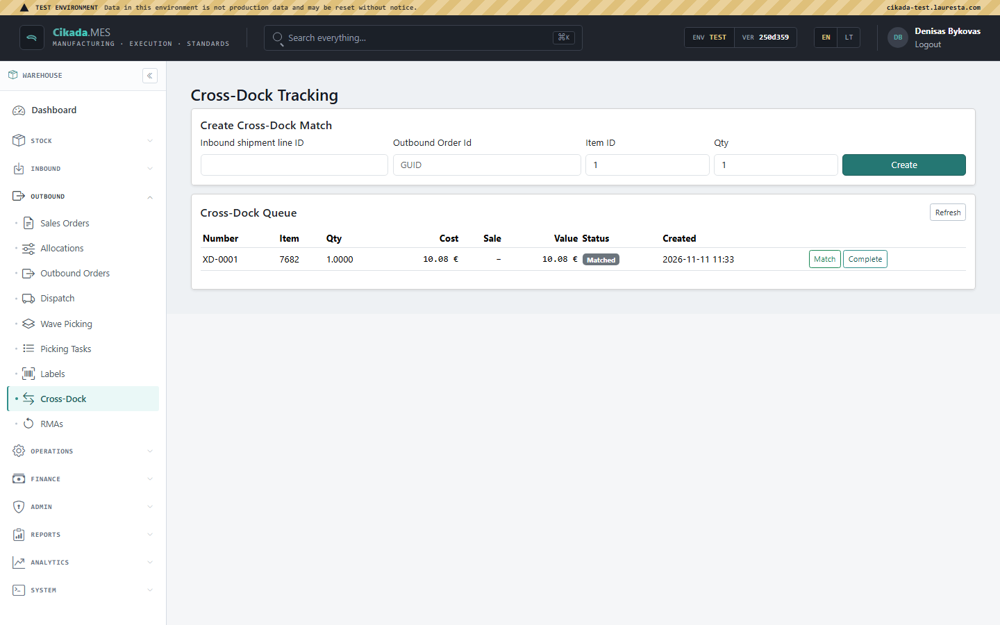

# Tiesioginis perkrovimas (Cross-Dock)

**Būsena:** dalinai

Ekranas veikia, bet tik kaip ryšių registras: jis nejudina atsargų ir nesudaro užduočių. Smulkiau – skyriuje „Dar neįgyvendinta".

## Kam skirta
Sandėlio modulio ekranas (UI: Outbound > Cross-Dock), kurio antraštė (UI: Cross-Dock Tracking), leidžia užregistruoti, kad atvežta priimamos siuntos eilutė skirta konkrečiam išsiunčiamam užsakymui, ir sekti to ryšio būseną. Ekraną naudoja sandėlio darbuotojai ir vadovai.

## Prieš pradedant
- Ekraną naudoti leidžiama rolėms Operator, QCInspector, WarehouseManager, WarehouseAdmin.
- Turi būti sukurta priimama siunta (žr. [P-01 Prekių priėmimas](P-01-priemimas-inbound.md)) ir išsiunčiamas užsakymas (žr. [P-03 Pardavimo užsakymai ir išsiuntimas](P-03-israsymas-isuntimas-outbound.md)) su ta pačia preke.
- Reikia žinoti: siuntos eilutės numerį (matomą siuntos kortelės sąraše (UI: Line) skliaustuose, pvz., „(Line 12)"), išsiunčiamo užsakymo GUID (naršyklės adreso eilutėje atidarius užsakymą) ir prekės numerį (Id).

## Žingsniai
### 1. Sukurti ryšį
1. Meniu pasirinkite (UI: Outbound > Cross-Dock). Atsidaro (UI: Cross-Dock Tracking) su blokeliu (UI: Create Cross-Dock Match).
2. Įveskite (UI: Inbound shipment line ID), (UI: Outbound Order Id) (GUID), (UI: Item ID) ir (UI: Qty). Pradinė (UI: Item ID) reikšmė 1 yra pavyzdinė – pakeiskite ją.
3. Spauskite (UI: Create). Pranešime „Cross-dock record created." Įrašas atsiranda eilėje su numeriu XD-… ir būsena Pending.

### 2. Keisti būseną
1. Blokelyje (UI: Cross-Dock Queue) matote (UI: Number), prekę, (UI: Qty), kainą, vertę, (UI: Status) ir (UI: Created).
2. Spauskite (UI: Match), kai prekė atvežta ir priskirta užsakymui – būsena tampa Matched.
3. Spauskite (UI: Complete), kai prekė perduota užsakymui – būsena tampa Completed. Užbaigimo data išsaugoma.
4. Eilutę atnaujina (UI: Refresh).

## Ką reiškia būsenos ir spalvos
Ekrane (UI: Cross-Dock Tracking) ryšio būsena rodoma pilka žyma.
- Pending – ryšys užregistruotas.
- Matched – prekė atvežta ir priskirta užsakymui.
- Completed – perkrovimas baigtas.
Ekrane rodoma pastaba „Link an inbound line to an order. This link does not move stock."

## Dažnos klaidos
- „Enter a positive inbound line ID and a valid outbound order ID." – siuntos eilutės numeris turi būti teigiamas, o užsakymo identifikatorius – GUID.
- „Quantity must be positive." – (UI: Qty) turi būti didesnis už 0.
- „Inbound line does not contain this item." – (UI: Item ID) nesutampa su siuntos eilutės preke.
- „Outbound order does not contain this item." – išsiunčiamame užsakyme tokios prekės nėra.
- „Quantity exceeds the inbound line." – kiekis didesnis už tikėtiną siuntos eilutės kiekį.
- „This link already exists." – šis siuntos eilutės ir užsakymo ryšys jau sukurtas.

## Dar neįgyvendinta
- Ryšys nejudina atsargų: ekrane (UI: Cross-Dock Tracking) mygtukai (UI: Match) ir (UI: Complete) tik keičia įrašo būseną. Atsargos priimamos ir išsiunčiamos įprastais ekranais.
- Siuntos eilutė, užsakymas ir prekė pasirenkami ranka įvedant numerius, o ne iš sąrašo; lentelėje prekė rodoma numeriu, ne SKU.

## Susiję procesai
- [P-01 Prekių priėmimas](P-01-priemimas-inbound.md)
- [P-03 Pardavimo užsakymai ir išsiuntimas](P-03-israsymas-isuntimas-outbound.md)
