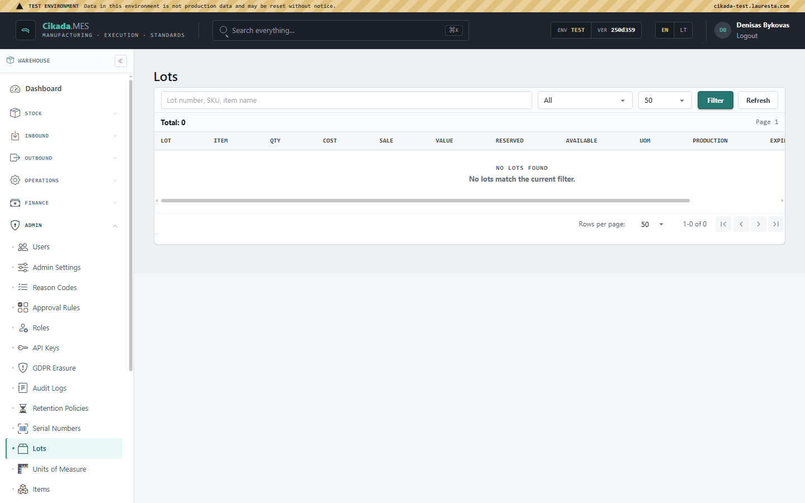
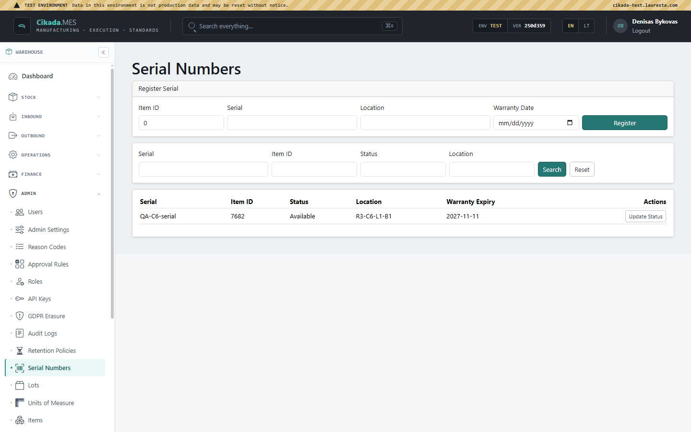

# Partijų ir serijų numeriai

**Būsena:** veikia

## Kam skirta
Sandėlio modulyje (Warehouse) du ekranai padeda sekti atskirus prekių vienetus. Partijų sąrašas (UI: Admin > Lots) rodo visas partijas su likučiais ir galiojimo datomis. Serijų numerių ekrane (UI: Admin > Serial Numbers) registruojami atskiri vienetai ir keičiama jų būsena. Abu ekranai yra meniu skyriuje (UI: Admin).

Partijų atsekamumo ataskaitos aprašytos puslapyje [Atsekamumas ir atitiktis](P-28-atsekamumas-ir-atitiktis.md).

## Prieš pradedant
- Partijų sąrašas ir serijų paieška API pusėje leidžiami rolėms Operator, QCInspector, WarehouseManager ir WarehouseAdmin.
- Serijų numerių ekranas rodomas tik tuo atveju, kai programos nustatymuose (`WarehouseApi:Roles`) yra rolė WarehouseAdmin arba Admin. Kitu atveju vietoj ekrano rodomas pranešimas „Admin role required.“
- Partijų ekrane partijų kurti negalima. Partija atsiranda automatiškai, kai priimant siuntą įvedamas partijos numeris (žr. [P-01 Prekių priėmimas](P-01-priemimas-inbound.md)). Prekėms, kurioms įjungtas partijų sekimas, priėmimo metu partijos numeris privalomas.
- Serijos numeriui registruoti reikia prekės vidinio numerio (Item ID), kuris yra skaičius iš prekių sąrašo.

## Žingsniai
### 1. Peržiūrėti partijas
1. Meniu pasirinkite (UI: Admin > Lots).
2. Lauke (UI: Lot number, SKU, item name) įveskite partijos numerį, prekės kodą arba pavadinimo dalį.
3. Išskleidžiamajame sąraše pasirinkite būseną: (UI: All), (UI: Active), (UI: Expiring soon), (UI: Expired) arba (UI: Depleted).
4. Spauskite (UI: Filter). Sąrašui perkrauti iš naujo naudokite (UI: Refresh).
5. Puslapio dydį pasirinkite iš 25, 50 arba 100. Viršuje rodoma (UI: Total: N) ir (UI: Page N).
6. Jei nieko nerasta, rodoma (UI: No lots found). Esant įjungtiems filtrams atsiranda mygtukas (UI: Clear filters).

Lentelės stulpeliai: (UI: Lot), (UI: Item), (UI: Qty), (UI: Cost), (UI: Sale), (UI: Value), (UI: Reserved), (UI: Available), (UI: UoM), (UI: Production), (UI: Expiry), (UI: Status).

### 2. Užregistruoti serijos numerį
1. Meniu pasirinkite (UI: Admin > Serial Numbers).
2. Skiltyje (UI: Register Serial) užpildykite (UI: Item ID) ir (UI: Serial). Lauką (UI: Location) ir (UI: Warranty Date) galima palikti tuščius.
3. Spauskite (UI: Register). Pavyks, kai prekė egzistuoja, o toks serijos numeris dar neužregistruotas (didžiosios ir mažosios raidės nesvarbios). Rodomas pranešimas (UI: Serial registered.).
4. Naujas serijos numeris visada gauna būseną (UI: Received).

### 3. Surasti ir pakeisti serijos būseną
1. Paieškos eilutėje užpildykite (UI: Serial), (UI: Item ID), (UI: Status) arba (UI: Location) ir spauskite (UI: Search). (UI: Reset) išvalo laukus. Vietos laukas filtruojamas pagal teksto dalį.
2. Lentelės eilutėje spauskite (UI: Update Status). Apačioje atsidaro blokas (UI: Update Serial ...).
3. Pasirinkite naują (UI: Status), jei reikia, įrašykite (UI: Location) ir spauskite (UI: Save). Rodomas pranešimas (UI: Serial status updated.).
4. (UI: Close) uždaro bloką be pakeitimų.

## Ką reiškia būsenos ir spalvos
Partijos būsena Partijų sąrašo stulpelyje (UI: Status) skaičiuojama taip, kaip nurodyta eilės tvarka:
- Depleted: partijos prieinamas kiekis lygus nuliui arba mažesnis.
- Expired: galiojimo data jau praėjo.
- ExpiringSoon: galiojimo data per artimiausias 30 dienų.
- Active: visos kitos partijos.

Stulpelyje būsena rodoma kodu (pvz. ExpiringSoon), o filtre – žodžiais (Expiring soon). Stulpeliai (UI: Cost), (UI: Sale) ir (UI: Value) rodo dabartinę prekės kainą, ne partijos kainą. (UI: Value) yra kiekis, padaugintas iš dabartinės savikainos.

Serijos numerio būsenos: (UI: Received), (UI: Available), (UI: Issued), (UI: Returned), (UI: Scrapped). Ekranas leidžia pasirinkti bet kurią būseną iš bet kurios, kitų apribojimų kode nėra. Kiekvienas pakeitimas išsaugomas serijos istorijoje su naudotoju ir laiku.

## Dažnos klaidos
- „Admin role required.“ Serijų ekrane: paskyra nėra administratorius pagal programos nustatymus. Kreipkitės į administratorių.
- „Serial already exists.“ Toks serijos numeris jau užregistruotas. Naudokite paiešką ir pakeiskite esamo numerio būseną.
- „Item not found.“ Neteisingas (UI: Item ID). Patikrinkite prekės numerį prekių sąraše.
- Rodomas klaidos plakatas su (UI: Retry): serveris nepasiekiamas arba nėra teisių. Pakartokite, o jei nepavyksta, perduokite plakato sekimo kodą (Trace ID) palaikymui.

## Dar neįgyvendinta
- Partijų ekrane nėra mygtukų kurti ar redaguoti partijas. Jos kuriamos tik priimant siuntą.
- Serijų numeriai nėra automatiškai susieti su priėmimu ar išsiuntimu: serijas reikia registruoti ir keisti ranka šiame ekrane.
- Serijų ekrane negalima pamatyti pasirinkto numerio būsenų istorijos, nors ji saugoma.
