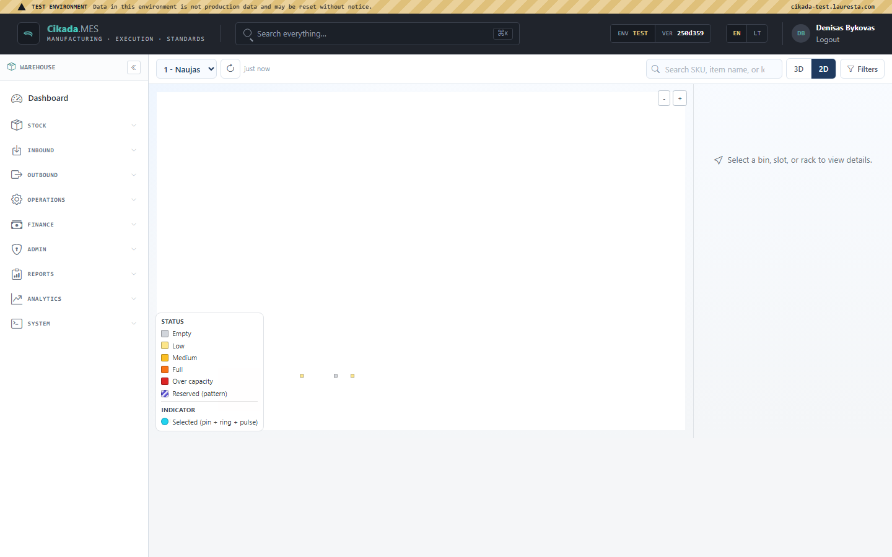
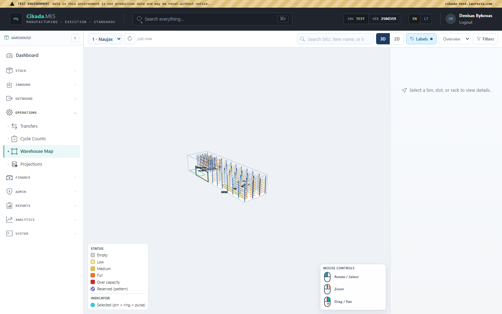

# Sandėlio žemėlapis (3D ir 2D)

**Būsena:** veikia

## Kam skirta
Sandėlio žemėlapis (UI: Operations > Warehouse Map) rodo pasirinkto sandėlio lentynas, vietas ir jų užpildymą 3D arba 2D vaizdu. Juo patogu rasti, kurioje vietoje yra prekė, kurios vietos tuščios ar perpildytos, ir atidaryti jos kortelę. Žemėlapis tik rodo duomenis, jame nieko keisti negalima.

## Prieš pradedant
- Žemėlapį gali atidaryti rolės Operator, QCInspector, WarehouseManager ir WarehouseAdmin.
- Sandėlis turi turėti sukonfigūruotą išdėstymą ir vietas su koordinatėmis. Jei vietų su koordinatėmis nėra, rodoma: (UI: No bins configured with coordinates. Configure layout first.)
- Išdėstymą ir lentynų struktūrą redaguoja administratorius ekrane (UI: Admin > Layout Editor), žr. [Sistemos administravimas](P-14-sistemos-administravimas.md).
- 3D vaizdui naudojama naršyklės grafika (WebGL). Jei 3D vaizdas neveikia, naudokite 2D.

## Žingsniai
### 1. Atidaryti žemėlapį ir pasirinkti sandėlį
1. Meniu pasirinkite (UI: Operations > Warehouse Map). Atsidaro 3D vaizdas.
2. Viršutiniame kairiajame kampe išskleidžiamajame sąraše pasirinkite sandėlį (rodoma „kodas - pavadinimas“).
3. Apvalus rodyklės mygtukas (UI: Refresh) perkrauna duomenis. Šalia rodoma, prieš kiek laiko duomenys atnaujinti.
4. Perjungiklis (UI: 3D) / (UI: 2D) keičia vaizdą. Perjungus adresas pasikeičia į `/visualization/2d` arba `/visualization/3d`, o pasirinkta vieta išlieka.

### 2. Valdyti vaizdą
1. 3D vaizde kairiuoju pelės mygtuku sukite ir pažymėkite objektą (UI: Rotate / Select), ratuku keiskite mastelį (UI: Zoom), tempimu dešiniuoju pelės mygtuku perstumkite vaizdą (UI: Drag / Pan). Pagalbos blokas (UI: Mouse controls) rodomas ekrane.
2. Jungiklis (UI: Labels) rodo arba slepia lentynų užrašus. Sąrašas (UI: Camera angle) leidžia pasirinkti (UI: Overview) arba (UI: Low angle).
3. 2D vaizde mastelį keičia mygtukai (UI: -) ir (UI: +).

### 3. Rasti prekę ar vietą
1. Paieškos lauke (UI: Search SKU, item name, or location...) pradėkite rašyti. Atsiranda pasiūlymų sąrašas, iš jo pasirinkite įrašą arba spauskite Enter.
2. Jei tekstas atitinka vietą, žemėlapis ją parodo ir pažymi. Jei atitinka prekę, viršuje rodoma prekės juosta su vietomis ir kiekiais, kuriose prekė yra. Spustelėjus vietos kodą, žemėlapis ją pažymi.
3. Jei prekės šiame sandėlyje nėra, rodoma „Not in ...“, o jei yra kituose sandėliuose – „Also in: ...“.
4. Paieškai nutraukti spauskite „x“ šalia laukelio arba klavišą Escape.

### 4. Filtruoti pagal zoną ir būseną
1. Spauskite (UI: Filters). Atsidariusiame lange pasirinkite zoną (UI: Zone) ir būseną (UI: Status). Pakartotinis paspaudimas ant pasirinkto filtro jį išjungia.
2. (UI: Reset) išvalo filtrus, (UI: Done) uždaro langą. Aktyvūs filtrai rodomi juostoje, juostos mygtukas (UI: Clear all) išvalo visus.
3. Jei nė viena vieta neatitinka filtrų, rodoma „No bins match the selected zone/status filters.“

### 5. Peržiūrėti vietos informaciją
1. Spustelėkite vietą, aukštą (slot) arba lentynos objektą. Dešinėje atsiranda informacijos kortelė. Kol nieko nepasirinkta, rodoma „Select a bin, slot, or rack to view details.“
2. Vietos kortelėje yra būsena (UI: Status), užpildymas (UI: Utilization), koordinatės, adresas, dydis, talpa ir sąrašas (UI: Handling Units) su pakuočių numeriais ir kiekiais.
3. Mygtukai kortelės apačioje: (UI: View Details) atidaro vietos kortelę (`/locations/{numeris}`), (UI: Open In Slots) atidaro (UI: Admin > Slots), (UI: Open In Locations) atidaro (UI: Admin > Locations) su vietos kodu.

## Ką reiškia būsenos ir spalvos
Legendoje (UI: Status) vietos užpildymas rodomas spalvomis, pagal vietos užimtą dalį nuo talpos:
- (UI: Empty): užpildymo nėra.
- (UI: Low): iki 45 % talpos.
- (UI: Medium): daugiau nei 45 %, bet ne daugiau kaip 80 %.
- (UI: Full): daugiau nei 80 %, bet ne daugiau kaip 100 %.
- (UI: Over capacity): daugiau nei 100 % talpos.
- (UI: Reserved (pattern)): vieta su kietuoju rezervavimu (HARD), vaizduojama brūkšniuotu raštu.

Pasirinkta vieta pažymima smeigtuku, žiedu ir pulsavimu (legenda (UI: Indicator)).

## Dažnos klaidos
- Raudonas pranešimas vietoj žemėlapio: nepavyko užkrauti sandėlio modelio. Spauskite (UI: Refresh); jei kartojasi, pasakykite palaikymui.
- „No bins configured with coordinates. Configure layout first.“ Sandėlio vietoms neįvestos koordinatės. Kreipkitės į administratorių.
- Tuščias 3D laukas: naršyklė nepalaiko WebGL. Perjunkite į (UI: 2D).
- Pasirinkto sandėlio sąrašas tuščias: aktyvių sandėlių nėra arba trūksta teisių.
