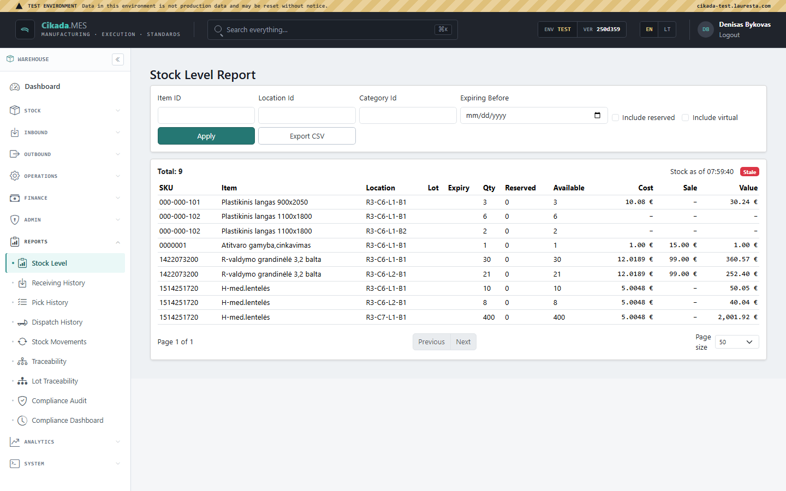
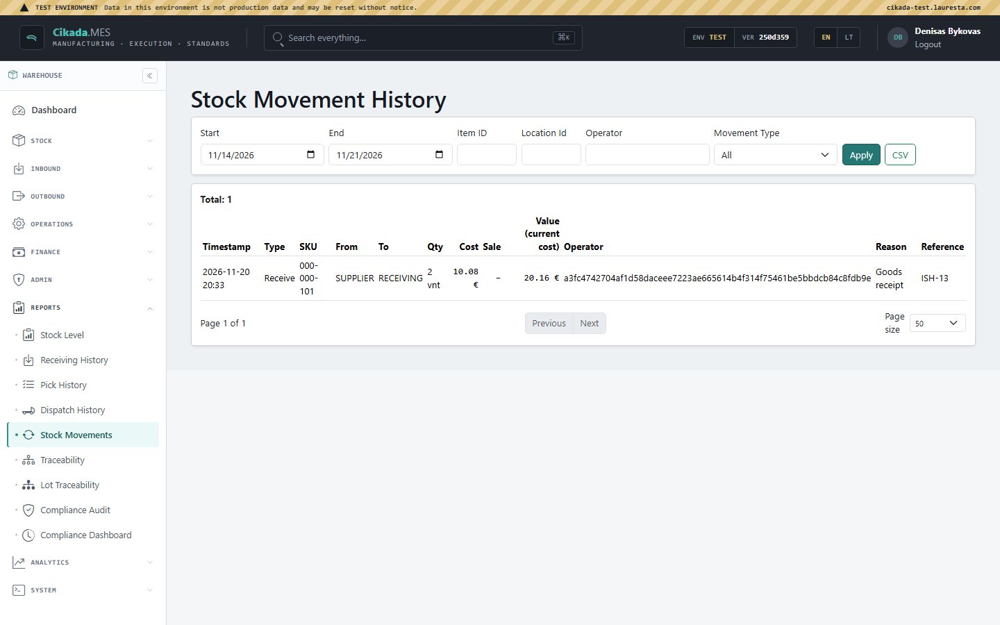

# Sandėlio ataskaitos

**Būsena:** veikia

## Kam skirta
Sandėlio modulio (Warehouse) skyriuje (UI: Reports) yra penkios lentelinės ataskaitos: atsargų likučiai, priėmimų istorija, surinkimų istorija, išsiuntimų istorija ir atsargų judėjimai. Visos jos tik rodo duomenis, nieko nekeičia, o rezultatą galima išsaugoti į CSV failą. Atsekamumo ir atitikties ataskaitos aprašytos puslapyje [Atsekamumas ir atitiktis](P-28-atsekamumas-ir-atitiktis.md), skaičiai ir tendencijos – puslapyje [Analitika](P-29-analitika.md).

## Prieš pradedant
- Visas penkias ataskaitas gali atidaryti rolės Operator, QCInspector, WarehouseManager ir WarehouseAdmin.
- Ataskaitose rodomos savikainos ir pardavimo kainos yra dabartinės prekių kainos, o ne sandorio metu galiojusios (antraštės užuomina: „Current item prices; historical transaction prices remain unchanged.“).
- Lentelės puslapiuojamos (pagal nutylėjimą 50 eilučių). Po lentele pasirenkamas puslapis ir eilučių skaičius.

## Žingsniai
### 1. Atsargų likučiai
1. Meniu pasirinkite (UI: Reports > Stock Level). Atsidaro (UI: Stock Level Report).
2. Pasirinktinai užpildykite filtrus: (UI: Item ID), (UI: Location Id), (UI: Category Id) – tai skaičiai; (UI: Expiring Before) – rodo tik likučius, kurių galiojimas baigiasi iki tos datos.
3. Pažymėkite (UI: Include reserved), jei reikia matyti rezervuotą kiekį stulpelyje (UI: Reserved). Be šios varnelės stulpelyje rodomas nulis. Pažymėkite (UI: Include virtual), jei reikia įtraukti virtualias vietas, kurios pagal nutylėjimą paslėptos.
4. Spauskite (UI: Apply). Viršuje rodoma (UI: Total: N) ir „Stock as of HH:mm:ss“. Šalia gali būti ženklelis (UI: Stale), jei duomenys atsilieka.
5. Spauskite (UI: Export CSV), kad gautumėte failą `stock-level-report.csv` su tais pačiais filtrais.

Stulpeliai: SKU, (UI: Item), (UI: Location), (UI: Lot), (UI: Expiry), (UI: Qty), (UI: Reserved), (UI: Available), (UI: Cost), (UI: Sale), (UI: Value).

### 2. Priėmimų istorija
1. Pasirinkite (UI: Reports > Receiving History).
2. Filtrai: (UI: Supplier Id) (skaičius), (UI: Status) – (UI: All), (UI: Draft), (UI: Partial) arba (UI: Complete), datų intervalas (UI: Expected From) ir (UI: Expected To).
3. Spauskite (UI: Apply), o failui – (UI: Export CSV).
4. Lentelėje rodoma siunta, nuoroda, tiekėjas, laukiama data, būsena, laukiamas ir priimtas kiekis bei sumos (UI: Purchase Total), (UI: Cost Total), (UI: Sale Total).

### 3. Surinkimų istorija
1. Pasirinkite (UI: Reports > Pick History).
2. Filtrai: (UI: Order Id), (UI: Operator/User), (UI: Completed From), (UI: Completed To). Du pastarieji turi ir datą, ir laiką.
3. Spauskite (UI: Apply) arba (UI: Export CSV).
4. Eilutėje rodoma surinkimo užduotis, užsakymas, prekė, užsakytas ir surinktas kiekis, vertė pagal dabartinę savikainą (UI: Value (current cost)), operatorius ir užbaigimo laikas.

### 4. Išsiuntimų istorija
1. Pasirinkite (UI: Reports > Dispatch History).
2. Filtrai: (UI: Date From), (UI: Date To), (UI: Carrier). (UI: Apply) pritaiko, (UI: Reset) išvalo, (UI: Refresh) perkrauna, (UI: Export CSV) išsaugo failą.
3. Viršuje trys kortelės: (UI: Total Shipments), (UI: Total Orders), (UI: On-Time Delivery) (procentas). Lentelėje: siunta, užsakymas, klientas, vežėjas, sekimo numeris, išsiuntimo ir pristatymo datos, būsena.

### 5. Atsargų judėjimai
1. Pasirinkite (UI: Reports > Stock Movements).
2. Pagal nutylėjimą rodomos paskutinės 7 dienos. Keiskite (UI: Start) ir (UI: End), taip pat gali filtruoti pagal (UI: Item ID), (UI: Location Id), (UI: Operator) ir (UI: Movement Type): (UI: Receive), (UI: Transfer), (UI: Pick), (UI: Adjust), (UI: Dispatch).
3. Spauskite (UI: Apply), o failui – (UI: CSV).
4. Lentelėje: laikas, tipas, SKU, iš kurios ir į kurią vietą, kiekis su matavimo vienetu, savikaina, kaina, vertė, operatorius, priežastis ir nuoroda.

## Ką reiškia būsenos ir spalvos
- Priėmimų istorijoje siuntos būsena rodoma kaip (UI: Draft), (UI: Partial) arba (UI: Complete); ta pati trijų reikšmių aibė siūloma filtre.
- Išsiuntimų istorijoje būsena rodoma ženkleliu: (UI: Dispatched) reiškia, kad siunta išsiųsta, bet pristatymo data neužfiksuota; (UI: Delivered) reiškia, kad pristatymo data užfiksuota.
- Atsargų likučių ataskaitoje ženklelis (UI: Stale) rodo, kad projekcija, iš kurios imami likučiai, atsilieka (daugiau nei 5 sekundės geltonai, daugiau nei 30 sekundžių raudonai). Jei ženklelis nedingsta, žr. [Pradžia ir sistemos būsena](P-27-pradzia-ir-sistemos-busena.md).

## Dažnos klaidos
- (UI: No rows found.) arba „No dispatch history rows found.“ / „No stock movements found.“: pagal filtrus duomenų nėra. Išplėskite datų intervalą arba išvalykite filtrus.
- Klaidos plakatas su mygtuku (UI: Retry): serveris nepasiekiamas arba trūksta teisių. Pakartokite, o jei kartojasi, perduokite plakato sekimo kodą palaikymui.
- Stulpelyje (UI: Reserved) rodomas nulis, nors prekė rezervuota: nepažymėta (UI: Include reserved).
- Likučių ataskaitoje nematyti prekės virtualioje vietoje: nepažymėta (UI: Include virtual).
