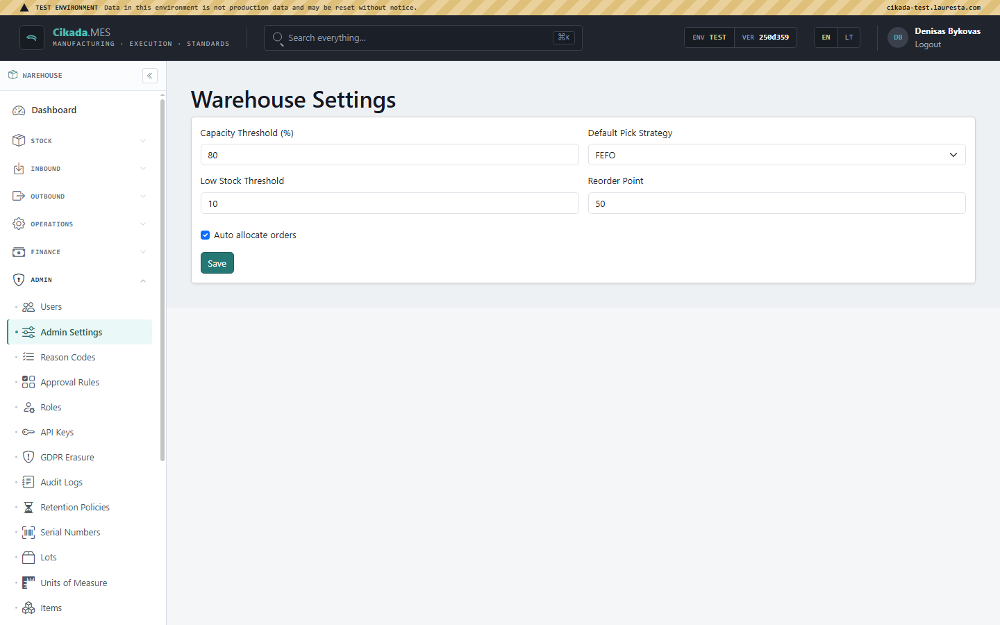
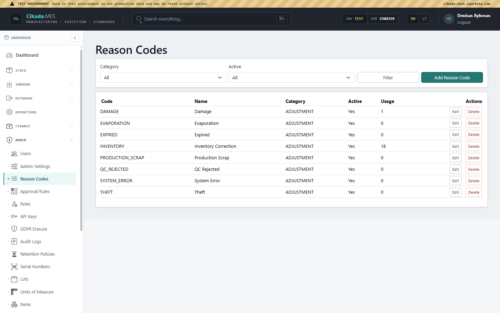

# Sistemos administravimas - nustatymai, priežasčių kodai, patvirtinimo taisyklės

**Būsena:** dalinai

## Kam skirta
Sandėlio modulio (Warehouse) skyrius `(UI: Admin)` skirtas sistemos administratoriui. Šiame puslapyje aprašyti trys bendrų nustatymų ekranai: sandėlio nustatymai `(UI: Admin > Admin Settings)`, atsargų korekcijų priežasčių kodai `(UI: Admin > Reason Codes)` ir patvirtinimo taisyklės `(UI: Admin > Approval Rules)`. Kitos administravimo temos aprašytos atskiruose puslapiuose, žr. skyrių „Susiję puslapiai".

## Prieš pradedant
- Visi trys ekranai yra meniu skiltyje `(UI: Admin)`. Skiltis matoma visiems prisijungusiems, tačiau duomenis keisti gali tik rolė `WarehouseAdmin`.
- Reason Codes sąrašą serveris leidžia skaityti ir rolei `WarehouseManager`; kurti, keisti ir trinti kodus gali tik `WarehouseAdmin`.
- Admin Settings skaityti gali bet kuri rolė nuo `Operator` aukštyn, keisti - tik `WarehouseAdmin`.
- Jei ekrane matote geltoną pranešimą „Admin role required.", šiam stendui nesukonfigūruota administratoriaus rolė; kreipkitės į sistemos administratorių.

## Žingsniai

### 1. Sandėlio nustatymai (Admin Settings)
1. Meniu pasirinkite `(UI: Admin > Admin Settings)`. Atsidaro puslapis `(UI: Warehouse Settings)`.
2. Užpildykite laukus: `(UI: Capacity Threshold (%))` - skaičius nuo 0 iki 100; `(UI: Default Pick Strategy)` - `FEFO` arba `FIFO`; `(UI: Low Stock Threshold)`; `(UI: Reorder Point)` - sveikieji skaičiai, ne mažesni už 0.
3. Pažymėkite arba nuimkite varnelę `(UI: Auto allocate orders)`.
4. Paspauskite `(UI: Save)`. Pasirodo pranešimas „Settings saved successfully", o šalia mygtuko - eilutė „Last updated by ... at ...".

### 2. Priežasčių kodai (Reason Codes)
1. Meniu pasirinkite `(UI: Admin > Reason Codes)`.
2. Sąrašą galima filtruoti: `(UI: Category)` ir `(UI: Active)`, tada paspausti `(UI: Filter)`. Kategorijos: `ADJUSTMENT`, `REVALUATION`, `WRITEDOWN`, `RETURN`.
3. Naujam kodui paspauskite `(UI: Add Reason Code)`. Atsidariusioje formoje `(UI: Create Reason Code)` užpildykite `(UI: Code)`, `(UI: Name)`, `(UI: Category)`, nebūtinai `(UI: Parent)` (rodomi tik kodai be tėvinio kodo) ir `(UI: Description)`; palikite `(UI: Active)` ir paspauskite `(UI: Save)`.
4. Kodui pakeisti eilutėje paspauskite `(UI: Edit)`, pataisykite laukus ir `(UI: Save)`.
5. Kodui pašalinti paspauskite `(UI: Delete)` ir patvirtinkite dialoge `(UI: Delete Reason Code)`. Stulpelyje `(UI: Usage)` rodoma, kiek kartų kodas panaudotas.

### 3. Patvirtinimo taisyklės (Approval Rules)
1. Meniu pasirinkite `(UI: Admin > Approval Rules)`.
2. Paspauskite `(UI: Add Approval Rule)`. Formoje `(UI: Create Approval Rule)` pasirinkite `(UI: Rule Type)` (`COST_ADJUSTMENT`, `WRITEDOWN` arba `TRANSFER`), `(UI: Threshold Type)` (`AMOUNT` arba `PERCENTAGE`), įveskite `(UI: Threshold Value)`, `(UI: Priority)`, pasirinkite `(UI: Approver Role)` ir paspauskite `(UI: Save)`.
3. Taisyklę galima keisti `(UI: Edit)` arba šalinti `(UI: Delete)`.
4. Taisyklei išbandyti skiltyje `(UI: Test Rule Evaluation)` pasirinkite taisyklės tipą, įveskite `(UI: Test Value)` ir paspauskite `(UI: Test Rule)`. Rezultatas: „Requires approval: <rolė>" arba „No approval required."

## Ką reiškia būsenos ir spalvos
- Stulpelis `(UI: Active)` Reason Codes ir Approval Rules sąrašuose rodo `(UI: Yes)` arba `(UI: No)`. Panaudotą priežasties kodą trinti negalima, todėl jį reikia pažymėti kaip neaktyvų.
- Reason Codes eilutės su tėviniu kodu rodomos įtrauktos į dešinę po tėviniu kodu.

## Dažnos klaidos
- „Admin role required." - ekranas atidarytas be administratoriaus rolės konfigūracijos; kreipkitės į administratorių.
- „Cannot delete reason code with usage history. Mark inactive instead." - kodas jau panaudotas; vietoj trynimo atidarykite `(UI: Edit)` ir nuimkite varnelę `(UI: Active)`.
- Forma nepasiduoda su raudonu patikros pranešimu - neįvestas privalomas laukas (`Code`, `Name`) arba reikšmė už leistinų ribų (pvz., `Capacity Threshold (%)` virš 100).

## Dar neįgyvendinta
- Approval Rules: kode nerasta vietų, kur kiti procesai (korekcijos, nurašymai, perkėlimai) skaitytų šias taisykles. Ekranas leidžia taisykles saugoti ir išbandyti, bet realių operacijų jos kol kas nestabdo.
- Admin Settings: sistema realiai naudoja tik `(UI: Reorder Point)` - jis lemia, kurios prekės rodomos pritrūkstančių atsargų sąrašuose Dashboard. `(UI: Capacity Threshold (%))`, `(UI: Default Pick Strategy)`, `(UI: Low Stock Threshold)` ir `(UI: Auto allocate orders)` yra išsaugomi, bet kode nerasta, kad kiti procesai juos skaitytų.

## Susiję puslapiai
- [P-30 Vartotojai, rolės ir API raktai](P-30-vartotojai-roles-api-raktai.md)
- [P-31 Auditas, duomenų saugojimas, GDPR, atsarginės kopijos](P-31-auditas-saugojimas-gdpr-kopijos.md)
- [P-15 Pagrindinių duomenų valdymas](P-15-pagrindinis-duomenu-valdymas.md)
