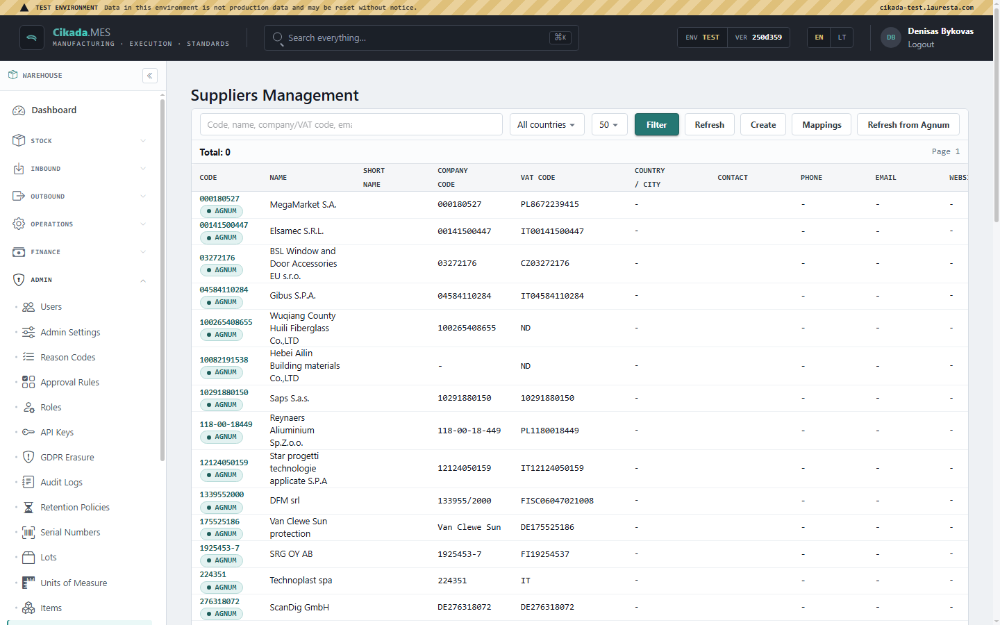
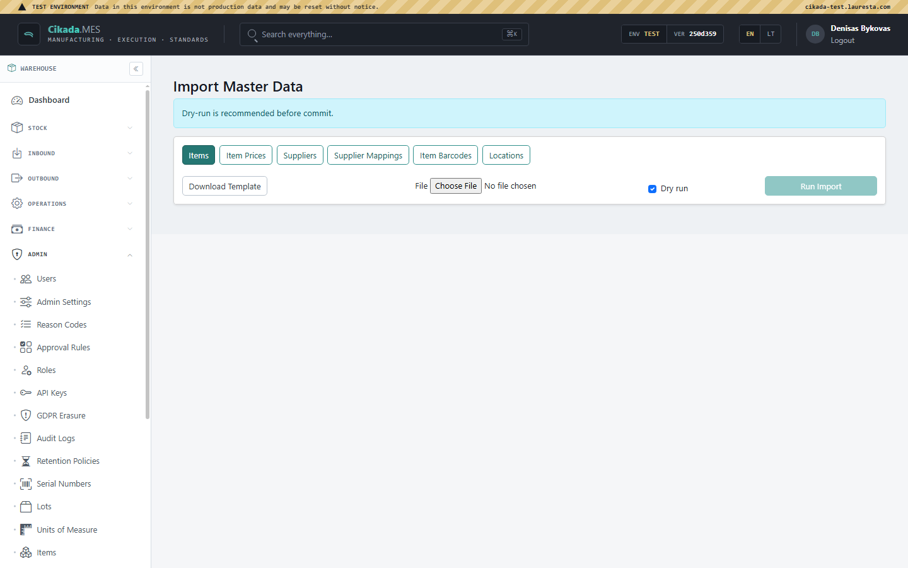

# Pagrindinių duomenų valdymas - tiekėjai, klientai, kainų grupės, importas

**Būsena:** veikia

## Kam skirta
Šis puslapis yra Sandėlio modulio (Warehouse) pagrindinių duomenų apžvalga ir aprašo tiekėjus `(UI: Admin > Suppliers)`, tiekėjų prekių susiejimus `(UI: Admin > Supplier Mappings)`, klientus `(UI: Admin > Customers)`, kainų grupes `(UI: Admin > Price Groups)` ir masinį importą `(UI: Admin > Import Wizard)`. Prekės, kategorijos, matavimo vienetai ir partijos aprašyti puslapyje [P-32](P-32-prekiu-pagrindiniai-duomenys.md); sandėliai, vietos, slotai ir maketas - puslapyje [P-33](P-33-sandeliai-vietos-slotai-maketas.md).

## Prieš pradedant
- Tiekėjus, susiejimus ir kainų grupes kurti bei keisti gali `WarehouseManager` ir `WarehouseAdmin`; peržiūrėti gali ir `Operator`, `QCInspector`.
- Klientų ekranas prieinamas `SalesAdmin`, `WarehouseManager`, `WarehouseAdmin`.
- Tiekėjų atnaujinimą iš Agnum gali paleisti `InventoryAccountant`, `WarehouseManager`, `WarehouseAdmin`.
- Importas `(UI: Import Wizard)` prieinamas tik `WarehouseAdmin`.
- Prieš kurdami tiekėjo prekių susiejimą, sukurkite tiekėją ir prekę.

## Žingsniai

### 1. Tiekėjo sukūrimas ir keitimas
1. Meniu pasirinkite `(UI: Admin > Suppliers)`. Atsidaro puslapis `(UI: Suppliers Management)`.
2. Filtruokite pagal paiešką `(UI: Code, name, company/VAT code, email, phone, country, city)` ir šalį `(UI: All countries)`, tada `(UI: Filter)`.
3. Paspauskite `(UI: Create)`. Dialoge `(UI: Create Supplier)` privalomi tik `(UI: Code)` ir `(UI: Name)`. Kiti laukai: `(UI: Short name)`, `(UI: Company code)`, `(UI: VAT code)`, `(UI: Country)`, `(UI: City)`, `(UI: Contact name)`, `(UI: Phone)`, `(UI: Email)`, `(UI: Website)`, `(UI: Registered address)`, `(UI: Pickup address)`, `(UI: Additional info)`.
4. Paspauskite `(UI: Create Supplier)`. Pakeitimams eilutėje pasirinkite `(UI: Actions)` > `(UI: Edit)` ir `(UI: Save Changes)`.
5. Jei tiekėjas susietas su Agnum (rodomas `(UI: Agnum Client Id)`), sinchronizuoti laukai atnaujinami automatiškai, o rankiniai pakeitimai išsaugomi.

### 2. Tiekėjo duomenys, svarbūs pirkimams
Pirkimo dokumentų (priėmimo) apskaita remiasi šiais tiekėjo duomenimis:
1. `(UI: VAT code)` ir `(UI: Country)`. Iš PVM kodo pirmųjų dviejų raidžių (arba, jei kodo nėra, iš šalies) nustatomas tiekėjo tipas: `LT` - vietinis, ES valstybės kodas - ES tiekėjas, kitas kodas - ne ES tiekėjas. Šis tipas lemia numatytąjį PVM režimą: vietinis, ES įsigijimas arba importas. Tiekėjo tipo tiekėjo dialoge redaguoti negalima; jis nustatomas paspaudus `(UI: Refresh from Agnum)` (tik jei dar nenustatytas). Jei PVM kodo nėra, o šalies pavadinimas neatpažįstamas, tipas lieka nenustatytas ir PVM režimas pasirenkamas pirkimo dokumente.
2. Tiekėjo kortelėje valiutos lauko nėra. Pirkimo valiuta ir kursas nurodomi pirkimo dokumente.
3. Automatiniam užregistravimui tiekėjas turi būti susietas su Agnum klientu (`(UI: Agnum Client Id)`), nebūti pažymėtas kaip dingęs Agnum sistemoje ir būti Agnum kreditoriumi, kitaip dokumento užregistruoti negalima.
4. Paspauskite `(UI: Refresh from Agnum)`: pasirodo pranešimas „Agnum sync: N new, N updated, N missing in Agnum, N code conflicts."
5. ES įsigijimams svarbios ir prekių savybės: 8 skaitmenų CN kodas ir neto svoris, žr. [P-32, 2 žingsnis](P-32-prekiu-pagrindiniai-duomenys.md).

### 3. Tiekėjų prekių susiejimai
1. Meniu pasirinkite `(UI: Admin > Supplier Mappings)`. Šį ekraną taip pat galima atidaryti iš tiekėjų sąrašo mygtuku `(UI: Mappings)`.
2. Filtruokite pagal `(UI: Supplier SKU / supplier / item)` ir `(UI: Supplier)`; paspauskite `(UI: Filter)`.
3. Paspauskite `(UI: Create Mapping)`. Formoje `(UI: Create Supplier Mapping)` pasirinkite `(UI: Supplier)` ir `(UI: Item)`, įveskite `(UI: Supplier SKU)`, `(UI: Lead Time (days))` ir `(UI: Price)`, tada `(UI: Save Mapping)`.
4. Esamam susiejimui pakeisti paspauskite `(UI: Edit)` ir `(UI: Save Changes)`.
5. Susiejimui pašalinti eilutėje paspauskite `(UI: Delete)` ir patvirtinkite dialoge `(UI: Delete mapping)`. Ištrinamas tik susiejimas su tiekėjo prekės kodu; pati prekė ir tiekėjas lieka.
6. Prekės tiekėjų kodus matysite ir prekės detalių puslapyje, bloke `(UI: Suppliers)`: tiekėjas, `(UI: Supplier SKU)`, pristatymo laikas, MOQ ir kaina. Jei prekei kodų nėra, rodomas užrašas „No supplier item codes for this item yet."; nuoroda `(UI: Manage supplier mappings)` atidaro šį ekraną.
7. Tiekėjo prekės kodą galima naudoti ir skenavimui: jei skenuojamas kodas nėra prekės brūkšninis kodas, sistema ieško tiekėjo prekės kodo (didžiosios ir mažosios raidės nesvarbios). Jei kodas priklauso vienai prekei, ji parenkama; jei to paties kodo turi kelios skirtingos prekės, sistema neatspėlioja ir parodo pranešimą, kad skenuoti reikia prekės brūkšninį kodą arba pasirinkti prekę rankiniu būdu.
8. Importuojant prekes iš Agnum, tiekėjo prekės kodas imamas tik iš Agnum tiekėjo kodo arba pagalbinio lauko; prekės pačios kodas čia nekopijuojamas. Jei Agnum tiekėjo kodo neturi, susiejimas nekuriamas.

### 4. Klientai
1. Meniu pasirinkite `(UI: Admin > Customers)`. Atsidaro puslapis `(UI: Customers Management)`; paieška `(UI: Code or name)`, `(UI: Filter)`, `(UI: Refresh)`.
2. Paspauskite `(UI: Create Customer)`. Privalomi `(UI: Name)` ir `(UI: Email)`. Kiti laukai: `(UI: Phone)`, `(UI: Status)` (`(UI: Active)`, `(UI: On Hold)`, `(UI: Inactive)`), `(UI: Payment Terms)` (`(UI: Net 30)`, `(UI: Net 60)`, `(UI: Cash on delivery)`, `(UI: Prepaid)`, `(UI: Credit card)`), `(UI: Credit Limit)` (ne mažesnis už 0), `(UI: Price Group)` (`(UI: None (base price))` arba grupė), `(UI: Billing Address)` (gatvė, miestas, regionas, pašto kodas, šalis) ir `(UI: Shipping Address)`; jei adresas sutampa, pažymėkite `(UI: Shipping address same as billing)`.
3. Kliento kodą sistema suteikia pati. Klientui pakeisti paspauskite `(UI: Edit)`.

### 5. Kainų grupės
1. Meniu pasirinkite `(UI: Admin > Price Groups)`. Skiltyje `(UI: Groups)` paspauskite `(UI: Create Group)`, įveskite `(UI: Code)`, `(UI: Name)`, nurodykite aktyvumą ir `(UI: Create)`.
2. Grupės `(UI: Edit)` ir `(UI: Delete)` mygtukai yra prie eilutės. `(UI: Customers)` atidaro grupės klientus, kur galima `(UI: Assign customer)` (paieška `(UI: Search customers by name or code)`) arba `(UI: Remove)`.
3. Prekių kainas konkrečiai grupei nustatykite prekės detalių puslapyje, žr. [P-32](P-32-prekiu-pagrindiniai-duomenys.md).

### 6. Masinis importas (Import Wizard)
1. Meniu pasirinkite `(UI: Admin > Import Wizard)`. Atsidaro puslapis `(UI: Import Master Data)`.
2. Pasirinkite skirtuką: `(UI: Items)`, `(UI: Item Prices)`, `(UI: Suppliers)`, `(UI: Supplier Mappings)`, `(UI: Item Barcodes)` arba `(UI: Locations)`.
3. Paspauskite `(UI: Download Template)` ir užpildykite atsisiųstą `.xlsx` šabloną.
4. Pasirinkite failą `(UI: File)`. Varnelė `(UI: Dry run)` pagal numatytąją pažymėta - tai tik patikra be įrašymo. Paspauskite `(UI: Run Import)`.
5. Skiltyje `(UI: Import Result)` matote `(UI: Inserted:)`, `(UI: Updated:)`, `(UI: Skipped:)`, `(UI: Errors:)` ir lentelę (`(UI: Row)`, `(UI: Column)`, `(UI: Value)`, `(UI: Message)`). Klaidų ataskaitą parsisiųskite `(UI: Download Error Report)`.
6. Kai patikra be klaidų, `(UI: Commit Changes)` tampa aktyvus ir įrašo duomenis. Kol yra klaidų, rodoma „Commit is disabled until dry-run errors are resolved."

## Ką reiškia būsenos ir spalvos
- Kliento `(UI: Status)`: `(UI: Active)` - aktyvus, `(UI: On Hold)` - sustabdytas, `(UI: Inactive)` - neaktyvus.
- Užrašas „Agnum client N" tiekėjo eilutėje rodo, kad tiekėjas susietas su Agnum klientu.

## Dažnos klaidos
- „Code is required." / „Name is required." - tiekėjo dialoge nepildytas privalomas laukas.
- „Supplier with code '...' already exists." - tiekėjo kodas turi būti unikalus.
- „Email is required.", „Credit limit must be greater than or equal to zero." - kliento dialogo patikros pranešimai.
- „Agnum sync: ... N code conflicts" - Agnum kliento kodas sutapo su kito tiekėjo kodu; toks tiekėjas sukuriamas atskirai, o jo kodas gauna priedą „~<Agnum kliento Id>". Patikrinkite tiekėjų sąrašą.

## Susiję puslapiai
- [P-32 Prekių pagrindiniai duomenys](P-32-prekiu-pagrindiniai-duomenys.md)
- [P-33 Sandėliai, vietos, slotai ir sandėlio maketas](P-33-sandeliai-vietos-slotai-maketas.md)
- [P-14 Sistemos administravimas](P-14-sistemos-administravimas.md)
