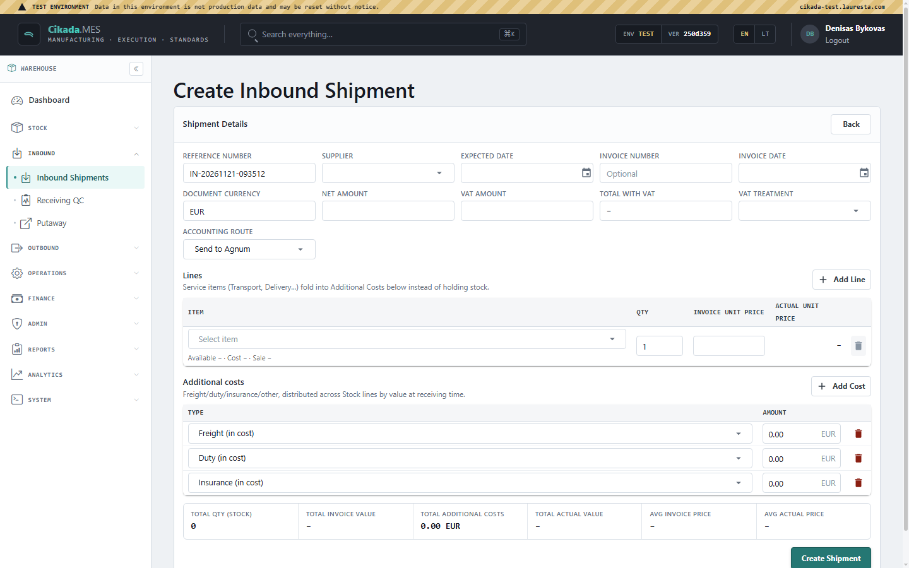
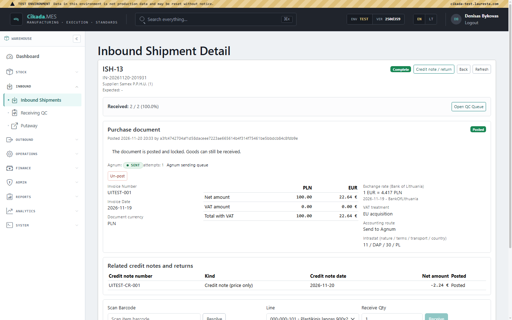

# Pirkimo dokumentas (tiekėjo sąskaita, valiuta, PVM, užregistravimas)

**Būsena:** veikia

## Kam skirta
Sandėlio modulio ekranai (UI: Create Inbound Shipment) ir (UI: Inbound Shipment Detail) skirti įvesti tiekėjo pirkimo sąskaitą kaip vieną dokumentą: tiekėją, valiutą, sumas be PVM ir su PVM, prekių eilutes bei papildomas išlaidas. Užregistravus (UI: Post) dokumentas užrakinamas, atsargų vertė pakoreguojama pagal galutinę sąskaitos sumą, o dokumentas be prekių eilučių išsiunčiamas į apskaitos sistemą Agnum. Vienas pirkimo dokumentas atitinka vieną tiekėjo sąskaitą: jei viena pristatymo siunta turi dvi sąskaitas, sukurkite du dokumentus.

## Prieš pradedant
- Tiekėjas turi būti sukurtas ir susietas su Agnum (žr. [P-15 Pagrindinių duomenų valdymas](P-15-pagrindinis-duomenu-valdymas.md), mygtukas (UI: Refresh from Agnum)). Tiekėjas, kuris nesusietas su Agnum, dingęs iš Agnum arba nėra kreditorius, negali būti ant užregistruojamo dokumento.
- Prekės turi būti sukurtos. Jei dokumentas yra ES įsigijimas, kiekviena atsargų prekė turi turėti 8 skaitmenų prekės kodą ir neto svorį (žr. [P-32 Prekių pagrindiniai duomenys](P-32-prekiu-pagrindiniai-duomenys.md), (UI: Admin > Items) > (UI: Edit)).
- Agnum apskaitos nustatymuose turi būti paskirta taisyklė sąskaitai ir PVM režimui (žr. [P-19 Agnum apskaitos nustatymai ir siuntimo eilė](P-19-agnum-nustatymai-ir-eile.md)). Be jos užregistruoti negalima.
- Dokumentą kurti, taisyti, priimti prekes ir registruoti gali rolės QCInspector, WarehouseManager, WarehouseAdmin. Rankinį kursą įvesti ir panaikinti užregistravimą gali InventoryAccountant, WarehouseManager, WarehouseAdmin.
- Mėnuo, kuriuo datuotas dokumentas, turi būti neuždarytas (žr. [P-22 Mėnesio uždarymas](P-22-menesio-uzdarymas.md)).

## Žingsniai
### 1. Sukurti dokumentą
1. Meniu pasirinkite (UI: Inbound > Inbound Shipments) ir spauskite (UI: + Create Inbound). Atsidaro (UI: Create Inbound Shipment).
2. Užpildykite antraštę: (UI: Reference Number) (privalomas; pasiūlomas automatiškai), (UI: Supplier) (privalomas), (UI: Expected Date), (UI: Invoice Number), (UI: Invoice Date).
3. Nurodykite (UI: Document currency) (trijų raidžių kodas, pvz. EUR, PLN, USD), (UI: Net amount) ir (UI: VAT amount) tiek, kiek parašyta sąskaitoje. (UI: Total with VAT) apskaičiuojamas pats.
4. Pasirinkite (UI: VAT treatment): (UI: Domestic purchase), (UI: EU acquisition) arba (UI: Import). Jei nepasirinksite, taikomas režimas pagal tiekėjo tipą (vietinis, ES, ne ES); jei tipo nėra, registruojant reikės pasirinkti.
5. Pasirinkite (UI: Accounting route): (UI: Send to Agnum) arba (UI: Entered manually in Agnum). Antruoju atveju privalomas laukas (UI: Reason for entering in Agnum manually); dokumentas užregistruojamas sandėlyje, bet į Agnum nesiunčiamas, o buhalteris jį įveda pats.
6. Pasirinkus (UI: EU acquisition), atsiranda Intrastat laukai: (UI: Delivery terms) (pvz. DAP), (UI: Transport mode) (pvz. 30), (UI: Country of dispatch) (dviejų raidžių, pvz. PL) ir (UI: Transaction nature) (numatyta 11). Jie privalomi registruojant.

### 2. Įvesti eilutes ir papildomas išlaidas
1. Skiltyje (UI: Lines) spauskite (UI: Add Line), pasirinkite prekę (UI: Item), (UI: Qty) ir (UI: Invoice unit price) (kaina pagal sąskaitą dokumento valiuta).
2. Stulpelyje (UI: Actual unit price) matoma kaina su paskirstytomis „į savikainą“ papildomomis išlaidomis. Paslaugų prekės (žyma „Service“) atsargų nesukuria – jų suma traktuojama kaip papildoma išlaida.
3. Skiltyje (UI: Additional costs) spauskite (UI: Add Cost), pasirinkite tipą (UI: Type) (prie pavadinimo rodoma „in cost“ – įeina į savikainą, arba „expense“ – nurašoma į išlaidas) ir (UI: Amount). Naujame dokumente iš anksto įtraukiamos eilutės kiekvienam tipui, išskyrus Other; tuščias sumas ištrinkite arba palikite nulines.
4. Apačioje matote (UI: Total Invoice Value), (UI: Total Additional Costs), (UI: Total Actual Value) ir žinutę „Lines and costs: … net amount: …“. Ji žalia, kai eilutės ir išlaidos tiksliai lygios (UI: Net amount); kitaip registruoti negalėsite.
5. Spauskite (UI: Create Shipment). Taisydami esamą dokumentą – (UI: Save Changes). Dokumentą galima taisyti, kol jis neužregistruotas.

### 3. Priimti prekes
Prekių priėmimas daromas dokumento kortelėje, kaip aprašyta [P-01 Prekių priėmimas](P-01-priemimas-inbound.md). Priimti galima ir prieš užregistravimą, ir po jo. Prieš užregistravimą priėmimas vertinamas preliminaria kaina; užregistravus vertė pakoreguojama.

### 4. Užregistruoti dokumentą
1. Atidarykite dokumentą: (UI: Inbound > Inbound Shipments) > (UI: View). Kortelėje yra skiltis (UI: Purchase document) su žyma (UI: Not posted).
2. Skiltyje matote sumas dokumento valiuta ir EUR, (UI: Exchange rate (Bank of Lithuania)) (1 EUR = … valiutos), kurso datą ir šaltinį bei užrašą „Preliminary until the document is posted“. Kursas imamas Lietuvos banko oficialus dokumento datai; jei tą dieną nepaskelbtas, imamas paskutinis ankstesnis; jei dokumento data yra šiandien, o kursas dar nepaskelbtas, registruoti negalima. Po užregistravimo kursas nebekeičiamas.
3. EUR dokumentui kurso nereikia. Kitos valiutos dokumentui buhalterio ar vadovo rolė mato laukus (UI: Manual rate (units per EUR)) ir (UI: Reason for the manual rate); rankinis kursas reikalauja priežasties ir neturi skirtis nuo paskutinio išsaugoto daugiau kaip 1,5 karto.
4. Jei yra neišspręstų problemų, jos išvardytos raudonu sąrašu virš mygtuko. Ištaisykite jas (žr. „Dažnos klaidos“).
5. Spauskite (UI: Post). Pranešimas „Document posted.“ reiškia sėkmę; žyma pasikeičia į (UI: Posted), pasirodo „Posted … by …“ ir užrašas „The document is posted and locked. Goods can still be received.“

### 5. Sekti siuntimą į Agnum
1. Užregistruoto dokumento skiltyje (UI: Purchase document) eilutėje „Agnum:“ rodoma siuntimo eilės būsena (Waiting, Sending, Sent, Unknown, Needs review, Annulled) ir bandymų skaičius. Nuoroda (UI: Agnum sending queue) atidaro eilę, žr. [P-19](P-19-agnum-nustatymai-ir-eile.md).
2. Jei maršrutas (UI: Entered manually in Agnum), rodoma ši žyma ir priežastis.

### 6. Panaikinti užregistravimą
1. Užregistruotame dokumente spauskite (UI: Un-post). Mygtuką mato tik buhalterio ar vadovo rolės.
2. Jei dokumentas į Agnum dar nebuvo nusiųstas, jis iškart grįžta į (UI: Not posted). Jei jau nusiųstas, sukuriama anuliavimo eilutė; dokumentas grįžta į (UI: Not posted), kai Agnum patvirtina ištrynimą. Atsargų vertė sugrįžta į buvusią prieš užregistravimą.
3. Panaikinti negalima, jei po užregistravimo priimta prekių, jei yra užregistruotos papildomų išlaidų sąskaitos (jas pirmiausia panaikinkite) arba mėnuo uždarytas.

## Ką reiškia būsenos ir spalvos
Sandėlio modulio dokumento kortelėje (UI: Inbound Shipment Detail) yra dvi nepriklausomos būsenos. Priėmimo būsena (Draft, Partial, Complete) rodo tik priimtą kiekį. Užregistravimo būsena rodo, ar dokumentas apskaitytas: (UI: Not posted) (pilka) arba (UI: Posted) (žalia). Užregistravus dokumento antraštės, kainų ir išlaidų keisti negalima.

PVM režimo reikšmės: (UI: Domestic purchase) – pirkimas Lietuvoje su PVM; (UI: EU acquisition) – įsigijimas iš ES, Intrastat laukai privalomi; (UI: Import) – pirkimas iš ne ES šalies. Muito ir importo PVM pagal deklaraciją sandėlyje neįvedami – juos į Agnum suveda buhalteris.

## Dažnos klaidos
Neužregistravus rodomi tokie pranešimai (jie rodomi raudonu sąrašu):
- „Enter the supplier invoice number.“ ir „Enter the supplier invoice date.“ – užpildykite (UI: Invoice Number) ir (UI: Invoice Date), spauskite (UI: Edit).
- „Enter the net and VAT amounts from the invoice.“ – įveskite (UI: Net amount) ir (UI: VAT amount).
- „Lines and additional costs do not add up to the net amount.“ – eilučių (kiekis × kaina) ir išlaidų suma turi būti lygi (UI: Net amount) iki cento.
- „This invoice number is already used for this supplier in this year.“ – tas pats tiekėjas, sąskaitos numeris ir metai jau yra.
- „The supplier cannot be posted to Agnum.“ – tiekėjas nesusietas su Agnum arba nėra kreditorius; atnaujinkite tiekėjus pagal P-15.
- „No Agnum posting rule is set for this stock account and VAT treatment.“ – trūksta taisyklės skiltyje (UI: Postings); žr. P-19.
- „The items belong to different stock accounts. Split the shipment.“ – dokumente prekės iš skirtingų atsargų sąskaitų; sukurkite du dokumentus.
- „Choose the VAT treatment.“ – pasirinkite (UI: VAT treatment).
- „Intrastat fields (delivery terms, transport mode, dispatch country, transaction nature) are required for an EU acquisition.“ – užpildykite Intrastat laukus.
- „Every stock item of an EU acquisition needs an 8-digit commodity code and a net weight.“ – papildykite prekių kortelę.
- „The exchange rate for today is not published yet.“ ir „There is no exchange rate for the document date.“ – palaukite paskelbimo arba įveskite rankinį kursą.
- „A manual rate needs a reason.“, „The rate differs from the last saved rate by more than 1.5 times.“ – ištaisykite rankinį kursą.
- „The month of this document is closed; nothing dated in it can be posted or un-posted.“ – buhalteris turi atidaryti mėnesį (P-22).
- „A reason is required when the document is entered in Agnum manually.“ – įrašykite priežastį.
- (UI: Un-post) pranešimai: „Un-post the additional cost invoices of this shipment first.“, „Goods were received after posting; un-posting would misstate the stock value.“

## Susiję procesai
- [P-01 Prekių priėmimas](P-01-priemimas-inbound.md) – prekių priėmimas ir kokybės patikra.
- [P-17 Tiekėjo kreditinės sąskaitos ir grąžinimai](P-17-tiekejo-kreditines-ir-grazinimai.md) – užregistruoto dokumento taisymas.
- [P-18 Papildomų išlaidų sąskaitos](P-18-papildomu-islaidu-saskaitos.md) – kito tiekėjo sąskaitos už pervežimą ar muitinę.
- [P-19 Agnum apskaitos nustatymai ir siuntimo eilė](P-19-agnum-nustatymai-ir-eile.md)
- [P-21 Intrastat atvykimai](P-21-intrastat-atvykimai.md)
