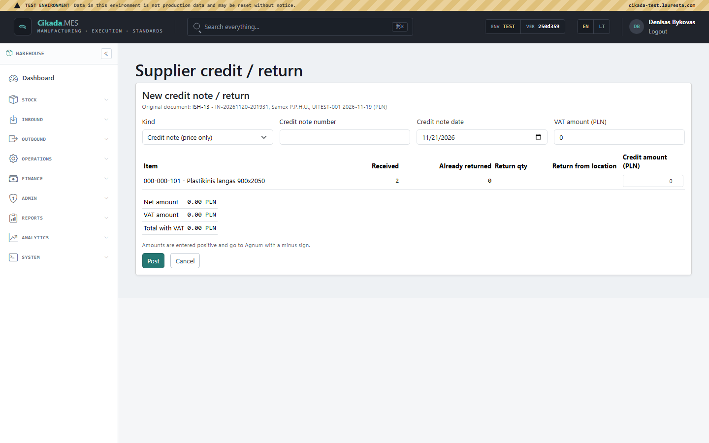
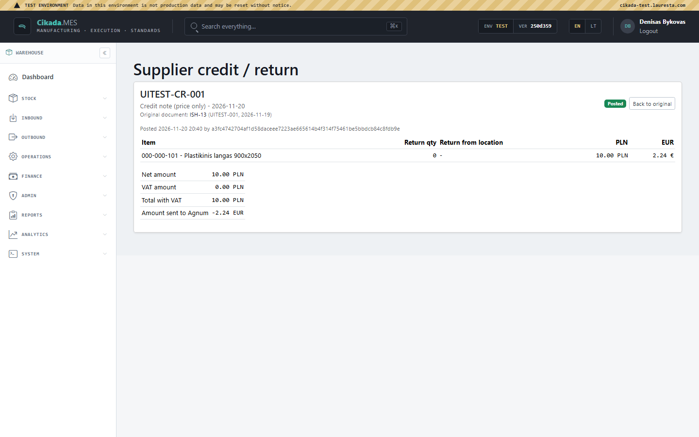

# Tiekėjo kreditinės sąskaitos ir prekių grąžinimas tiekėjui

**Būsena:** dalinai

## Kam skirta
Sandėlio modulio ekranas (UI: Supplier credit / return) skirtas įvesti tiekėjo kreditinę sąskaitą užregistruotam pirkimo dokumentui: arba tik kainos sumažinimą (UI: Credit note (price only)), arba prekių grąžinimą tiekėjui su kreditine sąskaita (UI: Supplier return (goods back)). Pirkimo dokumentas po užregistravimo užrakintas, todėl nepristatytas kiekis ar neteisinga kaina taisomi tik kreditiniu dokumentu. Kreditinis dokumentas į Agnum išsiunčiamas su minuso ženklu.

## Prieš pradedant
- Pirminis pirkimo dokumentas turi būti užregistruotas (UI: Posted), žr. [P-16 Pirkimo dokumentas](P-16-pirkimo-dokumentas.md). Kitaip rodoma „The original purchase document must be posted first.“
- Kurti ir registruoti kreditinį dokumentą gali rolės QCInspector, WarehouseManager, WarehouseAdmin; peržiūrėti – ir Operator.
- Grąžinant prekes, vietoje, iš kurios grąžinama, turi būti pakankamai atsargų.
- Dokumento data neturi patekti į uždarytą mėnesį (P-22).

## Žingsniai
### 1. Atidaryti kreditinio dokumento formą
1. Meniu pasirinkite (UI: Inbound > Inbound Shipments) ir atidarykite užregistruotą dokumentą (UI: View).
2. Dokumento kortelės viršuje spauskite (UI: Credit note / return). Mygtukas rodomas tik užregistruotam dokumentui. Atsidaro (UI: New credit note / return) su nuoroda į pirminį dokumentą (UI: Original document).

### 2. Užpildyti dokumentą
1. Pasirinkite (UI: Kind): (UI: Credit note (price only)) arba (UI: Supplier return (goods back)).
2. Įveskite (UI: Credit note number), (UI: Credit note date) (numatyta šiandien) ir (UI: VAT amount) dokumento valiuta.
3. Lentelėje kiekvienai pirminio dokumento eilutei matote (UI: Received) ir (UI: Already returned). Prie eilutės įveskite (UI: Credit amount) (suma be PVM, teigiama).
4. Jei pasirinkote (UI: Supplier return (goods back)), kiekvienai prekei papildomai įveskite (UI: Return qty) ir (UI: Return from location) (esamos vietos kodas). Įvedus kiekį, suma pasiūlomas kaip kiekis × pirminė kaina; ją galima pakeisti pagal kreditinę sąskaitą.
5. Apačioje rodomos (UI: Net amount), (UI: VAT amount), (UI: Total with VAT). Užrašas „Amounts are entered positive and go to Agnum with a minus sign.“ primena, kad sumas reikia įvesti teigiamas.

### 3. Užregistruoti
1. Spauskite (UI: Post). Dokumentas sukuriamas ir iškart užregistruojamas; atsidaro jo kortelė su žyma (UI: Posted) ir eilute (UI: Amount sent to Agnum).
2. Jei yra problemų, jos išvardytos raudonu sąrašu ir dokumentas lieka neužregistruotas; (UI: Cancel) grąžina į pirminį dokumentą.
3. Prekių grąžinimas nurašo prekes iš nurodytos vietos pagal vidutinę vertę. Skirtumas tarp kreditinės sumos ir nurašytos vertės priskiriamas likusiam to artikulo likučiui, bet ne daugiau nei jo vertė; likusi dalis rodoma kaip kainų skirtumas ir į atsargų vertę neįeina.
4. Kreditinis dokumentas įrašomas į siuntimo eilę (žr. [P-19](P-19-agnum-nustatymai-ir-eile.md)). Pirminio dokumento kortelėje atsiranda skiltis (UI: Related credit notes and returns) su nuoroda.

## Ką reiškia būsenos ir spalvos
Kreditinio dokumento kortelėje (UI: Supplier credit / return) žyma (UI: Not posted) (pilka) reiškia, kad dokumentas sukurtas, bet neužregistruotas; tada kortelėje yra mygtukas (UI: Post). (UI: Posted) (žalia) reiškia, kad dokumentas užrakintas. Pirminio dokumento skiltyje (UI: Related credit notes and returns) stulpelis (UI: Kind) rodo, ar tai (UI: Credit note (price only)), ar (UI: Supplier return (goods back)).

## Dažnos klaidos
- „The original purchase document must be posted first.“ – pirmiausia užregistruokite pirminį dokumentą.
- „A supplier return needs a returned quantity.“ – įveskite (UI: Return qty).
- „A price-only credit note cannot return goods; choose supplier return.“ – su grąžinamu kiekiu pasirinkite (UI: Supplier return (goods back)).
- „The returned quantity is more than was received.“ – grąžinamas kiekis viršija priimtą (atsižvelgiant į jau grąžintą).
- „Choose an existing location the goods are returned from.“ – (UI: Return from location) turi būti esamos vietos kodas.
- „There is not enough stock at the return location.“ – nurodytoje vietoje atsargų mažiau; patikrinkite (UI: Stock > Location Balance).
- „The credits would exceed the net amount of the original document.“ – visų kreditų suma negali viršyti pirminio dokumento sumos be PVM.
- „A line does not belong to the original document.“ – eilutė nėra iš pirminio dokumento.
- Taip pat taikomi P-16 pranešimai apie kursą, uždarytą mėnesį, nustatymų taisyklę ir kt.

## Dar neįgyvendinta
- Užregistruoto kreditinio dokumento užregistravimo panaikinimo (Un-post) ekrane nėra: ši funkcija blueprint dokumente pažymėta kaip nepadaryta.
- Atskiro kreditinių dokumentų sąrašo nėra; jie matomi tik pirminio pirkimo dokumento kortelėje.
- Siuntimo eilėje kreditinio dokumento eilutė pavadinama (UI: Additional cost invoice) ir nuoroda veda į (UI: Additional cost invoices); tai ekrano netikslumas, dokumentas yra kreditinis.

## Susiję procesai
- [P-16 Pirkimo dokumentas](P-16-pirkimo-dokumentas.md)
- [P-01 Prekių priėmimas](P-01-priemimas-inbound.md) – „Close with shortage“ nekeičia atsargų; trūkumas po užregistravimo tvarkomas kreditine sąskaita.
- [P-22 Mėnesio uždarymas](P-22-menesio-uzdarymas.md)
