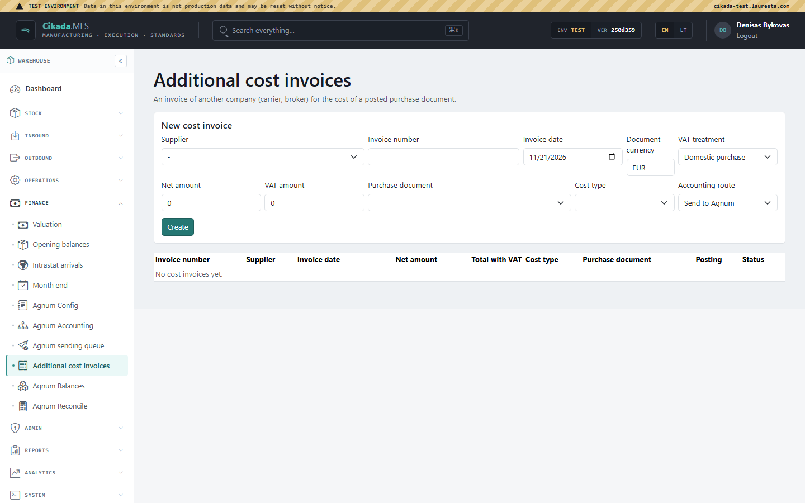

# Kito tiekėjo papildomų išlaidų sąskaitos

**Būsena:** veikia

## Kam skirta
Sandėlio modulio ekranas (UI: Additional cost invoices) skirtas suvesti kitos įmonės (vežėjo, ekspeditoriaus, muitinės tarpininko) sąskaitą už užregistruoto pirkimo dokumento išlaidas. Tokia sąskaita yra atskiras dokumentas su savo tiekėju, numeriu, valiuta ir PVM; ji registruojama ir į Agnum siunčiama atskirai, o jei išlaida „įeina į savikainą“, paskirstoma pirkimo dokumento prekėms.

## Prieš pradedant
- Pagrindinis pirkimo dokumentas turi būti užregistruotas (UI: Posted); sąrašas (UI: Purchase document) rodo tik tokius (iki 500 naujausių), žr. [P-16](P-16-pirkimo-dokumentas.md).
- Sąskaitos tiekėjas turi būti sukurtas ir susietas su Agnum.
- Išlaidų tipai ir jų sąskaitos nustatomos skiltyje (UI: Extra costs) ekrane (UI: Agnum accounting configuration), žr. [P-19](P-19-agnum-nustatymai-ir-eile.md).
- Peržiūrėti gali rolės Operator ir aukštesnės; kurti ir registruoti – QCInspector, WarehouseManager, WarehouseAdmin; panaikinti užregistravimą (siuntimo eilės veiksmas) – InventoryAccountant, WarehouseManager, WarehouseAdmin.

## Žingsniai
### 1. Sukurti sąskaitą
1. Meniu pasirinkite (UI: Finance > Additional cost invoices). Atsidaro puslapis su forma (UI: New cost invoice) ir sąrašu žemiau.
2. Užpildykite: (UI: Supplier), (UI: Invoice number), (UI: Invoice date), (UI: Document currency), (UI: VAT treatment) ((UI: Domestic purchase) / (UI: EU acquisition) / (UI: Import)), (UI: Net amount), (UI: VAT amount).
3. Lauke (UI: Purchase document) pasirinkite pagrindinį užregistruotą pirkimo dokumentą, o (UI: Cost type) – išlaidų tipą; prie pavadinimo rodoma „in cost“ (į savikainą) arba „expense“ (į išlaidas).
4. (UI: Accounting route): (UI: Send to Agnum) arba (UI: Entered manually in Agnum) (tada įveskite (UI: Reason for entering in Agnum manually)).
5. Spauskite (UI: Create). Sąskaita atsiranda sąraše su būsena (UI: Not posted).

### 2. Užregistruoti
1. Sąraše prie eilutės spauskite (UI: Post). Pranešimas „Document posted.“ reiškia sėkmę; klaidų atveju virš formos rodomas raudonas sąrašas.
2. Jei išlaida „įeina į savikainą“, jos suma pasiskirsto pagrindinio dokumento prekėms; dalis, tenkanti jau sunaudotoms prekėms, rodoma kaip kainų skirtumas. Jei „expense“ – suma eina į išlaidų sąskaitą ir prekių vertės nekeičia.
3. Stulpelyje (UI: Status) matoma siuntimo į Agnum eilės būsena (žr. [P-19](P-19-agnum-nustatymai-ir-eile.md)).

### 3. Panaikinti užregistravimą
Užregistruotos sąskaitos eilutėje spauskite (UI: Un-post). Jei sąskaita į Agnum dar nenusiųsta, ji iškart grįžta į (UI: Not posted); kitu atveju sukuriamas anuliavimas ir sąskaita grįžta po Agnum patvirtinimo. Pagrindinio pirkimo dokumento užregistravimą galima panaikinti tik pirmiausia panaikinus šias sąskaitas.

## Ką reiškia būsenos ir spalvos
Ekrano (UI: Additional cost invoices) stulpelyje (UI: Posting) rodoma (UI: Posted) arba (UI: Not posted). Stulpelyje (UI: Status) – siuntimo būsena (Waiting, Sending, Sent, Unknown, Needs review, Annulled) arba žyma (UI: Entered manually in Agnum).

## Dažnos klaidos
- „Amounts must be greater than or equal to 0.“ – sumos negali būti neigiamos.
- „Supplier does not exist.“, „Basis shipment does not exist.“, „Unknown additional cost type“ – pasirinkite tiekėją, pagrindinį dokumentą ir tipą iš sąrašų.
- Registruojant rodomi tie patys pranešimai kaip P-16: nėra kurso, nėra taisyklės PVM režimui, uždarytas mėnuo, tiekėjas nesusietas su Agnum ir pan.
- Pirkimo dokumento sąraše nėra reikiamo dokumento – jis dar neužregistruotas.

## Susiję procesai
- [P-16 Pirkimo dokumentas](P-16-pirkimo-dokumentas.md) – išlaidos, įvestos paties tiekėjo sąskaitoje, įrašomos pačiame dokumente.
- [P-19 Agnum apskaitos nustatymai ir siuntimo eilė](P-19-agnum-nustatymai-ir-eile.md)
