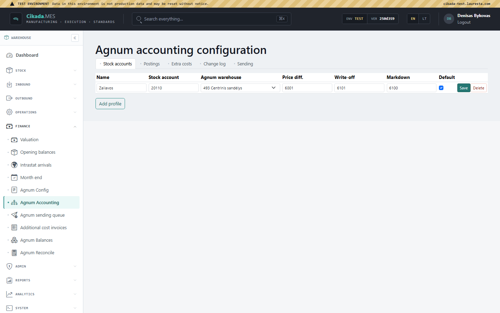
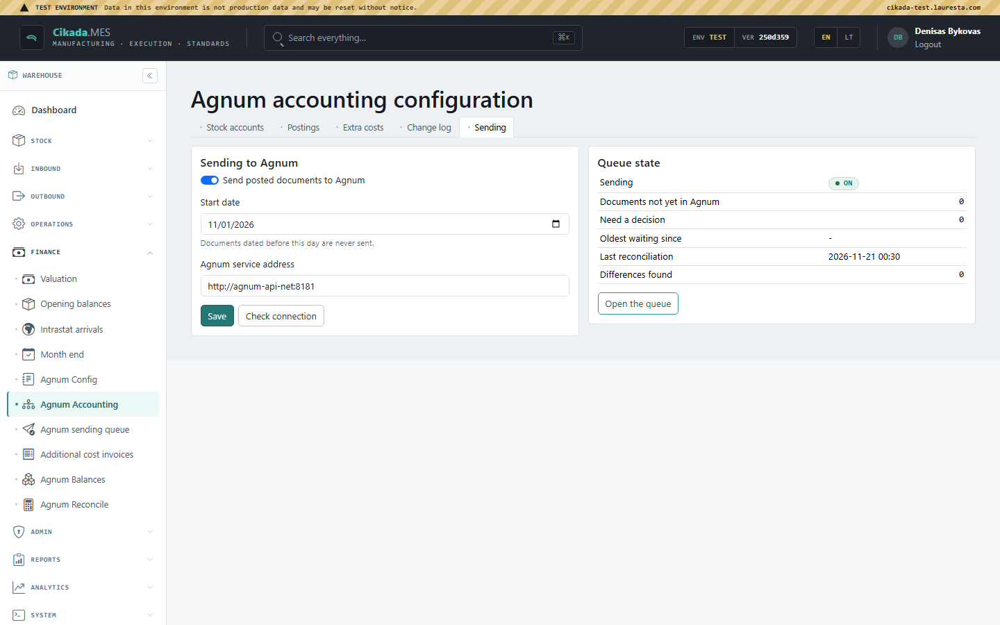
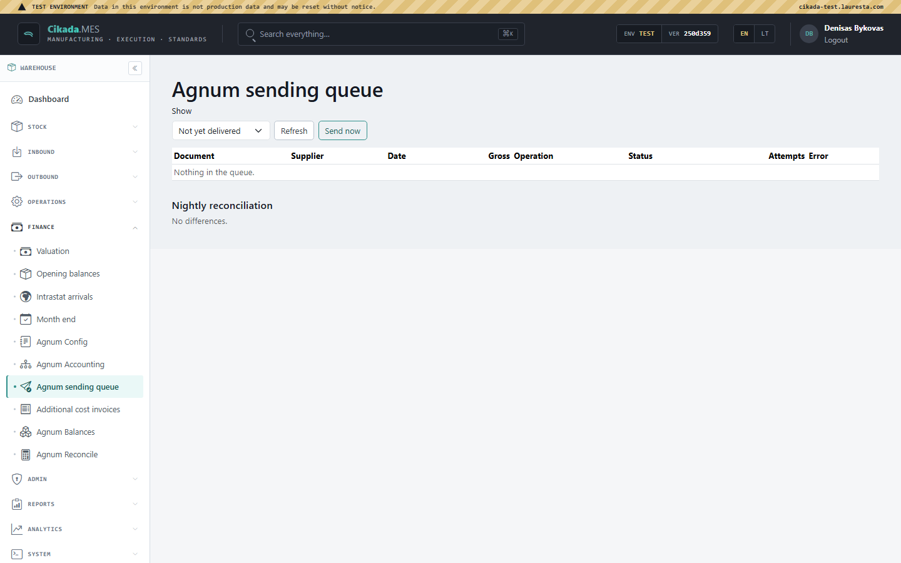

# Agnum apskaitos nustatymai ir siuntimo eilė

**Būsena:** veikia

## Kam skirta
Sandėlio modulio ekranas (UI: Agnum accounting configuration) skirtas nustatyti, kaip užregistruoti pirkimo dokumentai patenka į Agnum: kokia atsargų sąskaita, Agnum sandėlis, buhalterinių įrašų schema ir PVM kodas taikomi, kurios išlaidos eina į savikainą, ir ar siuntimas įjungtas. Ekranas (UI: Agnum sending queue) rodo kiekvieno dokumento siuntimo būseną ir leidžia pakartoti, pažymėti kaip įvestą rankiniu būdu arba panaikinti užregistravimą. Abu ekranus naudoja buhalteris ir sandėlio vadovas.

## Prieš pradedant
- Prieiga: InventoryAccountant, WarehouseManager, WarehouseAdmin.
- Sandėlio paslauga turi pasiekti Agnum paslaugą: schemų, sandėlių, sąskaitų ir PVM kodų sąrašai nuskaitomi iš Agnum. Jei Agnum nepasiekiamas, puslapis rodo „Agnum lists could not be loaded: …“ ir sąrašai tušti.
- Tiekėjai turi būti sinchronizuoti iš Agnum (žr. [P-15](P-15-pagrindinis-duomenu-valdymas.md)).

## Žingsniai
### 1. Atsargų sąskaitos (Stock accounts)
1. Meniu pasirinkite (UI: Finance > Agnum Accounting). Atsidaro (UI: Agnum accounting configuration) su kortelėmis (UI: Stock accounts), (UI: Postings), (UI: Extra costs), (UI: Change log), (UI: Sending).
2. Kortelėje (UI: Stock accounts) spauskite (UI: Add profile) ir užpildykite: (UI: Name), (UI: Stock account) (Agnum sąskaita, pvz. 20110), (UI: Agnum warehouse) (sąrašas iš Agnum), (UI: Price diff.), (UI: Write-off), (UI: Markdown) (kainų skirtumų, nurašymo ir nukainojimo sąskaitos) ir (UI: Default) (numatytasis profilis).
3. Spauskite (UI: Save) prie eilutės; (UI: Delete) pašalina profilį.
4. Ekrane nėra kategorijos susiejimo su profiliu; šis susiejimas galimas tik per API, o kitos kategorijos naudoja numatytąjį profilį.

### 2. Įrašų taisyklės (Postings)
1. Atidarykite (UI: Postings). Pirmiausia išsaugokite naujus profilius, kitaip rodoma „Save new profiles before adding postings.“
2. Spauskite (UI: Add posting). Pasirinkite (UI: Profile), (UI: VAT treatment) (Domestic purchase / EU acquisition / Import), (UI: Agnum scheme) ir, tik vietiniam pirkimui, (UI: VAT code). Schemos suskirstytos: viršuje „Debit this stock account“ (schemos, kurios debetuoja šią atsargų sąskaitą), žemiau „Other schemes“. Lauke „Filter Agnum schemes (number or name)“ galima ieškoti pagal numerį ar pavadinimą.
3. Spauskite (UI: Save). Sėkmę rodo žinutė „Saved“. Išsaugoti nepavyks, jei pasirinktoje schemoje nėra eilutės su šios atsargų sąskaitos debetu, vietiniam pirkimui – eilutės su PVM sąskaitos debetu, o kiekvienai išlaidų sąskaitai – eilutės su tokiu debetu; pranešimas nurodo trūkstamas eilutes.
4. Kol profiliui ir PVM režimui nėra taisyklės, tokio dokumento užregistruoti nepavyks („No Agnum posting rule is set for this stock account and VAT treatment.“).

### 3. Papildomos išlaidos (Extra costs)
1. Atidarykite (UI: Extra costs). Pradiniai tipai: Freight, Duty, Insurance, Other.
2. Redaguokite (UI: Name), (UI: Included in cost) (įeina į prekių savikainą) ir (UI: Expense account) (Agnum sąskaita, rodoma tik kai išlaida neįeina į savikainą), (UI: Active). (UI: Save) išsaugo, (UI: Add cost type) prideda naują. Kodo (UI: Code) po išsaugojimo keisti negalima.

### 4. Pakeitimų žurnalas (Change log)
Kortelėje (UI: Change log) matote kiekvieną pakeitimą: kada, kas, objektas, veiksmas, reikšmė prieš ir po.

### 5. Siuntimo nustatymai (Sending)
1. Atidarykite (UI: Sending). Skiltyje (UI: Sending to Agnum) pažymėkite (UI: Send posted documents to Agnum), nurodykite (UI: Start date) (anksčiau datuoti dokumentai niekada nesiunčiami) ir spauskite (UI: Save).
2. (UI: Agnum service address) tik skaitomas. (UI: Check connection) patikrina ryšį ir parodo „Connected. Warehouses in Agnum: N.“ arba „No connection: …“.
3. Skiltyje (UI: Queue state) matote: (UI: Sending) – On/Off, (UI: Documents not yet in Agnum), (UI: Need a decision), (UI: Oldest waiting since), (UI: Last reconciliation), (UI: Differences found). (UI: Open the queue) atidaro siuntimo eilę.

### 6. Siuntimo eilė
1. Meniu pasirinkite (UI: Finance > Agnum sending queue). Filtre (UI: Show) pasirinkite (UI: Not yet delivered) (numatyta), (UI: All) arba konkrečią būseną.
2. Eilutėje matote dokumentą ((UI: Purchase document) arba kitą tipą), tiekėją, datą, sumą, operaciją ((UI: Post) arba (UI: Annul)), būseną, bandymus ir klaidą. Dokumento numeris yra nuoroda.
3. (UI: Send now) paleidžia siuntimą nelaukiant; (UI: Refresh) perkrauna sąrašą.
4. (UI: Retry) grąžina eilutę į „Waiting“ ir nunulina bandymus (rodomas būsenoms Waiting, Unknown, Needs review).
5. (UI: Mark manual) naudokite, kai buhalteris dokumentą įvedė Agnum pats: įveskite (UI: Reason for entering in Agnum manually) ir spauskite (UI: Mark manual); eilutė tampa „Annulled“, o dokumento maršrutas – „Entered manually in Agnum“.
6. (UI: Un-post) prašo patvirtinimo „The document returns to NotPosted…“; patvirtinus dokumentas Agnum ištrinamas (jei ten yra), sandėlyje grįžta į „Not posted“.
7. Apačioje (UI: Nightly reconciliation) rodo naktinio palyginimo su Agnum skirtumus: (UI: Missing in Agnum), (UI: Differs), (UI: Unexpected in Agnum), (UI: Entered in Agnum outside Warehouse), (UI: Manual document not found).

## Ką reiškia būsenos ir spalvos
Ekrano (UI: Agnum sending queue) stulpelyje (UI: Status) rodomos šios būsenos.
- Waiting (Pending) – dokumentas laukia eilėje. Su užrašu „Held: sending is off or the date is before the start date“ – eilė jį laiko, nes siuntimas išjungtas arba dokumento data ankstesnė už pradžios datą.
- Sending – siunčiamas dabar.
- Sent – Agnum priėmė ir apskaitė dokumentą.
- Unknown (rodoma „Unknown, will check“) – atsakymo negauta (tinklo klaida); kitas bandymas pirmiausia pasitikrina, ar Agnum jau turi dokumentą, ir dubliavimo nesukuria.
- Needs review – Agnum atmetė dokumentą arba po kelių bandymų (1, 5, 15, 60 min.) nepavyko; reikia žmogaus sprendimo.
- Annulled – dokumentas išimtas iš eilės (anuliuotas arba pažymėtas kaip įvestas rankiniu būdu).
Siuntėjas dirba kas minutę. Vieno tiekėjo dokumentai siunčiami eilės tvarka: kol ankstesnis nėra Sent, kiti laukia.

## Dažnos klaidos
- Dokumentas nesiunčiamas, rodoma „Held…“ – patikrinkite (UI: Sending) kortelę: ar įjungta, ar (UI: Start date) ne vėlesnė už dokumento datą.
- „Agnum lists could not be loaded“ – Agnum paslauga nepasiekiama; naudokite (UI: Check connection).
- Needs review su klaida – perskaitykite stulpelį (UI: Error), ištaisykite priežastį (pvz., taisyklę ar tiekėją) ir spauskite (UI: Retry); jei dokumentą įvedėte Agnum patys – (UI: Mark manual).
- „A row in status … cannot be retried.“ – pakartoti galima tik Waiting, Unknown, Needs review.
- Uždaryti mėnesio negalima, kol eilėje yra eilučių ne Sent / Annulled – žr. [P-22](P-22-menesio-uzdarymas.md).

## Susiję procesai
- [P-16 Pirkimo dokumentas](P-16-pirkimo-dokumentas.md)
- [P-08 Agnum integracija](P-08-agnum-integracija.md)
- [P-22 Mėnesio uždarymas](P-22-menesio-uzdarymas.md)
