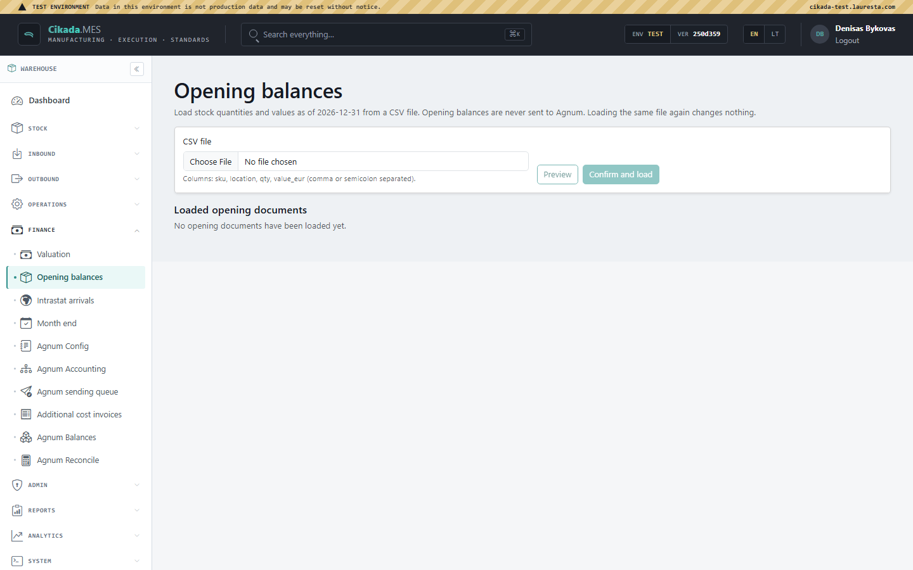

# Pradiniai likučiai iš CSV failo

**Būsena:** veikia

## Kam skirta
Sandėlio modulio ekranas (UI: Opening balances) skirtas vieną kartą įkelti atsargų kiekius ir vertes 2026-12-31 data iš CSV failo, kai pradedama dirbti su nauju apskaitos metu. Įkėlus sukuriamas kiekis vietose ir pradinė vertė EUR pagal atsargų sąskaitas. Pradiniai likučiai į Agnum niekada nesiunčiami. Ekraną naudoja buhalteris ir sandėlio vadovas.

## Prieš pradedant
- Prieiga: InventoryAccountant, WarehouseManager, WarehouseAdmin.
- Prekės (pagal SKU) ir sandėlio vietos jau sukurtos (žr. [P-15](P-15-pagrindinis-duomenu-valdymas.md) ir [P-33](P-33-sandeliai-vietos-slotai-maketas.md)). Vietos turi būti sandėlio viduje; išorinės vietos (pvz. tiekėjo) netinka.
- CSV failas: pirmoje eilutėje antraštė su stulpeliais `sku`, `location`, `qty`, `value_eur` (atskyrimas kableliu arba kabliataškiu). Kiekviena eilutė – vienas SKU vienoje vietoje, kiekis didesnis už nulį, vertė EUR ne neigiama.
- Buhalteris turi žinoti kiekvienos atsargų sąskaitos likutį Agnum 31.12 sulyginimui.

## Žingsniai
### 1. Įkelti failą ir peržiūrėti
1. Meniu pasirinkite (UI: Finance > Opening balances). Atsidaro (UI: Opening balances).
2. Lauke (UI: CSV file) pasirinkite failą. Peržiūra paleidžiama automatiškai; ją galima pakartoti mygtuku (UI: Preview).
3. Jei failas jau įkeltas, rodoma „This file is already loaded as …; nothing was changed.“ Pakartotinis to paties failo įkėlimas nieko nekeičia.
4. Jei yra klaidingų eilučių, rodoma „N row(s) have errors. Fix the file and upload it again.“ Klaidingos eilutės paryškintos, o stulpelyje (UI: Errors) nurodyta priežastis.

### 2. Sulyginti su Agnum
1. Skiltyje (UI: Totals per stock account) kiekvienai atsargų sąskaitai matote eilučių skaičių, kiekį ir vertę EUR.
2. Stulpelyje (UI: Agnum balance on 31.12) įveskite sąskaitos likutį Agnum; stulpelis (UI: Difference) parodo skirtumą. Tai tik palyginimas ekrane, nieko neišsaugo.

### 3. Patvirtinti
1. Kai klaidų nėra ir failas dar neįkeltas, spauskite (UI: Confirm and load).
2. Sėkmės atveju sukuriamas pradinių likučių dokumentas, o sąrašas (UI: Loaded opening documents) rodo jo numerį, failą, datą, eilučių skaičių, kiekį, vertę, kas ir kada įkėlė.
3. Patvirtinimas negrįžtamas: dokumento ekrane ištrinti nėra. Klaidas taisykite per korekcijas ar nukainojimą (žr. [P-07](P-07-atsargu-vertinimas-valuation.md) ir [P-06](P-06-atsargu-koregavimas-adjustments.md)).

## Dažnos klaidos
- „The file is empty.“ – failas tuščias.
- „The header must contain the columns sku, location, qty, value_eur.“ – patikrinkite antraštę.
- „Unknown item“ / „Unknown location“ – SKU ar vietos kodo sistemoje nėra.
- „Location is outside the stock“ – vieta nėra sandėlio viduje.
- „Quantity must be greater than zero“, „Negative quantity“, „Negative value“, „Not a valid number“ – ištaisykite reikšmes.
- „Duplicate item and location“ – ta pati pora kartojasi; sudėkite eilutes.
- „SKU is missing“ / „Location is missing“ – užpildykite laukus.

## Susiję procesai
- [P-07 Atsargų vertinimas](P-07-atsargu-vertinimas-valuation.md)
- [P-22 Mėnesio uždarymas](P-22-menesio-uzdarymas.md) – pradiniai likučiai rodomi atskiru stulpeliu.
