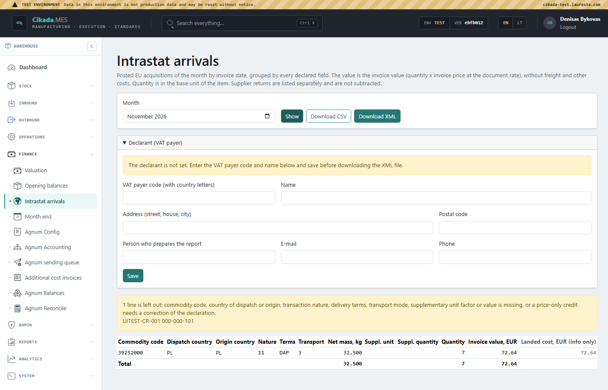

# Intrastat atvykimų ataskaita

**Būsena:** veikia

## Kam skirta
Sandėlio modulio ekranas (UI: Intrastat arrivals) skirtas parengti mėnesio Intrastat atvykimų duomenis: paskelbti (užregistruoti) ES įsigijimai pagal sąskaitos datą, sugrupuoti pagal visus deklaruojamus laukus: prekės kodą, išsiuntimo šalį, kilmės šalį, sandorio pobūdį, pristatymo sąlygas, transporto rūšį ir papildomą vienetą. Rodoma neto masė, papildomas kiekis ir sąskaitos vertė EUR. Duomenis sandėlis skaičiuoja pats iš pirkimo dokumentų, o ne iš Agnum. Ataskaitą galima parsisiųsti CSV failu.

**Deklaruojama vertė yra sąskaitos vertė:** kiekis × sąskaitos vieneto kaina (jei sąskaitos kainos nėra, užsakymo kaina), perskaičiuota eurais pagal dokumento kursą. Krovinio ir kitos papildomos išlaidos į deklaruojamą vertę neįtraukiamos. Savikaina su išlaidomis rodoma atskirame pilkame stulpelyje (UI: Landed cost, EUR (info only)) tik informacijai.

## Prieš pradedant
- Prieiga: InventoryAccountant, WarehouseManager, WarehouseAdmin.
- Į ataskaitą patenka tik paskelbti (UI: Posted) pirkimo dokumentai. Nepaskelbti dokumentai neįtraukiami.
- Pirkimo dokumentas turi būti su PVM režimu (UI: EU acquisition) (arba tiekėjas ES tipo) ir užpildytais Intrastat laukais, žr. [P-16](P-16-pirkimo-dokumentas.md). Pristatymo sąlygos, transporto rūšis ir sandorio pobūdis pasirenkami iš kodų sąrašų (Incoterms 2020; transportas 1, 2, 3, 4, 5, 7, 8, 9; sandorio pobūdis 11, 12, 21, 22, 23, 31-34, 41, 42, 51, 52, 71, 72, 80, 91, 99); kitos reikšmės registruojant atmetamos.
- Kiekviena atsargų prekė turi turėti 8 skaitmenų prekės kodą (UI: Commodity code (CN)), neto svorį vienetui (UI: Net weight per unit, kg) ir kilmės šalį (UI: Country of origin (ISO, 2 letters)) – (UI: Admin > Items) > (UI: Edit), žr. [P-32](P-32-prekiu-pagrindiniai-duomenys.md). Be jų ES įsigijimo užregistruoti neleidžiama.
- Jei prekės kodui reikalingas papildomas vienetas, prekės kortelėje užpildykite (UI: Supplementary unit (for example m2, p/st)) ir (UI: Supplementary units per one stock unit).

## Žingsniai
### 1. Parodyti mėnesio ataskaitą
1. Meniu pasirinkite (UI: Finance > Intrastat arrivals). Ataskaita atsidaro iškart einamam mėnesiui.
2. Lauke (UI: Month) pasirinkite mėnesį ir spauskite (UI: Show).
3. Lentelėje matote prekės kodą, išsiuntimo šalį, kilmės šalį, sandorio pobūdį, pristatymo sąlygas, transportą, neto masę, papildomą vienetą ir kiekį, kiekį bazės vienetais, sąskaitos vertę EUR ir eilutę (UI: Total). Eilutės su tokiais pat laukais sumuojamos.
4. Grąžinimai tiekėjui (paskelbti grąžinimo dokumentai) rodomi atskiromis geltonomis eilutėmis su žyma (UI: Return) ir sandorio pobūdžiu 21. Jie nėra atimami iš atvykimų sumos, o apatinėje eilutėje rodoma jų bendra vertė. Kreditinė sąskaita tik dėl kainos (be prekių grąžinimo) eilutėje nerodoma, o įrašoma į įspėjimų sąrašą: tokį atvejį reikia spręsti su buhalteriu (deklaracijos pataisymas).
5. Jei kai kurios eilutės praleistos (trūksta prekės kodo, šalių, kodų, papildomo vieneto koeficiento ar vertės), virš lentelės rodoma geltona žinutė su praleistų eilučių skaičiumi ir sąrašu. Papildykite duomenis ir paspauskite (UI: Show) dar kartą.

### 2. Parsisiųsti CSV
Spauskite (UI: Download CSV). Failas vadinasi `intrastat-arrivals-YYYY-MM.csv`. Stulpeliai: CommodityCode, DispatchCountry, OriginCountry, NatureOfTransaction, DeliveryTerms, TransportMode, SupplementaryUnit, Return (1 – grąžinimas), NetMassKg, SupplementaryQuantity, Quantity, InvoiceValueEur, LandedCostEur.

### 3. Tuščias mėnuo
Jei per mėnesį ES įsigijimų nebuvo, ekrane rodomas pranešimas, kad nulinė ataskaita muitinei vis tiek turi būti pateikta. Mėnuo be prekybos taip pat deklaruojamas.

## Dažnos klaidos
- „No EU acquisitions in this month. A zero report must still be filed with customs for this month.“ – mėnesį pagal sąskaitos datą nėra paskelbtų ES įsigijimų; pateikiama nulinė ataskaita.
- Pranešimas apie praleistas eilutes – papildykite prekės kortelę (CN kodas, svoris, kilmės šalis, papildomo vieneto koeficientas) arba dokumento Intrastat laukus.
- Registruojant dokumentą rodoma, kad kodas nėra sąraše – pasirinkite pristatymo sąlygas, transporto rūšį ir sandorio pobūdį iš sąrašo.
- Rodomi tik sąskaitos tipo dokumentai ir paskelbti grąžinimai; kreditinės sąskaitos tik dėl kainos į eilutes neįtraukiamos.

## Dar neįgyvendinta
Deklaracijos XML failas muitinės portalui dar negeneruojamas: duomenys įvedami portale rankiniu būdu iš šios ataskaitos arba CSV.

## Susiję procesai
- [P-16 Pirkimo dokumentas](P-16-pirkimo-dokumentas.md)
- [P-32 Prekių pagrindiniai duomenys](P-32-prekiu-pagrindiniai-duomenys.md)
- [P-22 Mėnesio uždarymas](P-22-menesio-uzdarymas.md)
