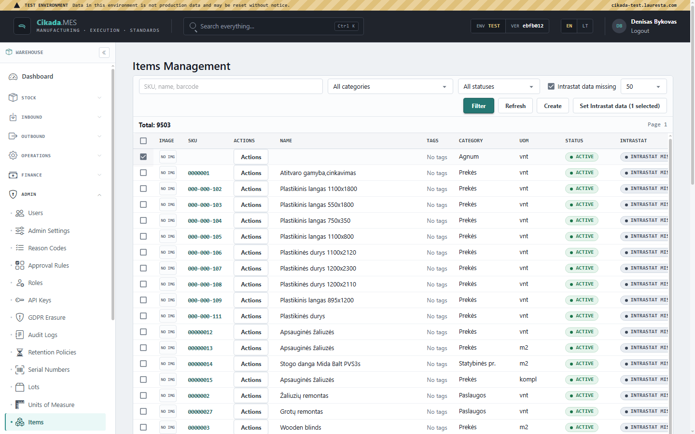
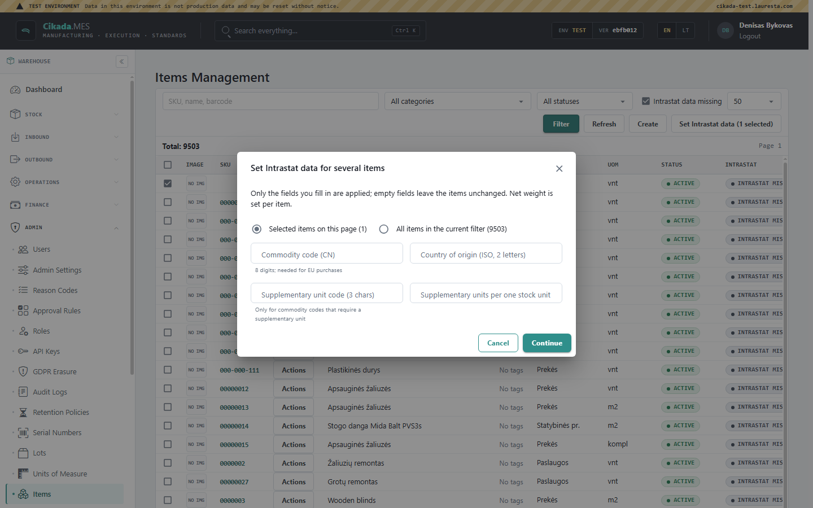
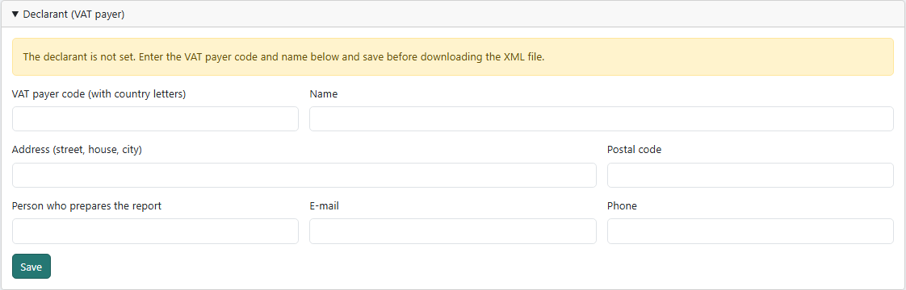

# Intrastat atvykimų ataskaita

**Būsena:** veikia

## Kam skirta
Sandėlio modulio ekranas (UI: Intrastat arrivals) skirtas parengti mėnesio Intrastat atvykimų duomenis: paskelbti (užregistruoti) ES įsigijimai pagal sąskaitos datą, sugrupuoti pagal visus deklaruojamus laukus: prekės kodą, išsiuntimo šalį, kilmės šalį, sandorio pobūdį, pristatymo sąlygas, transporto rūšį ir papildomą vienetą. Rodoma neto masė, papildomas kiekis ir sąskaitos vertė EUR. Duomenis sandėlis skaičiuoja pats iš pirkimo dokumentų, o ne iš Agnum. Ataskaitą galima parsisiųsti CSV failu.

**Deklaruojama vertė yra sąskaitos vertė:** kiekis × sąskaitos vieneto kaina (jei sąskaitos kainos nėra, užsakymo kaina), perskaičiuota eurais pagal dokumento kursą. Krovinio ir kitos papildomos išlaidos į deklaruojamą vertę neįtraukiamos. Savikaina su išlaidomis rodoma atskirame pilkame stulpelyje (UI: Landed cost, EUR (info only)) tik informacijai.

## Prieš pradedant
- Prieiga: InventoryAccountant, WarehouseManager, WarehouseAdmin.
- Į ataskaitą patenka tik paskelbti (UI: Posted) pirkimo dokumentai. Nepaskelbti dokumentai neįtraukiami.
- Pirkimo dokumentas turi būti su PVM režimu (UI: EU acquisition) (arba tiekėjas ES tipo) ir užpildytais Intrastat laukais, žr. [P-16](P-16-pirkimo-dokumentas.md). Pristatymo sąlygos, transporto rūšis ir sandorio pobūdis pasirenkami iš kodų sąrašų (Incoterms 2020; transportas 1, 2, 3, 4, 5, 7, 8, 9; sandorio pobūdis 11, 12, 21, 22, 23, 31-34, 41, 42, 51, 52, 71, 72, 80, 91, 99); kitos reikšmės registruojant atmetamos.
- Kiekviena atsargų prekė turi turėti 8 skaitmenų prekės kodą (UI: Commodity code (CN)), neto svorį vienetui (UI: Net weight per unit, kg) ir kilmės šalį (UI: Country of origin (ISO, 2 letters)) – (UI: Admin > Items) > (UI: Edit), žr. [P-32](P-32-prekiu-pagrindiniai-duomenys.md). Be jų ES įsigijimo užregistruoti neleidžiama.
- Jei prekės kodui reikalingas papildomas vienetas, prekės kortelėje užpildykite (UI: Supplementary unit code (3 characters, customs measurement unit classifier)) ir (UI: Supplementary units per one stock unit).

## Intrastat duomenų užpildymas keliom prekėm
Prekių kortelių po vieną redaguoti nereikia. Trys būdai:
1. **Rasti, ko trūksta.** (UI: Admin > Items) lange pažymėkite varnelę (UI: Intrastat data missing) ir paspauskite (UI: Filter): lieka atsargų prekės, kurioms nėra prekės kodo, neto masės arba kilmės šalies (paslaugų prekės neįtraukiamos). Tokios prekės sąraše pažymėtos ženkleliu (UI: Intrastat missing).
2. **Nustatyti keliom prekėm iš karto.** Pažymėkite prekes sąraše (pažymėjimas galioja tame puslapyje) arba nežymėkite nieko ir pasirinkite visas pagal dabartinį filtrą (pvz. vieną kategoriją). Paspauskite (UI: Set Intrastat data) ir užpildykite tik tuos laukus, kuriuos norite nustatyti: prekės kodą, kilmės šalį, papildomą vienetą su koeficientu. Tušti laukai prekių nekeičia. Prieš įrašant parodoma, kiek prekių pasikeis; patvirtinus pakeitimas taikomas visoms. Neto masė šiuo būdu nenustatoma, nes ji skiriasi pagal prekę.

3. **Excel.** (UI: Admin > Import Wizard) skirtuko (UI: Items) šablone yra stulpeliai `CommodityCode`, `NetWeightKg`, `OriginCountry`, `SupplementaryUnit`, `SupplementaryUnitFactor`; žr. [P-15](P-15-pagrindinis-duomenu-valdymas.md). Prekių eksporto į Excel kol kas nėra, todėl esamų prekių duomenis reikia įrašyti į šabloną patiems.

Patikros taisyklės tos pačios visur: prekės kodas - 8 skaitmenys, šalis - 2 raidžių ISO kodas, papildomas vienetas - 3 simboliai ir kartu su koeficientu, didesniu už nulį, neto masė - didesnė už nulį.

## Žingsniai
### 1. Parodyti mėnesio ataskaitą
1. Meniu pasirinkite (UI: Finance > Intrastat arrivals). Ataskaita atsidaro iškart einamam mėnesiui.
2. Lauke (UI: Month) pasirinkite mėnesį ir spauskite (UI: Show).
3. Lentelėje matote prekės kodą, išsiuntimo šalį, kilmės šalį, sandorio pobūdį, pristatymo sąlygas, transportą, neto masę, papildomą vienetą ir kiekį, kiekį bazės vienetais, sąskaitos vertę EUR ir eilutę (UI: Total). Eilutės su tokiais pat laukais sumuojamos.
4. Grąžinimai tiekėjui (paskelbti grąžinimo dokumentai) rodomi atskiromis geltonomis eilutėmis su žyma (UI: Return) ir sandorio pobūdžiu 21. Jie nėra atimami iš atvykimų sumos, o apatinėje eilutėje rodoma jų bendra vertė. Kreditinė sąskaita tik dėl kainos (be prekių grąžinimo) eilutėje nerodoma, o įrašoma į įspėjimų sąrašą: tokį atvejį reikia spręsti su buhalteriu (deklaracijos pataisymas).
5. Jei kai kurios eilutės praleistos (trūksta prekės kodo, šalių, kodų, papildomo vieneto koeficiento ar vertės), virš lentelės rodoma geltona žinutė su praleistų eilučių skaičiumi ir sąrašu. Papildykite duomenis ir paspauskite (UI: Show) dar kartą.

### 2. Parsisiųsti CSV
Spauskite (UI: Download CSV). Failas vadinasi `intrastat-arrivals-YYYY-MM.csv`. Stulpeliai: CommodityCode, DispatchCountry, OriginCountry, NatureOfTransaction, DeliveryTerms, TransportMode, SupplementaryUnit, Return (1 – grąžinimas), NetMassKg, SupplementaryQuantity, Quantity, InvoiceValueEur, LandedCostEur.

### 3. Deklaruotojo duomenys
Prieš pirmą XML sugeneravimą puslapio viršuje atidarykite bloką (UI: Declarant (VAT payer)) ir įveskite PVM mokėtojo kodą su šalies raidėmis (pvz. LT123456789) bei pavadinimą; adresas, ataskaitą rengiančio asmens vardas, el. paštas ir telefonas neprivalomi. Spauskite (UI: Save). Kol kodas ir pavadinimas nenurodyti, XML failo sugeneruoti neleidžiama; tada blokas atidarytas iškart ir virš jo rodomas geltonas įspėjimas.

### 4. Atsisiųsti XML ir įkelti į IDAIS
1. Parodykite mėnesio ataskaitą ir spauskite (UI: Download XML). Failas vadinasi `intrastat-arrivals-YYYY-MM-vN.xml`.
2. Failas nesudaromas, kol yra praleistų eilučių (įspėjimų sąraše): deklaracija būtų nepilna. Pirmiausia papildykite trūkstamus duomenis. Papildomo vieneto kodas prekės kortelėje turi būti 3 simbolių muitinės matavimo vieneto klasifikatoriaus kodas.
3. Grąžinimai tiekėjams į XML failą neįtraukiami (instrukcijoje jiems taisyklės nėra); ekrane rodoma pastaba. Mėnuo, kuriame yra tik grąžinimai, taip pat neeksportuojamas, tokį atvejį spręskite su buhalteriu.
4. Prisijunkite prie muitinės IDAIS portalo (https://intrastatas.muitine.lt, prisijungimas per BAP), pasirinkite Intrastato ataskaitos teikimą XML failu, pasirinkite atvykimus (IMPORT) ir to mėnesio failą ir įkelkite.
5. Sėkmingai įkėlę, lentelėje (UI: XML versions of the month) prie versijos spauskite (UI: Mark as filed). Žyma nustatoma tik ranka.

Struktūra paimta iš muitinės pildymo instrukcijos v1.00; XSD schema sistemoje dar nepatikrinta, todėl pirmą kartą failą verta įkelti anksčiau nei artėja terminas (10-a darbo diena kitą mėnesį).

### 5. Versijos ir patikslinimas
Versija yra sugeneruotas to mėnesio XML failas. Pirmas failas yra versija 1. Jei po to duomenys pasikeitė (pvz. pataisyta prekės kortelė) ir XML sugeneruojamas iš naujo, sukuriama versija 2 – tai patikslinta ataskaita, kurią įkeliate kaip kitą to paties mėnesio versiją. Jei duomenys nepasikeitė, naujos versijos nekuriama ir atsiunčiama ta pati. Lentelėje saugoma kiekvienos versijos data, autorius, eilučių skaičius, vertė, neto masė ir failo maiša; seną versiją galima atsisiųsti iš naujo (UI: Download). Patikslinimo nereikia, jei masė, kiekis ar vertė eilutėje skiriasi ne daugiau kaip 5 %.

### 6. Tuščias mėnuo
Jei per mėnesį ES įsigijimų nebuvo, ekrane rodomas pranešimas, kad nulinė ataskaita muitinei vis tiek turi būti pateikta. Mėnuo be prekybos taip pat deklaruojamas: (UI: Download XML) sugeneruoja failą su prekybos nevykdymo žyma ir be prekių sąrašo. Jei mėnesyje yra praleistų eilučių, nulinis failas nesudaromas.

## Dažnos klaidos
- „No EU acquisitions in this month. A zero report must still be filed with customs for this month.“ – mėnesį pagal sąskaitos datą nėra paskelbtų ES įsigijimų; pateikiama nulinė ataskaita.
- Pranešimas apie praleistas eilutes – papildykite prekės kortelę (CN kodas, svoris, kilmės šalis, papildomo vieneto koeficientas) arba dokumento Intrastat laukus.
- Registruojant dokumentą rodoma, kad kodas nėra sąraše – pasirinkite pristatymo sąlygas, transporto rūšį ir sandorio pobūdį iš sąrašo.
- Rodomi tik sąskaitos tipo dokumentai ir paskelbti grąžinimai; kreditinės sąskaitos tik dėl kainos į eilutes neįtraukiamos.

## Dar neįgyvendinta
XML nepatikrintas pagal muitinės XSD schemą (jos viešai paskelbtame šaltinyje nėra). Išvežimo (EXPORT) ataskaita ir tiesioginis perdavimas į IDAIS neįgyvendinti.

## Susiję procesai
- [P-16 Pirkimo dokumentas](P-16-pirkimo-dokumentas.md)
- [P-32 Prekių pagrindiniai duomenys](P-32-prekiu-pagrindiniai-duomenys.md)
- [P-22 Mėnesio uždarymas](P-22-menesio-uzdarymas.md)
