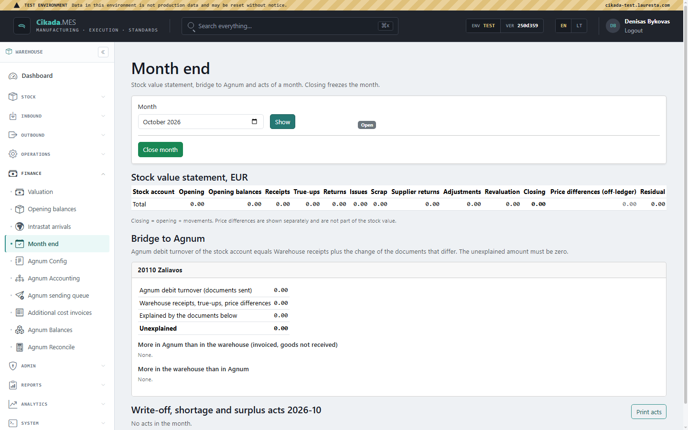

# Mėnesio uždarymas: atsargų vertės ataskaita, tiltas į Agnum, aktai

**Būsena:** veikia

## Kam skirta
Sandėlio modulio ekranas (UI: Month end) skirtas kas mėnesį patikrinti ir užfiksuoti atsargų vertę: atsargų vertės ataskaita pagal atsargų sąskaitą, „tiltas“ tarp sandėlio ir Agnum apyvartos, nurašymo, trūkumo ir pertekliaus aktai. Uždarius mėnesį jo duomenys užšaldomi, o jame datuotų dokumentų užregistruoti ar jų panaikinti nebegalima. Ekraną naudoja buhalteris ir sandėlio vadovas.

## Prieš pradedant
- Prieiga: InventoryAccountant, WarehouseManager, WarehouseAdmin.
- Mėnuo turi būti pasibaigęs.
- Visi mėnesio pirkimo dokumentai turi būti išsiųsti į Agnum arba anuliuoti, žr. [P-19](P-19-agnum-nustatymai-ir-eile.md).

## Žingsniai
### 1. Parodyti mėnesį
1. Meniu pasirinkite (UI: Finance > Month end). Atsidaro praėjęs mėnuo.
2. Lauke (UI: Month) pasirinkite mėnesį ir spauskite (UI: Show). Šalia rodoma būsena (UI: Open) arba (UI: Closed) su užrašu „Closed by … at …“.

### 2. Perskaityti atsargų vertės ataskaitą
1. Skiltyje (UI: Stock value statement, EUR) kiekvienai atsargų sąskaitai matote: (UI: Opening), (UI: Opening balances), (UI: Receipts), (UI: True-ups), (UI: Returns), (UI: Issues), (UI: Scrap), (UI: Supplier returns), (UI: Adjustments), (UI: Revaluation), (UI: Closing), (UI: Price differences (off-ledger)) ir (UI: Residual).
2. Likutis pabaigoje = likutis pradžioje + judėjimai. Kainų skirtumai rodomi atskirai ir į atsargų vertę neįeina. (UI: Residual) turi būti 0,00; nenulinė eilutė paryškinama raudonai.

### 3. Patikrinti tiltą į Agnum
1. Skiltyje (UI: Bridge to Agnum) kiekvienai atsargų sąskaitai lyginama (UI: Agnum debit turnover (documents sent)) ir (UI: Warehouse receipts, true-ups, price differences).
2. (UI: Explained by the documents below) – skirtumas, kurį paaiškina dokumentai, išvardyti dviem sąrašais: „More in Agnum than in the warehouse (invoiced, goods not received)“ ir „More in the warehouse than in Agnum“. Prie kiekvieno dokumento nurodyta priežastis: sąskaita mėnesio, prekės priimtos vėliau; dokumentas neišsiųstas į Agnum; įvestas Agnum rankiniu būdu; prekės priimtos, sąskaita neužregistruota; sumos skiriasi.
3. (UI: Unexplained) turi būti 0,00 (žalia). Kitaip (raudona) uždaryti neleidžiama.

### 4. Peržiūrėti ir atspausdinti aktus
Skiltyje (UI: Write-off, shortage and surplus acts) matote sumas pagal priežastį ir eilutes: nurašymas (Write-off), trūkumas (Shortage), perteklius (Surplus). (UI: Print acts) atspausdina tik šią skiltį.

### 5. Uždaryti mėnesį
1. Jei mėnuo atviras ir kliūčių nėra, spauskite (UI: Close month). Jei yra kliūčių, virš mygtuko rodomas sąrašas „The month cannot be closed yet:“, o mygtukas neaktyvus.
2. Uždarymo metu ataskaita išsaugoma kaip nuotrauka; vėliau atstatydami projekcijas uždaryto mėnesio nepakeisite.

### 6. Atidaryti mėnesį iš naujo
Uždarytam mėnesiui įveskite (UI: Reason for reopening (recorded in the audit journal)) ir spauskite (UI: Reopen month). Priežastis privaloma.

## Ką reiškia būsenos ir spalvos
Ekrano (UI: Month end) žyma (UI: Closed) (žalia) reiškia, kad mėnuo užšaldytas, (UI: Open) (pilka) – kad dar galima registruoti dokumentus. Statement eilutė raudona, kai (UI: Residual) nelygus nuliui. Tilto eilutė (UI: Unexplained) žalia, kai lygi nuliui.

## Dažnos klaidos
Uždaryti neleidžia šios priežastys (rodomos sąraše):
- „The month YYYY-MM has not ended yet.“ – mėnuo dar nepasibaigė.
- „DOC: Post is Pending / NeedsReview / …“ – eilėje yra neišsiųstas dokumentas; sutvarkykite [P-19](P-19-agnum-nustatymai-ir-eile.md).
- „Stock account …: unexplained difference to Agnum … EUR.“ – tilte lieka nepaaiškintas skirtumas; patikrinkite dokumentus abiejuose sąrašuose.
- „Stock account …: statement residual … EUR.“ – ataskaitos likutis nesutampa.
- „A reason is required to reopen a month.“ – įveskite atidarymo priežastį.
- „The month is already closed.“ / „The month is not closed.“ – veiksmas neatitinka būsenos.

## Susiję procesai
- [P-07 Atsargų vertinimas](P-07-atsargu-vertinimas-valuation.md)
- [P-19 Agnum apskaitos nustatymai ir siuntimo eilė](P-19-agnum-nustatymai-ir-eile.md)
- [P-20 Pradiniai likučiai](P-20-pradiniai-likuciai.md)
- [P-21 Intrastat atvykimai](P-21-intrastat-atvykimai.md)
