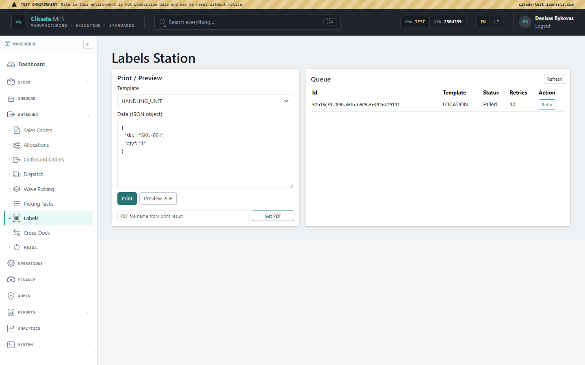

# Etikečių stotelė (Labels)

**Būsena:** veikia

## Kam skirta
Sandėlio modulio ekranas (UI: Outbound > Labels), kurio antraštė (UI: Labels Station), skirtas spausdinti sandėlio vietų, sandėliavimo vienetų ir prekių etiketes. Čia galima peržiūrėti etiketę PDF faile ir pakartoti nepavykusį spausdinimą. Etiketės automatiškai nespausdinamos iš priėmimo ar kitų ekranų – jas reikia išsiųsti ranka čia.

## Prieš pradedant
- Ekraną naudoti leidžiama rolėms Operator, QCInspector, WarehouseManager, WarehouseAdmin.
- Etiketės spausdintuvas turi būti prieinamas sistemai; jei ne, užklausa nepasiekia popieriaus (žr. 2 žingsnį).
- Reikia žinoti etiketės šabloną ir jo laukus (žr. žemiau).

## Žingsniai
### 1. Parengti etiketės duomenis
1. Meniu pasirinkite (UI: Outbound > Labels). Kairėje yra blokelis (UI: Print / Preview), dešinėje – eilė (UI: Queue).
2. Sąraše (UI: Template) pasirinkite šabloną. Sistemoje yra trys šablonai: LOCATION, HANDLING_UNIT, ITEM.
3. Lauke (UI: Data (JSON object)) įrašykite etiketės laukus JSON objektu. Pradinis pavyzdys su laukais sku ir qty netinka nė vienam šablonui – pakeiskite jį.
4. Laukai pagal šabloną: LOCATION – LocationCode, Aisle, Rack, Level, Bin; HANDLING_UNIT – HUBarcode, ItemSKU, Qty, LotNumber, ExpiryDate; ITEM – ItemSKU, Description. Pavyzdys prekės etiketei: {"ItemSKU": "RM-0001", "Description": "Plienas 2 mm"}.

### 2. Peržiūrėti ir spausdinti
1. Spauskite (UI: Preview PDF) – naršyklė atsisiunčia etiketės PDF failą.
2. Spauskite (UI: Print). Po mygtuku rodomas pranešimas su rezultato būsena ir žinute.
3. Jei spausdintuvas buvo nepasiekiamas, užklausa gali patekti į eilę (būsena Queued) arba gali būti sukurtas tik PDF. Tada rodoma klaida; PDF failo pavadinimą įrašykite į lauką (UI: PDF file name from print result) ir spauskite (UI: Get PDF).

### 3. Pakartoti eilės užduotį
1. Dešinėje lentelėje (UI: Queue) matote (UI: Id), (UI: Template), (UI: Status), (UI: Retries).
2. Prie nepavykusios eilutės spauskite (UI: Retry). Pranešime „Queue retry submitted." Sąrašą atnaujina (UI: Refresh).

## Dažnos klaidos
- „Template is required." – nepasirinktas šablonas.
- „Data JSON must be an object." / „Invalid data JSON." – lauke (UI: Data (JSON object)) turi būti JSON objektas su kabutėmis ir kableliais.
- „PDF file name is required." – prieš (UI: Get PDF) įrašykite failo pavadinimą.
- „Labels request failed." – užklausa nepavyko; patikrinkite šabloną ir duomenis arba kreipkitės į administratorių.
- Etiketėje tušti laukai – JSON raktų pavadinimai neatitinka šablono laukų (žr. 1 žingsnį).

## Susiję procesai
- [P-01 Prekių priėmimas](P-01-priemimas-inbound.md)
- [P-02 Padėjimas į vietą](P-02-padeti-i-lokacija-putaway.md)
- [P-03 Pardavimo užsakymai ir išsiuntimas](P-03-israsymas-isuntimas-outbound.md)
