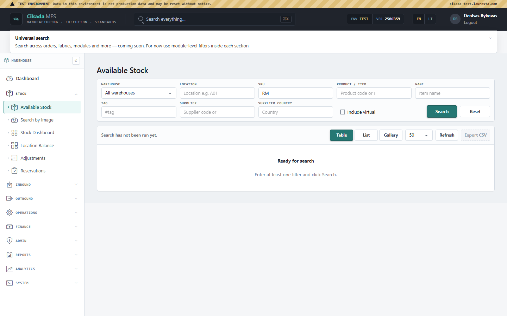
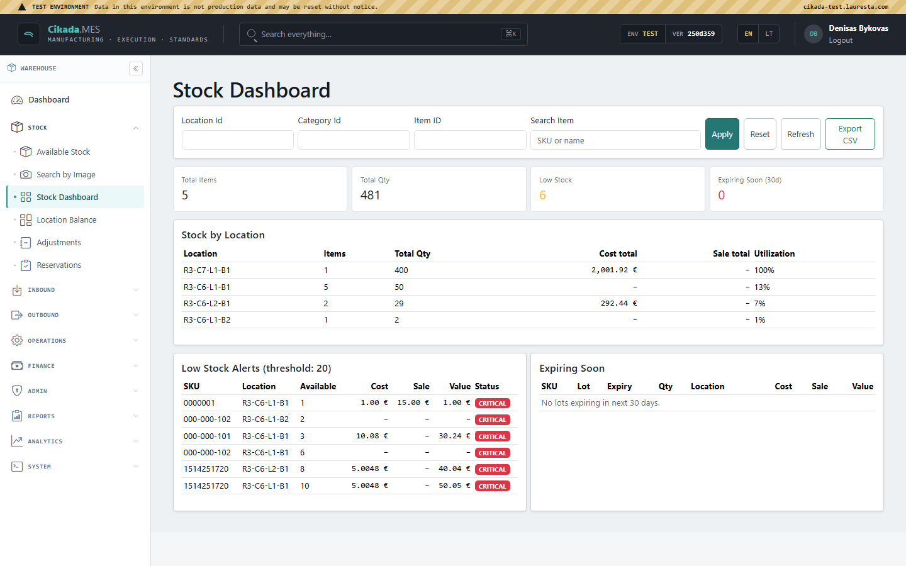

# Atsargų peržiūra (Available Stock, Stock Dashboard, Location Balance)

**Būsena:** veikia

## Kam skirta
Sandėlio modulio skyrius (UI: Stock) skirtas pamatyti, kiek ir kur yra prekių: surasti prekę pagal kodą ar nuotrauką, apžvelgti atsargas pagal sandėlio vietas, pamatyti mažėjančias ir senstančias prekes bei sandėlio vietų užimtumą. Visi ekranai tik rodo duomenis, jų pakeisti negalima.

## Prieš pradedant
- Ekranus naudoti leidžiama rolėms Operator, QCInspector, WarehouseManager, WarehouseAdmin.
- Kad pamatytumėte kiekius, prekės turi būti priimtos (žr. [P-01 Prekių priėmimas](P-01-priemimas-inbound.md)).
- Kainų stulpelius (UI: Cost), (UI: Sale), (UI: Value) užpildo pagal prekės kortelę; jei prekei kaina nenurodyta, laukelis tuščias.

## Žingsniai
### 1. Surasti atsargas (Available Stock)
1. Meniu pasirinkite (UI: Stock > Available Stock). Ekranas rodo „Ready for search" ir nieko neparodo, kol neužpildytas bent vienas filtras.
2. Užpildykite bent vieną: (UI: Warehouse), (UI: Location) (pvz., A01*), (UI: SKU) (pvz., RM-*), (UI: Product / item), (UI: Name), (UI: Tag), (UI: Supplier), (UI: Supplier country). Pažymėkite (UI: Include virtual), jei reikia matyti ir virtualias (neturinčias fizinės lentynos) vietas.
3. Spauskite (UI: Search). Virš lentelės matote „Showing … item(s) on page … of …".
4. Rodinį pasirinkite mygtukais (UI: Table), (UI: List), (UI: Gallery). Eilučių skaičių puslapyje – 25, 50 ar 100.
5. Lentelėje matote sandėlį, vietą, SKU, pavadinimą, žymes, (UI: Physical) (fiziškai yra), (UI: Reserved) (rezervuota), (UI: Available) (laisva), kainą, vertę ir (UI: Last Updated). Spustelėjus SKU atsidaro prekės kortelė.
6. (UI: Export CSV) išsaugo rezultatus faile, (UI: Reset) išvalo filtrus.

### 2. Apžvelgti atsargas (Stock Dashboard)
1. Meniu pasirinkite (UI: Stock > Stock Dashboard). Filtrai: (UI: Location Id), (UI: Category Id), (UI: Item ID), (UI: Search Item). Spauskite (UI: Apply), (UI: Reset) arba (UI: Refresh).
2. Ekranas rodo tik fizines vietas (virtualios nerodomos). Viršuje matote keturias suvestines: (UI: Total Items), (UI: Total Qty), (UI: Low Stock), (UI: Expiring Soon (30d)).
3. Lentelėje (UI: Stock by Location) – prekių skaičius, laisvas kiekis, savikainos ir pardavimo vertė kiekvienoje vietoje.
4. Blokelyje „Low Stock Alerts (threshold: 20)" išvardytos prekės, kurių laisvas kiekis mažesnis nei 20; žyma CRITICAL rodoma, kai kiekis ne didesnis nei 10, kitu atveju – LOW.
5. Blokelyje (UI: Expiring Soon) – partijos, kurių galiojimas baigiasi per 30 dienų: (UI: Lot), (UI: Expiry), (UI: Qty).
6. (UI: Export CSV) išsaugo atsargų lygius faile.

### 3. Patikrinti vietų užimtumą (Location Balance)
1. Meniu pasirinkite (UI: Stock > Location Balance). Filtrai: (UI: Location Id) ir (UI: Status) (įveskite tikslią vietos būsenos reikšmę, pvz., Active). Spauskite (UI: Apply) arba (UI: Reset).
2. Lentelėje matote vietą, (UI: Item Count), svorį ir tūrį, didžiausią leistiną svorį ir tūrį, užimtumą procentais pagal svorį ir tūrį, būseną ir vertę.
3. Apačioje puslapiavimas ir eilučių skaičiaus pasirinkimas.

### 4. Pamatyti vienos vietos turinį
1. Ekranas (UI: Location Details) atidaromas ne iš (UI: Stock) meniu: ekrane (UI: Admin > Locations) prie vietos spauskite (UI: View Details) arba sandėlio žemėlapyje pasirinkę vietą spauskite (UI: View Details).
2. Viršuje matote vietos kodą, būseną ir brūkšninį kodą, žemiau – vietoje esančias prekes: (UI: Internal SKU), (UI: Item), (UI: Quantity), (UI: Cost), (UI: Sale), (UI: Total Value).
3. (UI: Previous) ir (UI: Next) perverčia po 50 eilučių. (UI: Open Admin Locations) grąžina į vietų sąrašą.

### 5. Surasti prekę pagal nuotrauką (Search by Image)
1. Meniu pasirinkite (UI: Stock > Search by Image).
2. Spustelėkite apvalų mygtuką (UI: Tap to take a photo or choose from gallery) ir nufotografuokite prekę arba pasirinkite paveikslėlį (iki 5 MB). Telefone atsidaro kamera.
3. Kol vyksta paieška, rodoma „Identifying item.".
4. Rezultatai rodomi kortelėmis su nuotrauka, SKU, pavadinimu ir panašumo procentu. Jei geriausias panašumas ne mažesnis nei 85 procentai, atsidaro tos prekės kortelė iškart; kitu atveju spustelėkite norimą kortelę.

## Ką reiškia būsenos ir spalvos
- Ekrane (UI: Available Stock) (UI: Physical) – kiek prekės fiziškai yra vietoje, (UI: Reserved) – kiek jau rezervuota užsakymams, (UI: Available) – kiek galima dar rezervuoti.
- Ekrane (UI: Stock Dashboard) stulpelis (UI: Utilization) rodo vietos kiekį procentais nuo didžiausio kiekio tarp rodomų vietų, o ne nuo fizinės vietos talpos. Talpą rodo ekranas (UI: Location Balance).
- Ekrane (UI: Search by Image) panašumo procentas: žalia – 85 ir daugiau, geltona – 65 ir daugiau, pilka – mažiau.

## Dažnos klaidos
- „No stock found" / „No stock matches the current filters." – pagal filtrus atsargų nėra; praplėskite filtrus.
- „Search has not been run yet." – paieška nepaleista; įveskite filtrą ir spauskite (UI: Search).
- „No matching items found." – paieška pagal nuotrauką nerado; pabandykite aiškesnę nuotrauką arba pirmiausia pridėkite nuotraukas prie prekių.
- „Image similarity search unavailable" – paieškos pagal nuotrauką funkcija serveryje išjungta; kreipkitės į administratorių.
- „Photo file is required." – nepasirinktas failas.
- „Location … was not found." – vietos su tokiu numeriu nėra.
- „Stock request failed." – užklausa nepavyko; spauskite (UI: Refresh) arba bandykite vėliau.

## Susiję procesai
- [P-06 Atsargų koregavimas](P-06-atsargu-koregavimas-adjustments.md)
- [P-25 Rezervacijos](P-25-rezervacijos.md)
- [P-04 Perkėlimas tarp vietų](P-04-perkelimas-transfer.md)
- [P-12 Sandėlio žemėlapis](P-12-sandelio-zemelapis-visualization.md)
