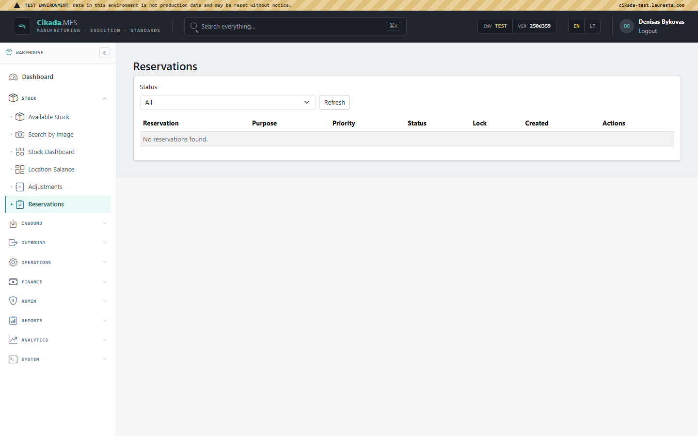

# Rezervacijos (Reservations)

**Būsena:** veikia

## Kam skirta
Sandėlio modulio ekranas (UI: Stock > Reservations) rodo atsargų rezervacijas – kiekius, kurie jau priskirti užsakymams ir negali būti parduoti kitam. Čia galima peržiūrėti, ką rezervacija apima, pradėti jos komplektavimą ir užregistruoti paėmimą iš sandėliavimo vieneto. Ekraną naudoja sandėlio darbuotojai ir vadovai.

## Prieš pradedant
- Ekraną ir veiksmus (UI: Start Picking), (UI: Pick) leidžiama naudoti rolėms Operator, QCInspector, WarehouseManager, WarehouseAdmin.
- Rezervacijos šiame ekrane nekuriamos. Jos atsiranda rezervuojant pardavimo užsakymą ([P-03 Pardavimo užsakymai ir išsiuntimas](P-03-israsymas-isuntimas-outbound.md)).

## Žingsniai
### 1. Peržiūrėti rezervacijas
1. Meniu pasirinkite (UI: Stock > Reservations). Atsidaro (UI: Reservations).
2. Sąraše (UI: Status) pasirinkite All, Allocated arba Picking. (UI: Refresh) atnaujina lentelę.
3. Lentelėje matote (UI: Reservation) (trumpą numerį), (UI: Purpose), (UI: Priority), (UI: Status), (UI: Lock) ir (UI: Created). Puslapiavimas rodomas apačioje.
4. Spustelėkite eilutę – atsidaro langas (UI: Reservation …) su rezervacijos eilutėmis: (UI: Requested), kaina, vertė, (UI: Allocated), sandėlis, vieta, (UI: Allocated HUs). Langą uždaro (UI: Close).

### 2. Pradėti komplektavimą
1. Eilutei su būsena Allocated spauskite (UI: Start Picking). Mygtukas rodomas tik rezervacijoms, kurių paskirtis nėra SALES_ORDER; pardavimo užsakymų komplektavimas vyksta pagal [P-26 Bangos ir komplektavimo užduotys](P-26-bangos-ir-komplektavimas.md).
2. Lange (UI: Start picking?) skaitote „Start picking this reservation now?" ir spauskite (UI: Start). Rezervacija tampa Picking.

### 3. Užregistruoti paėmimą
1. Eilutei su būsena Picking spauskite (UI: Pick). Atsidaro (UI: Pick Reservation …).
2. Sąraše (UI: Line) pasirinkite eilutę (rodomi SKU, vieta ir priskirtas kiekis), sąraše (UI: Handling Unit) – sandėliavimo vienetą, o lauke (UI: Quantity) – paimamą kiekį.
3. Spauskite (UI: Submit Pick). Mygtukas neaktyvus, kol laukai neteisingi. Atšaukti galima mygtuku (UI: Cancel).

## Ką reiškia būsenos ir spalvos
Ekrane (UI: Reservations) rezervacijos būsena rodoma žodžiu.
- Allocated – atsargos priskirtos, komplektavimas dar nepradėtas.
- Picking – komplektavimas vyksta; galima registruoti paėmimus.
Stulpelis (UI: Lock) rodo rezervacijos užrakto tipą, o (UI: Purpose) – kam ji skirta.

## Dažnos klaidos
- „Select a reservation line." – pasirinkite (UI: Line).
- „Select a handling unit." – pasirinkite (UI: Handling Unit).
- „Quantity must be greater than zero." – (UI: Quantity) turi būti didesnis už 0.
- „Quantity exceeds allocated quantity …" – paimama daugiau, nei priskirta.
- „No reservations found." – pagal pasirinktą būseną rezervacijų nėra.
- Prieigos klaida – trūksta rolės Operator ar aukštesnės.

## Susiję procesai
- [P-03 Pardavimo užsakymai ir išsiuntimas](P-03-israsymas-isuntimas-outbound.md)
- [P-26 Bangos ir komplektavimo užduotys](P-26-bangos-ir-komplektavimas.md)
- [P-24 Atsargų peržiūra](P-24-atsargu-perziura.md)
