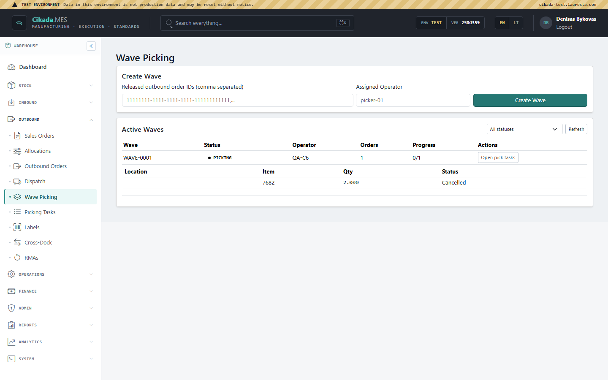
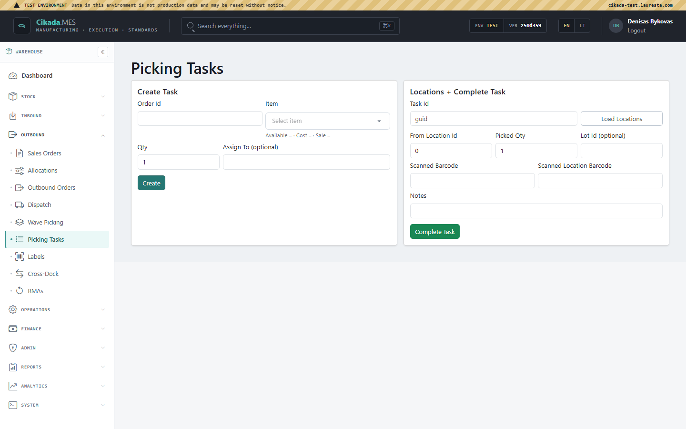

# Bangos ir komplektavimo užduotys (Wave Picking, Picking Tasks)

**Būsena:** dalinai

Abu ekranai veikia su tikrais duomenimis, bet yra nepatogūs: nėra komplektavimo užduočių sąrašo, o numerius (GUID, vietos Id) reikia įvesti ranka. Smulkiau – skyriuje „Dar neįgyvendinta".

## Kam skirta
Sandėlio modulio ekranas (UI: Outbound > Wave Picking) sujungia kelis jau paleistus komplektuoti užsakymus į vieną bangą ir paskiria jai komplektuotoją. Ekranas (UI: Outbound > Picking Tasks) leidžia sukurti komplektavimo užduotį ranka, pamatyti, iš kur prekę imti, ir pažymėti užduotį įvykdyta.

## Prieš pradedant
- Užsakymas turi būti paleistas komplektuoti: pardavimo užsakymo mygtukas (UI: Release to Picking), žr. [P-03 Pardavimo užsakymai ir išsiuntimas](P-03-israsymas-isuntimas-outbound.md). Paleidžiant sistema pati sukuria komplektavimo užduotis.
- Bangas kurti ir komplektuotoją priskirti gali tik WarehouseManager ir WarehouseAdmin. Bangų sąrašą ir (UI: Start) leidžiama naudoti rolėms Operator, QCInspector, WarehouseManager, WarehouseAdmin.
- Komplektavimo užduotį ranka kurti (UI: Create) gali tik WarehouseManager ir WarehouseAdmin; užduoties vietų peržiūra ir įvykdymas leidžiami rolėms Operator ir aukštesnėms.
- Išsiunčiamo užsakymo GUID matomas naršyklės adreso eilutėje, atidarius užsakymą ekrane (UI: Outbound Orders).

## Žingsniai
### 1. Sukurti bangą
1. Meniu pasirinkite (UI: Outbound > Wave Picking). Atsidaro ekranas (UI: Wave Picking).
2. Blokelio (UI: Create Wave) lauke (UI: Released outbound order IDs (comma separated)) įrašykite išsiunčiamų užsakymų GUID, atskirtus kableliais.
3. Jei jau žinote komplektuotoją, įrašykite (UI: Assigned Operator).
4. Spauskite (UI: Create Wave). Pranešime „Wave created." Jei komplektuotojas įrašytas, banga iškart gauna būseną Assigned, kitaip – Created.
5. Kiekvienas užsakymas turi būti paleistas komplektuoti, turėti komplektavimo užduotis ir nepriklausyti kitai bangai.

### 2. Paskirti ir pradėti
1. Sąraše (UI: Active Waves) pasirinkite būsenos filtrą (UI: All statuses) / Created / Assigned / Picking / Completed ir, jei reikia, spauskite (UI: Refresh).
2. Bangai su būsena Created spauskite (UI: Assign). Naudojamas lauke (UI: Assigned Operator) įrašytas vardas; jei laukas tuščias, įrašoma „picker-01". Komplektuotojas priskiriamas visoms dar neatliktoms bangos užduotims.
3. Bangai su būsena Assigned spauskite (UI: Start) – būsena tampa Picking.
4. Lentelėje matote bangos numerį (WAVE-…), būseną, operatorių, užsakymų skaičių ir eigą (įvykdytos / visos eilutės). Po kiekviena banga pateiktas surinkimo sąrašas pagal vietas: (UI: Location), (UI: Item), (UI: Qty), (UI: Status). Nuoroda (UI: Open pick tasks) atidaro ekraną (UI: Picking Tasks).
5. Banga tampa Completed, kai visos jos užduotys įvykdytos.

### 3. Sukurti komplektavimo užduotį ranka
1. Meniu pasirinkite (UI: Outbound > Picking Tasks). Kairėje yra blokelis (UI: Create Task).
2. Įveskite (UI: Order Id), pasirinkite (UI: Item), (UI: Qty) ir, jei reikia, (UI: Assign To (optional)).
3. Spauskite (UI: Create). Pasirodo „Task created:" su užduoties GUID, kuris automatiškai įrašomas į lauką (UI: Task Id) dešiniajame blokelyje.

### 4. Pamatyti vietas ir įvykdyti užduotį
1. Dešiniajame blokelyje (UI: Locations + Complete Task) įrašykite (UI: Task Id) ir spauskite (UI: Load Locations). Lentelėje matote vietas, iš kurių galima imti: (UI: Location), (UI: Available), (UI: Lot).
2. Įveskite (UI: From Location Id) (sandėlio vietos numerį, ne kodą), (UI: Picked Qty), pasirinktinai (UI: Lot Id (optional)).
3. Jei naudojate skaitytuvą, įveskite (UI: Scanned Barcode) (prekės kodas) ir (UI: Scanned Location Barcode) (vietos kodas) – sistema patikrins, ar jie atitinka. Galite įrašyti (UI: Notes).
4. Spauskite (UI: Complete Task). Pranešime „Pick task completed." Prekė perkeliama iš vietos į išsiuntimo zoną SHIPPING.

## Ką reiškia būsenos ir spalvos
Ekrane (UI: Wave Picking) bangos būsena rodoma žyma: Created – sukurta, dar nepaskirta; Assigned – paskirta komplektuotojui; Picking – komplektuojama; Completed – visos užduotys įvykdytos. Created žyma pilka, Assigned ir Picking – informacinė, Completed – baigtinė. Užduočių eilutės rodo savo būseną žodžiu (pvz., Pending, Completed).

## Dažnos klaidos
- „Enter at least one valid order GUID." – lauke nėra nė vieno tinkamo GUID.
- „Every order must be released for picking." – kuris nors užsakymas dar nepaleistas komplektuoti.
- „An order already belongs to a wave." – užsakymas jau įtrauktas į kitą bangą.
- „Every order must have real pick tasks." – užsakymas neturi užduočių; paleiskite jį iš pardavimo užsakymo.
- „Assign the wave before starting." – (UI: Start) galima tik paskirtai bangai.
- „Order Id, item and qty are required." / „Valid task id is required." / „Task id, from location id and picked qty are required." – užpildykite trūkstamus laukus.
- „Pick task … is already …" – užduotis jau įvykdyta.
- „Picked quantity … exceeds task quantity …" – imama daugiau nei užduotyje.
- „Scanned barcode … does not match expected item …" arba „Scanned location barcode … does not match expected location …" – nuskaityta ne ta prekė ar vieta.
- „Pick from a location reserved for this order, within its remaining quantity." – imama iš vietos, kuri šiam užsakymui nerezervuota.
- „Available quantity at location … is …" – vietoje nepakanka atsargų.

## Dar neįgyvendinta
- Sandėlio modulio ekrane (UI: Picking Tasks) nėra komplektavimo užduočių sąrašo: užduoties GUID reikia žinoti iš anksto (jį matote tik sukūrę užduotį šiame ekrane). Bangos surinkimo sąraše užduočių numerių nerodoma.
- Lauke (UI: From Location Id) reikia numerinio vietos Id, o lentelėje (UI: Locations + Complete Task) rodomi tik vietų kodai.
- Ekrane (UI: Wave Picking) užsakymus reikia nurodyti ranka įvedant GUID; pasirinkimo iš sąrašo nėra, o bangos surinkimo sąraše prekė rodoma numeriu, ne SKU.
- Mygtuko (UI: Assign) numatytasis operatorius „picker-01" yra pavyzdinė reikšmė.

## Susiję procesai
- [P-03 Pardavimo užsakymai ir išsiuntimas](P-03-israsymas-isuntimas-outbound.md)
- [P-25 Rezervacijos](P-25-rezervacijos.md)
