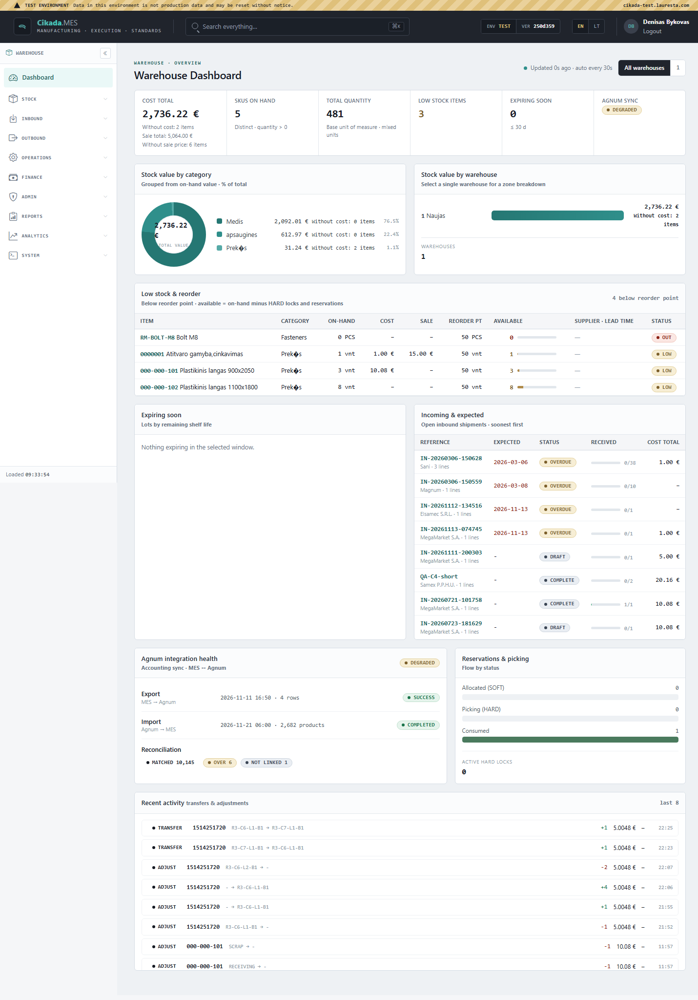
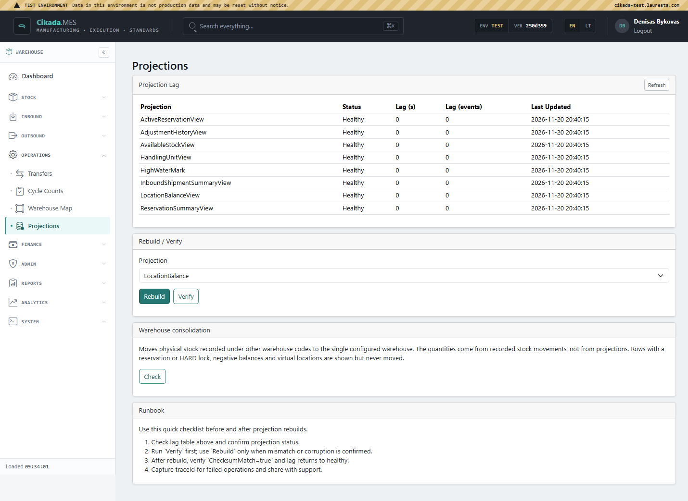

# Pradžia ir sistemos būsena

**Būsena:** veikia

## Kam skirta
Atidarius Sandėlio modulį (Warehouse) pirmiausia matomas pradžios skydelis (UI: Dashboard) su atsargų vertėmis, mažėjančiais likučiais, galiojimo pabaiga, laukiamomis siuntomis ir sąsajos su Agnum būsena. Prie jo priklauso ekranas (UI: Operations > Projections), kuriame administratorius tikrina ir perstato sandėlio duomenų suvestines, bei nuoroda (UI: System > Job Queue) į fono užduočių lentelę. Čia taip pat aprašytas pranešimas „Access denied“.

## Prieš pradedant
- Pradžios skydelį atidaryti gali rolės Operator, QCInspector, WarehouseManager ir WarehouseAdmin.
- Ekranas (UI: Operations > Projections) matomas visiems, bet visus jo veiksmus (perstatymą, tikrinimą, sandėlių sujungimą) API leidžia tik rolei WarehouseAdmin. Kitos rolės gauna klaidos pranešimą.
- Adresas `/` neturi savo turinio: jis iškart nukreipia į (UI: Dashboard).
- Nuoroda (UI: System > Job Queue) veikia tik jei serverio nustatyme `Hangfire:DashboardUrl` nurodytas adresas.

## Žingsniai
### 1. Pradžios skydelis
1. Atidarykite Sandėlio modulį arba meniu viršuje pasirinkite (UI: Dashboard). Antraštė (UI: Warehouse Dashboard).
2. Dešinėje viršuje rodoma „Updated Ns ago · auto every Ns“: duomenys atsinaujina patys kas 30 sekundžių (nustatymas `RefreshIntervals:DashboardSeconds`, ne mažiau kaip 5 s).
3. Mygtukais (UI: All warehouses) ir sandėlių kodais pasirinkite, kuriam sandėliui rodyti skaičius.
4. Viršutinėse kortelėse: (UI: Cost total) su pardavimo verte ir pastaba, kiek prekių be kainos, (UI: SKUs on hand), (UI: Total quantity), (UI: Low stock items), (UI: Expiring soon) ir (UI: Agnum sync). Paspaudus ant paskutinių trijų, puslapis nušoka į atitinkamą bloką.
5. Žemiau yra blokai: (UI: Stock value by category) (žiedinė diagrama), (UI: Stock value by warehouse), (UI: Low stock & reorder), (UI: Expiring soon), (UI: Incoming & expected), (UI: Agnum integration health), (UI: Reservations & picking), (UI: Recent activity).
6. Jei kuris nors blokas nepavyksta užkrauti, jame rodomas klaidos pranešimas su mygtuku pakartoti, o kiti blokai lieka.

### 2. Duomenų suvestinių (projekcijų) tikrinimas
1. Meniu pasirinkite (UI: Operations > Projections).
2. Bloke (UI: Projection Lag) matote kiekvienos suvestinės būseną, atsilikimą sekundėmis (UI: Lag (s)) ir įvykiais (UI: Lag (events)), paskutinį atnaujinimą. (UI: Refresh) perkrauna lentelę.
3. Bloke (UI: Rebuild / Verify) išskleidžiamajame sąraše (UI: Projection) pasirinkite suvestinę: LocationBalance, AvailableStock, OutboundOrderSummary, ShipmentSummary, DispatchHistory, OnHandValue arba InboundShipmentSummary.
4. Spauskite (UI: Verify), kad palygintumėte esamus duomenis su perskaičiuotais. Rezultatas rodomas žalia (kontrolinė suma sutampa) arba raudona (nesutampa) juosta.
5. Spauskite (UI: Rebuild) tik tada, kai patikrinimas rodo neatitikimą. Patvirtinimo lange „Rebuild projection?“ dar kartą spauskite (UI: Rebuild). Po perstatymo rodomas blokas (UI: Rebuild Result) su (UI: Checksum Match), (UI: Swapped), (UI: Events Processed) ir (UI: Duration).
6. Perstatant OnHandValue duomenys iš karto nekeičiami: pirmiausia rodoma pakeitimų lentelė (UI: Added), (UI: Removed), (UI: Changed). Tik WarehouseAdmin matys lauką (UI: Reason (required)) ir mygtuką (UI: Apply reviewed changes). Priežastis ir kontrolinės sumos įrašomos į auditą.

### 3. Sandėlių sujungimas
1. Tame pačiame ekrane bloke (UI: Warehouse consolidation) spauskite (UI: Check).
2. Rodomas tikslinis sandėlis (UI: Target warehouse) ir lentelė su likučiais, užregistruotais kitų sandėlių kodais. Kiekviena eilutė pažymėta: (UI: Will be moved), (UI: Not moved) arba (UI: Virtual location, not moved), o priežastis – aktyvus rezervavimas, HARD užraktas ar neigiamas likutis.
3. WarehouseAdmin gali įrašyti (UI: Reason (required)) ir spausti (UI: Move stock). Judinamos tik eilutės su būsena (UI: Will be moved).

### 4. Fono užduočių lentelė
1. Meniu skyriuje (UI: System) pasirinkite (UI: Job Queue).
2. Nuoroda atidaro naują naršyklės kortelę su fono užduočių lentele (pavadinimas „Warehouse Jobs“). Joje matomos periodinės užduotys, pavyzdžiui, Agnum eksportas, importas ir planinės atitikties ataskaitos.

## Ką reiškia būsenos ir spalvos
- Kortelė (UI: Low stock items): išryškinama, kai yra prekių žemiau užsakymo taško. Lentelėje būsena (UI: Out) reiškia, kad prieinamo kiekio nėra.
- Kortelė (UI: Expiring soon): raudonai paryškinama, kai yra pasibaigusių ar greitai pasibaigsiančių partijų. Lentelė suskirstyta į grupes: (UI: Expired), (UI: ≤ 7 days), (UI: 8–30 days), (UI: 31–90 days). Ženkleliai prie dienų: iki 7 dienų raudonas, iki 30 geltonas.
- (UI: Agnum sync): (UI: In sync) – viskas gerai, (UI: Degraded) – dalinis sutrikimas, (UI: Failed) – nepavyko, (UI: Unknown) – nežinoma. Bloke (UI: Agnum integration health) atskirai rodomas eksportas (MES į Agnum) ir importas (Agnum į MES) su laiku, eilučių skaičiumi bei pakartojimais, o (UI: Reconciliation) rodo suderintų, per daug, per mažai ir nesusietų įrašų skaičių. Šie rodikliai rodo senąjį Agnum eksportą ir importą, kurie bus pašalinti; dabartinę siuntimo eilę žr. [P-19](P-19-agnum-nustatymai-ir-eile.md).
- (UI: Reservations & picking): (UI: Allocated (SOFT)), (UI: Picking (HARD)), (UI: Consumed), aktyvūs HARD užraktai ir ženklelis „N in picking > 2h“, jei surinkimas užstrigo ilgiau nei 2 valandas.
- Projekcijų lentelėje ženklelis (UI: Stale): atsilikimas didesnis nei 5 s (geltonas) arba 30 s (raudonas); (UI: Unknown) – laikas nežinomas.

## Dažnos klaidos
- „Access denied. Your account does not have permission to open this page.“ Rodomas, kai paskyra neturi teisės atidaryti puslapio. Spauskite (UI: Back to dashboard) arba kreipkitės į administratorių dėl rolės.
- Projekcijų ekrane po (UI: Rebuild) ar (UI: Verify) rodomas klaidos plakatas: paprastai trūksta WarehouseAdmin teisės arba serveris nepasiekiamas. Mygtukas (UI: Copy Error) nukopijuoja klaidos tekstą palaikymui.
- „Data changed. Run the preview again before applying.“ Tarp peržiūros ir taikymo duomenys pasikeitė. Perstatykite OnHandValue iš naujo.
- Nuoroda (UI: Job Queue) atidaro tuščią puslapį: nenustatytas `Hangfire:DashboardUrl`. Kreipkitės į administratorių.
