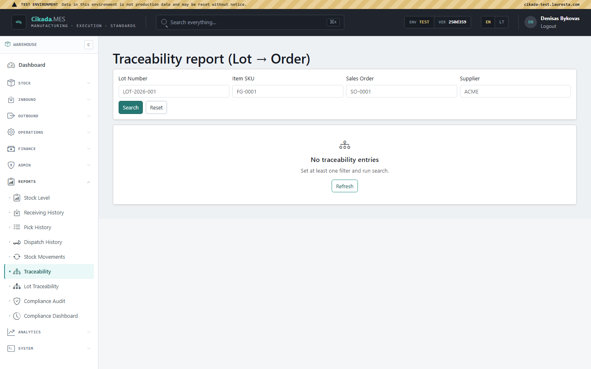
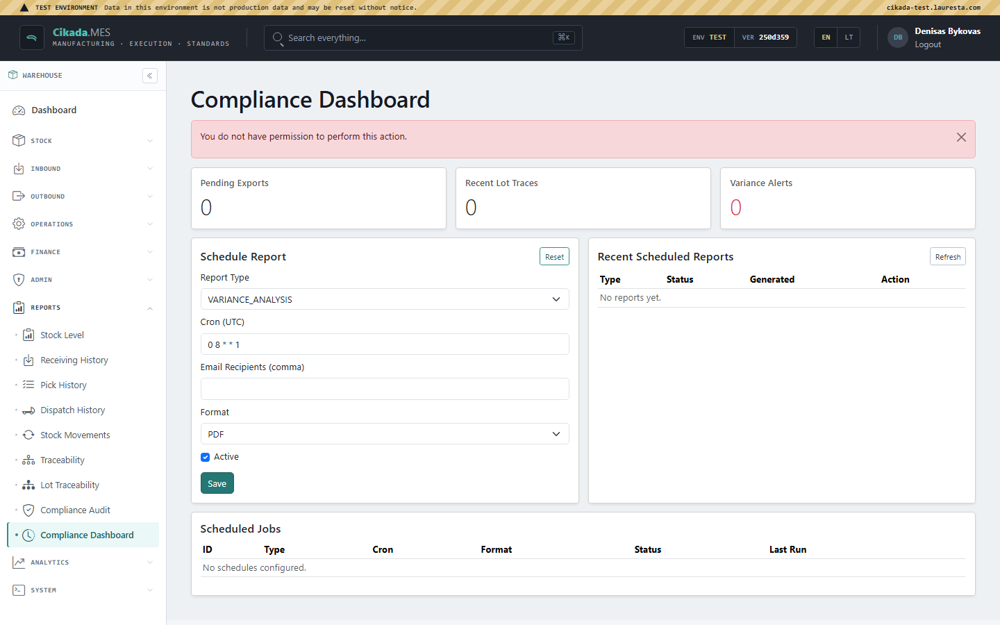

# Atsekamumas ir atitiktis

**Būsena:** dalinai

## Kam skirta
Sandėlio modulyje (Warehouse) skyriuje (UI: Reports) yra keturi ekranai atsekamumui ir atitikčiai: partijos kelio ataskaita (UI: Traceability), partijos medis (UI: Lot Traceability), veiksmų auditas (UI: Compliance Audit) ir planinių ataskaitų lentelė (UI: Compliance Dashboard). Jais atsakoma į klausimus „iš kurio tiekėjo atėjo partija ir kam išsiųsta“ ir „kas, kada ir ką sandėlyje pakeitė“. Deja, partijos ryšiai šiuo metu nustatomi pagal prekę, o ne pagal tikslią partiją, todėl rezultatai yra apytiksliai (žr. skyrių „Dar neįgyvendinta“).

## Prieš pradedant
- (UI: Reports > Traceability) gali atidaryti rolės Operator, QCInspector, WarehouseManager ir WarehouseAdmin.
- (UI: Reports > Lot Traceability) ir (UI: Reports > Compliance Dashboard) leidžiami tik rolėms WarehouseManager ir Auditor. Rolė WarehouseAdmin šių dviejų ekranų duomenų gauti negali.
- (UI: Reports > Compliance Audit) leidžiamas tik rolėms WarehouseManager ir WarehouseAdmin.
- Partija turi būti užregistruota, t. y. atsirasti priimant siuntą (žr. [Partijų ir serijų numeriai](P-11-partiju-seriju-sekimas.md)).

## Žingsniai
### 1. Partijos kelio ataskaita
1. Pasirinkite (UI: Reports > Traceability). Atidarius ekraną paieška paleidžiama automatiškai be filtrų ir parodo iki 100 partijų.
2. Įveskite vieną ar kelis filtrus: (UI: Lot Number) (tikslus numeris), (UI: Item SKU), (UI: Sales Order) arba (UI: Supplier) (teksto dalis). Spauskite (UI: Search). (UI: Reset) išvalo filtrus.
3. Kiekvienai partijai rodoma kortelė su trimis blokais: (UI: Upstream) (tiekėjas, siunta, priėmimo laikas, kiekis), (UI: Current) (vieta ir prieinamas kiekis) ir (UI: Downstream Sales) (išsiųsti pardavimo užsakymai su klientu, kiekiu, data ir sekimo numeriu).
4. Jei nurodytas (UI: Lot Number), o tokios partijos nėra, rodoma klaida „Lot not found.“

### 2. Partijos medis
1. Pasirinkite (UI: Reports > Lot Traceability). Atsidaro (UI: Lot Traceability).
2. Įveskite (UI: Lot Number) ir pasirinkite (UI: Direction): (UI: Backward (Supplier)) – nuo partijos iki tiekėjo, arba (UI: Forward (Customer)) – nuo partijos iki kliento.
3. Spauskite (UI: Build Trace). Rodomas (UI: Trace ID), sudarymo laikas ir medis iš mazgų (LOT, SHIPMENT, SUPPLIER, RESERVATION, OUTBOUND_ORDER, CUSTOMER). Jei partija neturi jokių ryšių, rodomas ženklelis (UI: Approximate).
4. (UI: Export CSV) išsaugo medį į failą `lot-trace-<numeris>.csv`. Mygtukas aktyvus tik sudarius medį.
5. Jei laukas tuščias, rodoma „Lot number is required.“; jei partijos nėra – „Lot not found.“

### 3. Veiksmų auditas
1. Pasirinkite (UI: Reports > Compliance Audit).
2. Nurodykite (UI: Start) ir (UI: End) (pagal nutylėjimą paskutinės 30 dienų) ir (UI: Report Type): STOCK_MOVEMENTS, ADJUSTMENTS, VALUATIONS arba USER_ACTIONS.
3. Spauskite (UI: Apply). (UI: Refresh) perkrauna. Lentelė: (UI: Timestamp), (UI: Type), (UI: Actor), (UI: Reference), (UI: Category), (UI: Details), (UI: Notes).
4. (UI: Export CSV) ir (UI: Export PDF) išsaugo failus `compliance-audit-<data>.csv` ir `.pdf`.

### 4. Planinės ataskaitos
1. Pasirinkite (UI: Reports > Compliance Dashboard). Viršuje trys skaičiai: (UI: Pending Exports), (UI: Recent Lot Traces), (UI: Variance Alerts).
2. Bloke (UI: Schedule Report) pasirinkite tipą (VARIANCE_ANALYSIS, TRANSACTION_EXPORT arba LOT_TRACE), įveskite (UI: Cron (UTC)) (pagal nutylėjimą `0 8 * * 1`, t. y. pirmadieniais 08:00 UTC), (UI: Email Recipients (comma)), (UI: Format) PDF arba CSV, žymą (UI: Active) ir spauskite (UI: Save). (UI: Reset) išvalo formą.
3. Lentelėje (UI: Scheduled Jobs) eilutės mygtukas (UI: Run) paleidžia ataskaitą iš karto, (UI: Delete) pašalina planą (be papildomo patvirtinimo).
4. Lentelėje (UI: Recent Scheduled Reports) rodomi paskutiniai 10 sugeneruotų failų su nuoroda (UI: Download).

## Ką reiškia būsenos ir spalvos
- (UI: Approximate) ženklelis: ryšys tarp partijos, tiekėjo ir kliento nustatytas pagal prekę, ne pagal partiją. Partijos kelio ataskaitoje (UI: Approximate Linkage) rodomas prie visų partijų.
- (UI: Variance Alerts) (raudonas skaičius): inventorizacijos eilučių, kuriose fizinis kiekis skiriasi nuo sistemos kiekio, skaičius.
- (UI: Pending Exports): laukiančių operacijų eksporto užduočių skaičius.
- Planinės ataskaitos būsena: (UI: Completed), (UI: Failed), (UI: InProgress), pagal tai, kaip baigėsi paskutinis generavimas.

## Dažnos klaidos
- Rodomas klaidos plakatas, o duomenų nėra: rolė neturi teisės šiam ekranui (žr. skyrių „Prieš pradedant“) arba serveris nepasiekiamas.
- „Lot not found.“ Partija su tokiu numeriu neegzistuoja. Patikrinkite numerį ekrane (UI: Admin > Lots).
- Medis tuščias ir pažymėtas (UI: Approximate): partijos prekei dar nėra nei priėmimų, nei išsiuntimų.
- Nuoroda (UI: Download) neatsidaro: nuorodoje įrašytas serverio failo kelias, o ne interneto adresas.

## Dar neįgyvendinta
- Partijos kelio ataskaita ir partijos medis nesieja įrašų su konkrečia partija: tiekėjas, siuntos ir išsiųsti užsakymai imami pagal tą pačią prekę. Partijos kelio ataskaitoje rodoma tik naujausia priėmimo siunta, o gamybos užsakymų blokas visada tuščias.
- Planinių ataskaitų gavėjų sąrašas (UI: Email Recipients (comma)) išsaugomas, bet laiškas, jei pašto siuntimas serveryje įjungtas, siunčiamas ne šiems gavėjams, o vienam bendram sistemos adresui. Jei pašto siuntimas išjungtas, laiškai nesiunčiami.
- Esamo plano redaguoti ekrane negalima: lentelėje nėra redagavimo mygtuko, galima tik sukurti naują, paleisti arba ištrinti.
- (UI: Recent Lot Traces) rodo išsaugotų partijos medžių skaičių, o ne tik naujausius.
