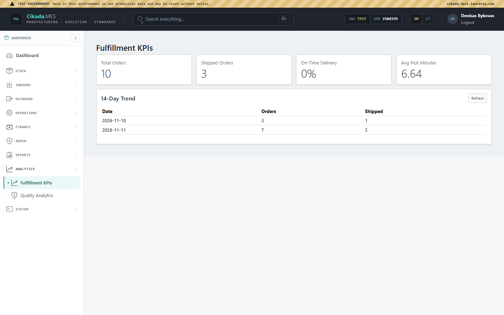
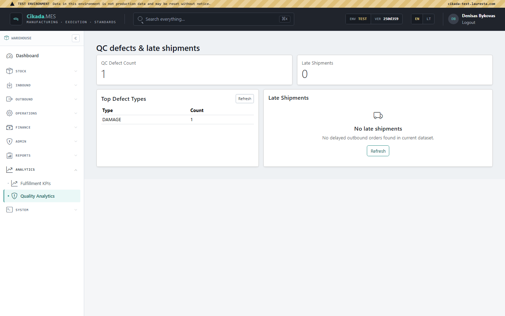

# Analitika (užsakymų vykdymas ir kokybė)

**Būsena:** dalinai

## Kam skirta
Sandėlio modulio (Warehouse) skyriuje (UI: Analytics) yra du skaičių ekranai vadovams. Ekranas (UI: Analytics > Fulfillment KPIs) rodo, kaip sekasi vykdyti pardavimo užsakymus: kiek išsiųsta, kiek laiku ir per kiek laiko surenkama. Ekranas (UI: Analytics > Quality Analytics) rodo kokybės defektų skaičių ir pavėluotas išsiuntimus. Abu ekranai tik rodo duomenis.

## Prieš pradedant
- Abu ekranus gali atidaryti rolės Operator, QCInspector, WarehouseManager ir WarehouseAdmin.
- Skaičiai skaičiuojami iš sistemoje esančių pardavimo ir išsiuntimo užsakymų, todėl ekranas bus tuščias, jei užsakymų nėra.
- Datų filtrų ekranuose nėra: skaičiuojami visi užsakymai.

## Žingsniai
### 1. Užsakymų vykdymo rodikliai
1. Meniu pasirinkite (UI: Analytics > Fulfillment KPIs). Atsidaro (UI: Fulfillment KPIs).
2. Viršuje keturios kortelės: (UI: Total Orders) (visi pardavimo užsakymai), (UI: Shipped Orders) (išsiųsti), (UI: On-Time Delivery) (procentas) ir (UI: Avg Pick Minutes) (vidutinis laikas nuo išsiuntimo užsakymo datos iki surinkimo, minutėmis).
3. Apačioje lentelė (UI: 14-Day Trend) su stulpeliais (UI: Date), (UI: Orders) ir (UI: Shipped): kiek užsakymų turi tos dienos užsakymo datą ir kiek iš jų jau išsiųsta (išsiuntimas gali būti vėlesnę dieną), už paskutines 14 dienų.
4. Mygtukas (UI: Refresh) perskaičiuoja duomenis. Ekranas pats neatsinaujina.

### 2. Kokybės ir pavėluotų išsiuntimų analizė
1. Pasirinkite (UI: Analytics > Quality Analytics). Atsidaro (UI: QC defects & late shipments).
2. Dvi kortelės: (UI: QC Defect Count) ir (UI: Late Shipments).
3. Kairėje lentelė (UI: Top Defect Types) su stulpeliais (UI: Type) ir (UI: Count). Mygtukas (UI: Refresh) perkrauna duomenis.
4. Dešinėje lentelė (UI: Late Shipments) su stulpeliais (UI: Order), (UI: Requested), (UI: Shipped) ir (UI: Current order status). Joje rodoma iki 100 naujausių išsiuntimų, kurie išsiųsti vėliau nei prašyta išsiuntimo data.

## Ką reiškia būsenos ir spalvos
- Rodiklis (UI: On-Time Delivery) skaičiuojamas tik iš išsiųstų užsakymų: laiku laikomas užsakymas, išsiųstas ne vėliau nei prašyta pristatymo diena. Užsakymai be prašomos pristatymo datos laiku nelaikomi.
- Kortelėje (UI: Late Shipments) skaičius gali siekti daugiausia 100, nes lentelė apribota iki 100 įrašų.
- Lentelėje (UI: Late Shipments) skiltis (UI: Current order status) rodo dabartinę išsiuntimo užsakymo būseną.
- Kai duomenų nėra, vietoj lentelių rodomi pranešimai „No KPI trend“, „No defects recorded“ arba „No late shipments“.

## Dažnos klaidos
- Rodomas klaidos plakatas su mygtuku (UI: Retry): serveris nepasiekiamas arba trūksta teisių. Pakartokite arba perduokite plakato sekimo kodą palaikymui.
- Visi skaičiai lygūs nuliui: sistemoje nėra pardavimo ar išsiuntimo užsakymų (žr. [P-03 Išsiuntimas](P-03-israsymas-isuntimas-outbound.md)).
- (UI: QC Defect Count) lygus nuliui, nors defektų būta: žr. toliau.

## Dar neįgyvendinta
- Kokybės ekrane rodomi defektai užregistruoti per sandėlio sąsają (API), o sandėlio programoje nėra ekrano ar mygtuko defektui įvesti. Todėl (UI: QC Defect Count) ir (UI: Top Defect Types) bus tušti, kol defektai neįvedami kitu būdu.
- Ekranuose nėra datų intervalo, filtrų ar eksporto į failą.
- Programos resursuose yra blokas „Late Shipment Root Causes“, bet ekrane jis nerodomas.
