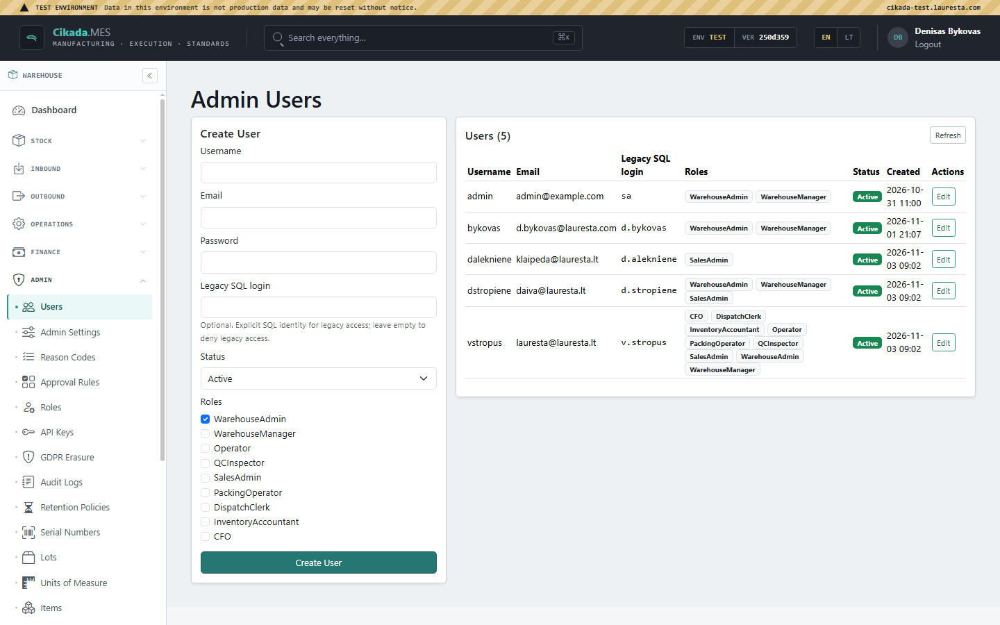
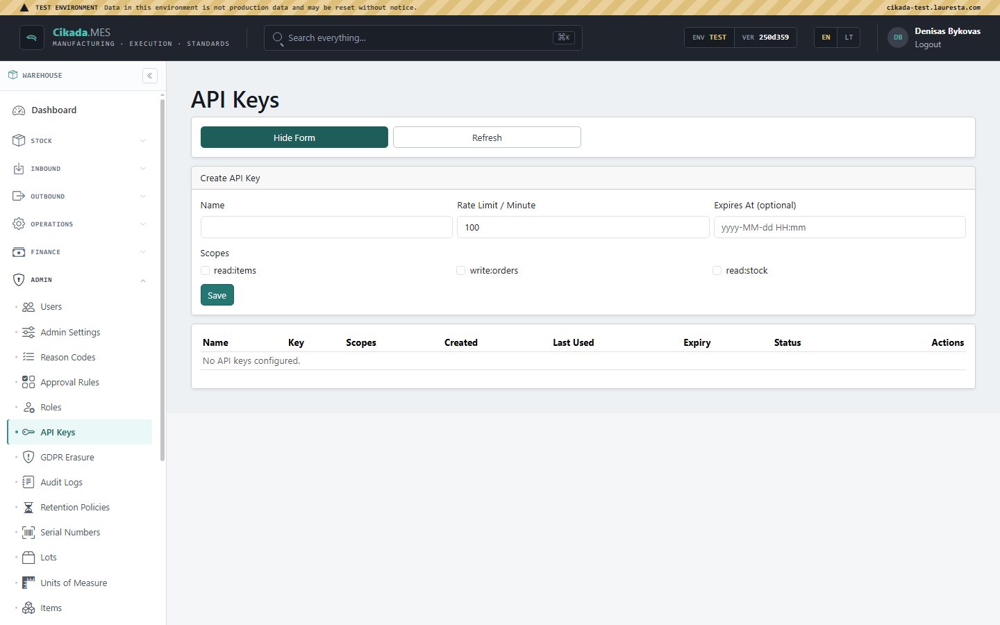

# Vartotojai, rolės ir API raktai

**Būsena:** dalinai

## Kam skirta
Sandėlio modulio (Warehouse) administratorius šiuose ekranuose kuria vartotojus `(UI: Admin > Users)`, tvarko papildomas roles su teisių rinkiniais `(UI: Admin > Roles)` ir išduoda API raktus kitoms sistemoms `(UI: Admin > API Keys)`. Visus tris ekranus naudoti gali tik rolė `WarehouseAdmin`.

## Prieš pradedant
- Turite būti prisijungę kaip `WarehouseAdmin`. Serveris kitoms rolėms atsako 403.
- Vartotojų kūrimui ir keitimui serveris papildomai reikalauja patikrintos Cikada administratoriaus sesijos. Jei jos nėra, rodoma klaida „A verified Cikada administrator session is required."
- Ekranai Roles ir API Keys rodo geltoną pranešimą „Admin role required.", jei stendo konfigūracijoje nėra administratoriaus rolės.

## Žingsniai

### 1. Naujo vartotojo sukūrimas
1. Meniu pasirinkite `(UI: Admin > Users)`. Kairėje yra forma `(UI: Create User)`, dešinėje - sąrašas `(UI: Users)`.
2. Užpildykite `(UI: Username)`, `(UI: Email)` ir `(UI: Password)`. Slaptažodis turi būti bent 8 simbolių, vartotojo vardas unikalus (iki 100 simbolių).
3. Jei vartotojui reikia prieigos prie senosios sistemos, įrašykite `(UI: Legacy SQL login)`. Laukas nebūtinas; palikus tuščią, senoji prieiga draudžiama. Leidžiamos raidės, skaitmenys ir simboliai `\ . - _ @ $`.
4. Pasirinkite `(UI: Status)`: `(UI: Active)` arba `(UI: Inactive)`.
5. Pažymėkite bent vieną rolę iš sąrašo `(UI: Roles)`: `WarehouseAdmin`, `WarehouseManager`, `Operator`, `QCInspector`, `SalesAdmin`, `PackingOperator`, `DispatchClerk`, `InventoryAccountant`, `CFO`. Pagal numatytąją pažymėta `WarehouseAdmin` - nuimkite, jei nenorite suteikti administratoriaus teisių.
6. Paspauskite `(UI: Create User)`. Pasirodo pranešimas „User ... created." ir vartotojas atsiranda sąraše.

### 2. Vartotojo keitimas
1. Sąraše prie vartotojo paspauskite `(UI: Edit)`. Apačioje atsidaro forma „Edit <vardas>".
2. Galite pakeisti `(UI: Email)`, `(UI: Legacy SQL login)` (ištrynus lauką senoji prieiga atimama), `(UI: Status)` ir roles.
3. Paspauskite `(UI: Save)` arba `(UI: Cancel)`.
4. Vartotojo vardo ir slaptažodžio šiame ekrane pakeisti negalima, vartotojo ištrinti taip pat negalima; atjungimui naudokite statusą `(UI: Inactive)`.

### 3. Papildomų rolių kūrimas ir priskyrimas
1. Meniu pasirinkite `(UI: Admin > Roles)`. Lentelėje rodomi stulpeliai `(UI: Name)`, `(UI: Description)`, `(UI: System)` ir `(UI: Permissions)`.
2. Naujai rolei paspauskite `(UI: Add Role)`, įveskite `(UI: Name)`, `(UI: Description)` ir pažymėkite teises. Teisių sąrašas fiksuotas: `ITEM`, `LOCATION`, `ORDER`, `QC`, kiekvienai po `READ` ir `UPDATE` (visos su sritimi `ALL`). Paspauskite `(UI: Save)`.
3. Rolei pakeisti paspauskite `(UI: Edit)`; šalinti - `(UI: Delete)` ir patvirtinkite `(UI: Delete Role)`. Sistemos rolių (`(UI: System)` = `(UI: Yes)`) ištrinti negalima.
4. Rolei priskirti vartotojui skiltyje `(UI: Assign Role To User)` pasirinkite `(UI: User)`, `(UI: Role)` ir paspauskite `(UI: Assign Role)`. Pasirodo pranešimas „Role assigned successfully."

### 4. API rakto sukūrimas, rotavimas ir šalinimas
1. Meniu pasirinkite `(UI: Admin > API Keys)`.
2. Paspauskite `(UI: Create New Key)`. Įveskite `(UI: Name)`, `(UI: Rate Limit / Minute)` (pagal numatytąją 100), nebūtinai `(UI: Expires At (optional))` formatu `yyyy-MM-dd HH:mm`, ir pažymėkite bent vieną sritį `(UI: Scopes)`: `read:items`, `write:orders`, `read:stock`. Paspauskite `(UI: Save)`.
3. Ekrane parodoma `(UI: One-time key value:)` reikšmė. Nusikopijuokite ją iš karto: vėliau ji neberodoma, lentelėje stulpelyje `(UI: Key)` matomi tik taškai.
4. Raktas pateikiamas HTTP antraštėje `X-API-Key`. Serveris tikrina rakto sritis, galiojimo pabaigą ir užklausų limitą per minutę.
5. Raktui pakeisti paspauskite `(UI: Rotate)`. Parodoma nauja reikšmė; ankstesnė reikšmė dar 7 dienas lieka galioti, kad kita sistema spėtų persijungti.
6. Raktui išjungti paspauskite `(UI: Delete)` ir patvirtinkite `(UI: Delete API Key)`. Raktas nėra fiziškai šalinamas, o tampa neaktyvus (stulpelis `(UI: Status)`); neaktyvaus rakto `(UI: Delete)` mygtukas išjungtas.

## Ką reiškia būsenos ir spalvos
- Users lentelėje `(UI: Status)`: žalias ženklelis - `(UI: Active)`, pilkas - `(UI: Inactive)`. Neaktyvus vartotojas neprisijungia.
- API Keys lentelėje `(UI: Last Used)` rodo paskutinį panaudojimą, `(UI: Expiry)` - galiojimo pabaigą arba „Never".

## Dažnos klaidos
- „Username, email, and password are required." - nepildytas vienas iš trijų privalomų laukų.
- „Select at least one role." - nepažymėta nė viena rolė.
- „Password must be at least 8 characters." arba „Username must be unique." - serverio patikros pranešimai kuriant vartotoją.
- „Select a user." / „Select a role." - Roles ekrane prieš `(UI: Assign Role)` nepasirinktas vartotojas arba rolė.
- „At least one scope is required." - kuriant API raktą nepažymėta nė viena sritis.

## Dar neįgyvendinta
- Ekranas Users siūlo tik 9 fiksuotas roles. Serverio politikos naudoja ir rolę `Auditor` (audito žurnalų ir atitikties peržiūra), bet jos per šį ekraną priskirti negalima.
- Ekrane Roles sukurtos rolės su teisėmis `ITEM`, `LOCATION`, `ORDER`, `QC` realiai tikrinamos tik tada, kai vartotojas turi bent vieną čia priskirtą rolę, ir tik užklausoms į prekių, vietų, kokybės kontrolės ir užsakymų API. Administravimo API šių teisių netikrina, o API raktų užklausoms jos netaikomos.

## Susiję puslapiai
- [P-14 Sistemos administravimas](P-14-sistemos-administravimas.md)
- [P-31 Auditas, duomenų saugojimas, GDPR, atsarginės kopijos](P-31-auditas-saugojimas-gdpr-kopijos.md)
