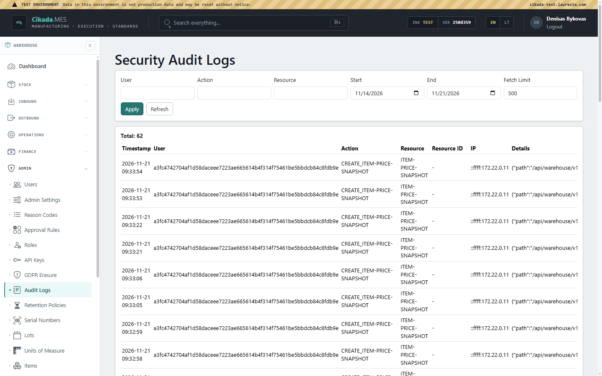
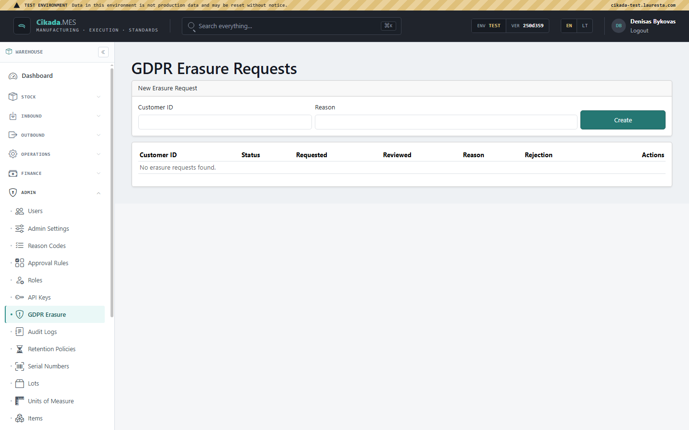

# Auditas, duomenų saugojimas, GDPR, atsarginės kopijos ir avarinio atkūrimo bandymai

**Būsena:** dalinai

## Kam skirta
Sandėlio modulio (Warehouse) administratorius šiuose ekranuose peržiūri saugumo audito žurnalą `(UI: Admin > Audit Logs)`, nustato duomenų saugojimo terminus `(UI: Admin > Retention Policies)`, tvarko klientų duomenų ištrynimo (anonimizavimo) prašymus pagal GDPR `(UI: Admin > GDPR Erasure)`, paleidžia atsarginių kopijų operacijas `(UI: Admin > Backups)`, ir avarinio atkūrimo bandymus `(UI: Admin > DR Drills)`. Svarbu: atsarginių kopijų ir avarinio atkūrimo ekranai šiuo metu yra imitacija, žr. skyrių „Dar neįgyvendinta".

## Prieš pradedant
- Visi penki ekranai prieinami tik rolei `WarehouseAdmin` (serveris kitoms rolėms atsako 403).
- Jei ekrane matote „Admin role required.", šiam stendui nesukonfigūruota administratoriaus rolė.
- Klientas, kuriam taikomas GDPR prašymas, turi egzistuoti: klientas kuriamas ekrane `(UI: Admin > Customers)`, žr. [P-15](P-15-pagrindinis-duomenu-valdymas.md).

## Žingsniai

### 1. Audito žurnalo peržiūra
1. Meniu pasirinkite `(UI: Admin > Audit Logs)`. Atsidaro puslapis `(UI: Security Audit Logs)`.
2. Naudokite filtrus: `(UI: User)`, `(UI: Action)`, `(UI: Resource)`, datos `(UI: Start)` ir `(UI: End)`, `(UI: Fetch Limit)` (kiek įrašų paimti iš serverio).
3. Paspauskite `(UI: Apply)`. Paspaudus `(UI: Refresh)` sąrašas įkeliamas iš naujo.
4. Lentelės stulpeliai: `(UI: Timestamp)`, `(UI: User)`, `(UI: Action)`, `(UI: Resource)`, `(UI: Resource ID)`, `(UI: Details)`. Apačioje yra puslapiavimas ir viso įrašų skaičius `(UI: Total)`.

### 2. Duomenų saugojimo politikos
1. Meniu pasirinkite `(UI: Admin > Retention Policies)`.
2. Paspauskite `(UI: Create Policy)`. Pasirinkite `(UI: Data Type)` (`Events`, `Projections`, `AuditLogs`, `CustomerData`), įveskite `(UI: Retention Days)` (daugiau už 0), nebūtinai `(UI: Archive After)` ir `(UI: Delete After)` (dienomis, ne mažiau už 0), palikite `(UI: Active)` ir paspauskite `(UI: Save)`.
3. Politiką galima keisti `(UI: Edit)` arba šalinti `(UI: Delete)`.
4. Paspaudus `(UI: Execute Now)`, politikos įvykdomos iš karto; pranešime nurodoma, kiek įrašų suarchyvuota ir kiek ištrinta.
5. Skiltyje `(UI: Audit Log Legal Hold)` įveskite `(UI: Audit Log ID)`, pasirinkite `(UI: Legal Hold)` = `(UI: Enabled)` arba `(UI: Disabled)` ir paspauskite `(UI: Apply Legal Hold)`. Įrašo teisinis įšaldymas yra skirtas apsaugoti nuo ištrynimo.

### 3. GDPR ištrynimo prašymai
1. Meniu pasirinkite `(UI: Admin > GDPR Erasure)`. Atsidaro puslapis `(UI: GDPR Erasure Requests)`.
2. Naujam prašymui skiltyje `(UI: New Erasure Request)` įveskite `(UI: Customer ID)` (kliento GUID identifikatorius) ir `(UI: Reason)`, paspauskite `(UI: Create)`. Jei identifikatorius nėra GUID, rodoma „Customer ID must be a valid GUID."
3. Prašymas sąraše gauna būseną PENDING. Prie jo paspauskite `(UI: Approve)` arba `(UI: Reject)`.
4. Atmetant įveskite `(UI: Rejection Reason)` ir paspauskite `(UI: Confirm Reject)`.
5. Patvirtinus, serveris fone įvykdo anonimizavimą: kliento pavadinimas pakeičiamas į „Customer-<identifikatorius>", el. paštas užmaskuojamas, telefonas išvalomas, klientas tampa neaktyvus, adresai užmaskuojami, o pardavimo užsakymų ir siuntų santraukose pakeičiamas kliento pavadinimas. Prašymas tampa COMPLETED.

### 4. Atsarginės kopijos
1. Meniu pasirinkite `(UI: Admin > Backups)`. Atsidaro puslapis `(UI: Backup Management)`.
2. Paspauskite `(UI: Trigger Backup)`. Naujas įrašas atsiranda lentelėje su stulpeliais `(UI: Type)`, `(UI: Status)`, `(UI: Started)`, `(UI: Completed)`, `(UI: Size (bytes))`, `(UI: Artifact)`.
3. Atkūrimui lauke `(UI: Restore Target)` įveskite tikslinės aplinkos pavadinimą (privalomas) ir paspauskite `(UI: Restore)` prie įrašo. Mygtukas aktyvus tik kai būsena „COMPLETED". Pranešime rodomas rezultatas ir `(UI: Evidence: ...)` kelias.

### 5. Avarinio atkūrimo bandymai
1. Meniu pasirinkite `(UI: Admin > DR Drills)`. Atsidaro puslapis `(UI: Disaster Recovery Drills)`.
2. Lauke `(UI: Scenario)` pasirinkite `DATA_CENTER_OUTAGE`, `DATABASE_CORRUPTION` arba `RANSOMWARE` ir paspauskite `(UI: Trigger Drill)`.
3. Lentelėje stebėkite `(UI: Status)`, `(UI: Started)`, `(UI: Completed)`, `(UI: Actual RTO)` ir `(UI: Issues)` (geltoni ženkleliai).

## Ką reiškia būsenos ir spalvos
- GDPR prašymo būsenos: PENDING (laukia sprendimo, tik tada aktyvūs `(UI: Approve)` ir `(UI: Reject)`), APPROVED (patvirtintas, laukia vykdymo), COMPLETED (anonimizuota), REJECTED (atmesta, nurodyta priežastis).
- Backups: mygtukas `(UI: Restore)` išjungtas, jei kopijos būsena ne „COMPLETED".
- DR Drills: geltonas ženklelis stulpelyje `(UI: Issues)` reiškia bandymo metu pastebėtą problemą.

## Dažnos klaidos
- „Target environment is required." - nepildytas `(UI: Restore Target)`.
- „Audit Log ID must be greater than zero." - Retention Policies ekrane įvestas neteisingas žurnalo įrašo numeris.
- „Customer '<id>' was not found." - GDPR prašyme nurodytas nesantis kliento identifikatorius.
- „Erasure request ... must be PENDING to approve." - prašymas jau išspręstas.

## Dar neįgyvendinta
- Backups: `(UI: Trigger Backup)` ir `(UI: Restore)` tik sukuria tekstinį failą `artifacts/backups` ir `artifacts/restores` aplankuose (turinyje parašyta „Simulated pg_dump backup" ir „Restore simulation"). Tikras duomenų bazės išsaugojimas ar atkūrimas nevykdomas, todėl šio ekrano nepakanka kaip tikrai atsarginei kopijai.
- DR Drills: bandymas tik surašo žingsnių žurnalo failus ir skaičiuoja laiką, jokie skriptai nepaleidžiami. Scenarijus `DATA_CENTER_OUTAGE` visada pažymimas problema „DNS switch automation failed" (užprogramuota kode).
- Retention Policies: `(UI: Execute Now)` realiai apdoroja tik politikas su `(UI: Data Type)` = `AuditLogs` (archyvuoja ir ištrina pasibaigusius audito įrašus, išskyrus teisiškai įšaldytus). Politikos `Events`, `Projections` ir `CustomerData` išsaugomos, bet kode nerasta, kad kas nors jas vykdytų.

## Susiję puslapiai
- [P-14 Sistemos administravimas](P-14-sistemos-administravimas.md)
- [P-30 Vartotojai, rolės ir API raktai](P-30-vartotojai-roles-api-raktai.md)
