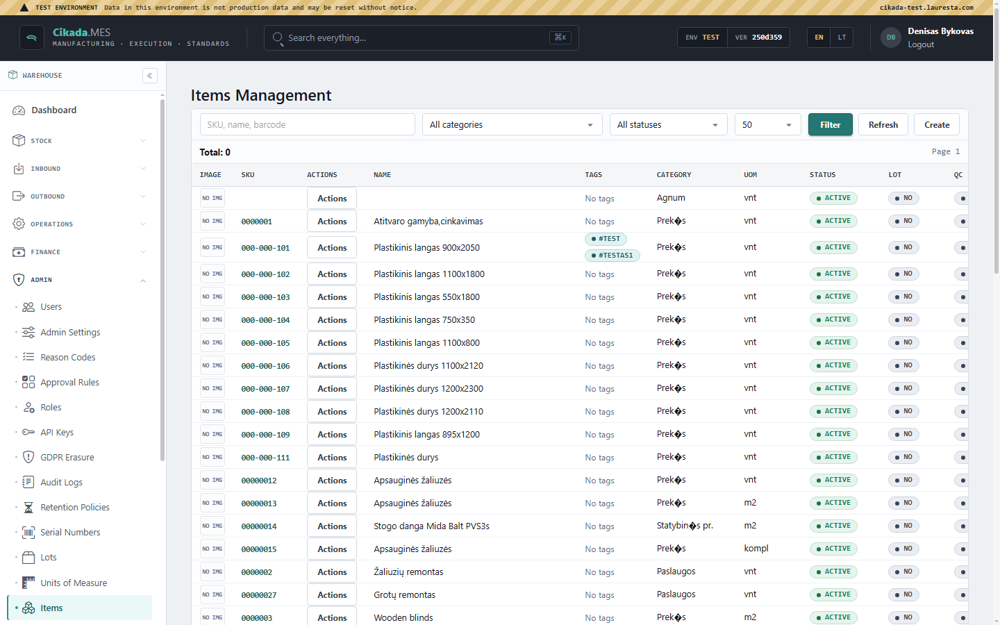
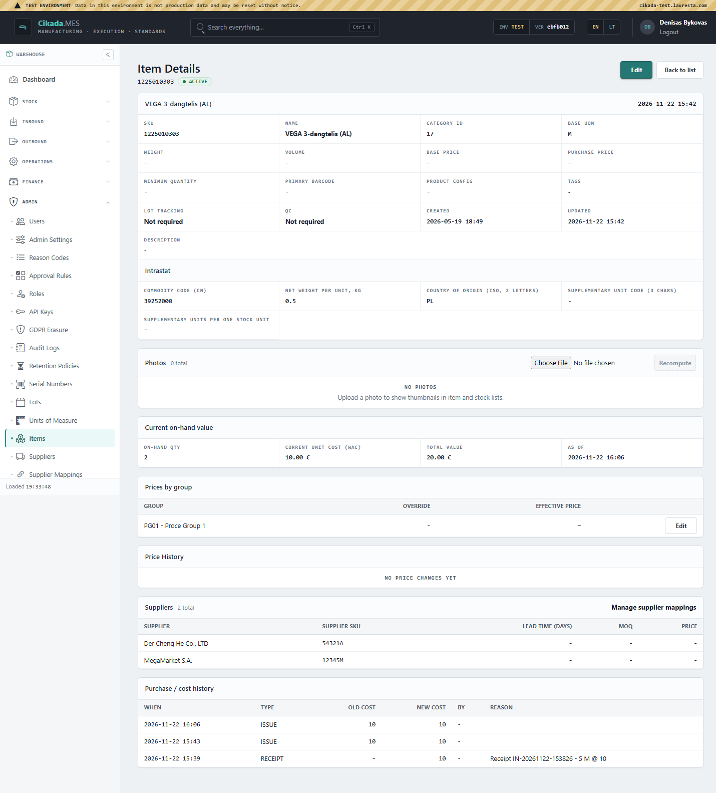

# Prekių pagrindiniai duomenys - prekės, kategorijos, matavimo vienetai, partijos, serijos numeriai

**Būsena:** veikia

## Kam skirta
Sandėlio modulio (Warehouse) skiltyje `(UI: Admin)` tvarkomi prekių duomenys: prekių kortelės `(UI: Admin > Items)`, kategorijos `(UI: Admin > Categories)`, matavimo vienetai `(UI: Admin > Units of Measure)`, partijų sąrašas `(UI: Admin > Lots)` ir serijos numeriai `(UI: Admin > Serial Numbers)`. Nuo šių duomenų priklauso priėmimas, atsargos, pirkimo dokumentų apskaita ir Intrastat ataskaita.

## Prieš pradedant
- Prekes, kategorijas ir kainų perrašymus kurti bei keisti gali `WarehouseManager` ir `WarehouseAdmin`. Peržiūrėti prekes, kategorijas, matavimo vienetus ir partijas gali ir `Operator`, `QCInspector`.
- Prekė reikalauja kategorijos ir bazinio matavimo vieneto. Todėl pirmiausia sukurkite kategoriją (4 žingsnis); matavimo vienetai tik peržiūrimi (5 žingsnis).
- Serijos numerių ekrane registruoti ir keisti būseną gali `Operator` ir aukštesnės rolės, bet ekranas rodo „Admin role required.", jei stendo konfigūracijoje nėra administratoriaus rolės.
- Kitų tiekėjų ir klientų duomenys aprašyti puslapyje [P-15 Pagrindinių duomenų valdymas](P-15-pagrindinis-duomenu-valdymas.md).

## Žingsniai

### 1. Prekės sukūrimas ir keitimas
1. Meniu pasirinkite `(UI: Admin > Items)`. Atsidaro puslapis `(UI: Items Management)`.
2. Sąrašą galima filtruoti: paieška `(UI: SKU, name, barcode)`, kategorija `(UI: All categories)`, būsena `(UI: All statuses)`; paspauskite `(UI: Filter)`.
3. Naujai prekei paspauskite `(UI: Create)`. Atsidaro dialogas `(UI: Create Item)`.
4. Užpildykite pagrindinius laukus: `(UI: Internal SKU)` (jei paliksite tuščią, kodas sugeneruojamas automatiškai: `(UI: Auto-generated if empty)`), `(UI: Name)` (privalomas), `(UI: Category)` (privalomas), `(UI: Base UoM)` (privalomas), `(UI: Status)` (`(UI: Active)`, `(UI: Discontinued)`, `(UI: Obsolete)`).
5. Pasirinkite `(UI: Item Type)`: `(UI: Stock)` arba `(UI: Service)`. Paslaugų prekės (pvz., transportas, pristatymas) fizinio likučio negauna. Pasirinkus `(UI: Service)` atsiranda laukas `(UI: Cost Type)` - papildomų išlaidų grupė, į kurią paslaugos suma įskaičiuojama pirkimo dokumente.
6. Papildomi laukai: `(UI: Primary Barcode)`, `(UI: Weight)`, `(UI: Volume)`, `(UI: Base Price)`, `(UI: Purchase Price)`, `(UI: Product Config)`, žymos `(UI: Tags)` (įrašykite ir paspauskite `(UI: Add)`), `(UI: Description)`.
7. Pažymėkite `(UI: Requires lot tracking)`, jei prekė sekama pagal partijas, ir `(UI: Requires QC)`, jei priėmimo metu reikalinga kokybės kontrolė.
8. Paspauskite `(UI: Create Item)`. Redaguojant to paties dialogo mygtukas vadinasi `(UI: Save Changes)`; Internal SKU redaguojant nebekeičiamas.

### 2. Muitinės kodas (CN) ir neto svoris ES įsigijimams
Prekės, kurios perkamos iš ES tiekėjų (ES įsigijimas, Intrastat), privalo turėti muitinės kodą ir neto svorį. Šie laukai yra tame pačiame dialoge `(UI: Create Item)` / `(UI: Edit Item)`:
1. `(UI: Commodity code (CN))` - 8 skaitmenų kombinuotosios nomenklatūros kodas. Pagalbinis tekstas: „8 digits; needed for EU purchases". Jei įrašyta ne 8 skaitmenys, dialogas rodo „Commodity code must be 8 digits."
2. `(UI: Net weight per unit, kg)` - vieno bazinio vieneto neto svoris kilogramais. Turi būti didesnis už 0, kitaip rodoma „Net weight must be greater than zero."
3. `(UI: Country of origin (ISO, 2 letters))` - kilmės šalis dviem raidėmis (ES įsigijimui privaloma).
4. `(UI: Supplementary unit code (3 characters, customs measurement unit classifier))` ir `(UI: Supplementary units per one stock unit)` - papildomas Intrastat matavimo vienetas ir kiek tokių vienetų yra viename sandėlio vienete (pvz. m2 ir 1,5, jei vienas gaminys yra 1,5 m2). Kodas turi būti 3 simbolių muitinės matavimo vienetų klasifikatoriaus kodas (jis patenka į XML failą). Užpildykite tik prekėms, kurių CN kodui reikia papildomo vieneto; abu laukai pildomi kartu, koeficientas didesnis už 0.
5. Šie laukai nėra privalomi saugant prekę, bet pirkimo dokumento apskaitos metu serveris tikrina: kiekvienai atsargų (`(UI: Stock)`) prekei ES įsigijimo dokumente reikia 8 skaitmenų kodo, neto svorio didesnio už 0 ir kilmės šalies (kitaip rodoma pranešimas apie kilmės šalį), o taip pat, jei papildomas vienetas nurodytas, jo koeficiento. Dėl kodo ir svorio rodoma „Every stock item of an EU acquisition needs an 8-digit commodity code and a net weight." Paslaugų prekėms šių duomenų nereikia.
6. Intrastat ataskaitoje prekės eilutė be CN kodo, kilmės šalies ar papildomo vieneto koeficiento praleidžiama ir įrašoma į įspėjimų sąrašą.
7. Šie laukai rodomi ir prekės kortelės skirtuke `(UI: Data)`, skiltyje `(UI: Intrastat)`; jei ko nors trūksta, prie skilties rodoma žyma `(UI: Data missing)`, kitaip – `(UI: Data complete)`. Laukus keiskite per `(UI: Edit)` dialogą (sąraše arba skilties `(UI: Main)` antraštėje) arba keliom prekėm iš karto, žr. [P-21](P-21-intrastat-atvykimai.md).

### 3. Prekės kortelė: likučiai, judėjimai, kainos, nuotraukos
1. Sąraše pasirinkite eilutės meniu `(UI: Actions)` ir `(UI: Details)` arba paspauskite SKU. Atsidaro prekės kortelė; į sąrašą grąžina nuoroda `(UI: Items)` viršuje.
2. Viršuje rodoma nuotrauka, kategorija, pavadinimas, SKU, būsena, vienetas, brūkšninis kodas (jei jo nėra, `(UI: Assign)` atidaro redagavimą), pirmasis tiekėjas ir likučio juosta: rezervuota, laisva ir laukiama (atviros priėmimo siuntos) su minimalaus kiekio žyma. Mygtukai `(UI: Move)` ir `(UI: Adjust stock)` atidaro perkėlimo ir likučio korekcijos langus, `(UI: Show in 3D)` – sandėlio 3D vaizdą su pažymėta vieta. Pardavimo kainą ir minimalų kiekį galima pakeisti per `(UI: Change)` (Enter – išsaugoti, Esc – atšaukti).
   Skirtukai: `(UI: Locations)` (likutis pagal vietas su veiksmais eilutėje ir rezervacijos), `(UI: Movements)` (judėjimai su filtrais ir einamuoju likučiu), `(UI: Prices & suppliers)` (kainos, WAC, `(UI: Prices by group)`, tiekėjai, `(UI: Price History)`, `(UI: Purchase / cost history)`), `(UI: Photos)` ir `(UI: Data)` (visi laukai). Pasirinktas skirtukas išlieka nuorodoje (`?tab=`). Dešinėje visada matomi `(UI: Recent movements)`, `(UI: Incoming)` ir `(UI: Reserved)`.
3. Skiltyje `(UI: Prices by group)` prie grupės paspauskite `(UI: Edit)`, įveskite kainą stulpelyje `(UI: Override)` ir paspauskite `(UI: Save)`. Grupės kuriamos ekrane `(UI: Admin > Price Groups)`. Jei grupių nėra, rodomas pranešimas „No price groups".
4. Skirtuke `(UI: Photos)` nuotrauką nutempkite į laukelį arba spauskite `(UI: Choose file)`; ją galima nustatyti kaip pagrindinę `(UI: Primary)`, atidaryti `(UI: Open)` ir ištrinti `(UI: Delete)`; mygtukas `(UI: Recompute search index)` perskaičiuoja paieškos pagal paveikslėlį duomenis. Tas pats veikia ir iš sąrašo per `(UI: Photos)`.
5. Prekei išjungti sąraše pasirinkite `(UI: Actions)` > `(UI: Deactivate)` ir patvirtinkite.

### 4. Kategorijos
1. Meniu pasirinkite `(UI: Admin > Categories)`. Atsidaro puslapis `(UI: Categories Management)`.
2. Skiltyje `(UI: Create Category)` įveskite `(UI: Code)`, `(UI: Name)` ir nebūtinai `(UI: Parent Id)`, paspauskite `(UI: Save)`.
3. Eilutėje `(UI: Edit)` atidaro redagavimo formą, `(UI: Save Changes)` išsaugo; `(UI: Delete)` pašalina kategoriją.

### 5. Matavimo vienetai, partijos, serijos numeriai
1. `(UI: Admin > Units of Measure)`: ekranas tik peržiūrai. Filtruokite pagal paiešką ir `(UI: UoM Type)` (`(UI: Weight)`, `(UI: Volume)`, `(UI: Piece)`, `(UI: Length)`), `(UI: Filter)`. Matote tris lenteles: `(UI: Units)`, `(UI: Handling Unit Types)`, `(UI: Item UoM Conversions)`. Kurti ar keisti vienetų per šį ekraną negalima.
2. `(UI: Admin > Lots)`: partijų sąrašas tik peržiūrai; filtrai `(UI: Lot number, SKU, item name)` ir būsena (`(UI: Active)`, `(UI: Expiring soon)`, `(UI: Expired)`, `(UI: Depleted)`). Stulpeliai: `(UI: Lot)`, `(UI: Item)`, `(UI: Qty)`, `(UI: Reserved)`, `(UI: Available)`, `(UI: Expiry)`, `(UI: Status)`.
3. `(UI: Admin > Serial Numbers)`: skiltyje `(UI: Register Serial)` įveskite `(UI: Item ID)`, `(UI: Serial)`, `(UI: Location)`, `(UI: Warranty Date)` ir paspauskite `(UI: Register)`. Paieška pagal serijos numerį, prekę, būseną ar vietą; eilutėje `(UI: Update Status)` leidžia pasirinkti būseną (`Received`, `Available`, `Issued`, `Returned`, `Scrapped`) ir vietą, tada `(UI: Save)`.

## Ką reiškia būsenos ir spalvos
- Prekės `(UI: Status)`: `(UI: Active)` - aktyvi; `(UI: Discontinued)` - nebegaminama; `(UI: Obsolete)` - pasenusi.
- Partijų būsena: `(UI: Expiring soon)` - netrukus baigsis galiojimas, `(UI: Expired)` - pasibaigė, `(UI: Depleted)` - likutis išnaudotas.

## Dažnos klaidos
- „Name is required.", „Category is required.", „Base UoM is required." - nepildytas privalomas laukas prekės dialoge.
- „Commodity code must be 8 digits." - CN kodas ne iš 8 skaitmenų.
- „Category has child categories and cannot be deleted." arba „Category is referenced by items and cannot be deleted." - prieš trinant reikia pašalinti vaikines kategorijas arba perkelti prekes.
- „Category '<kodas>' already exists." - kategorijos kodas turi būti unikalus.

## Susiję puslapiai
- [P-15 Pagrindinių duomenų valdymas](P-15-pagrindinis-duomenu-valdymas.md)
- [P-33 Sandėliai, vietos, slotai ir sandėlio maketas](P-33-sandeliai-vietos-slotai-maketas.md)
- [P-11 Partijų ir serijų sekimas](P-11-partiju-seriju-sekimas.md)
