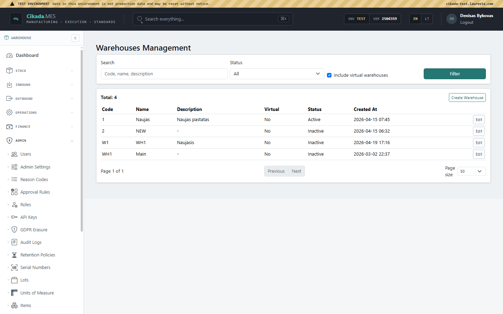
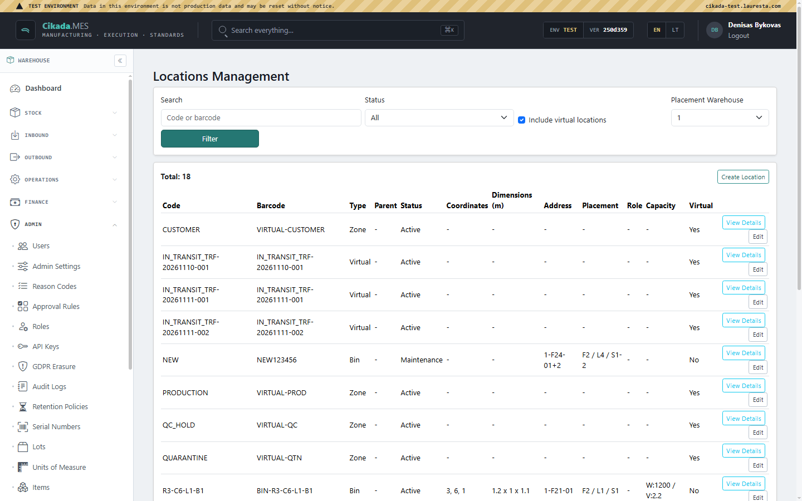
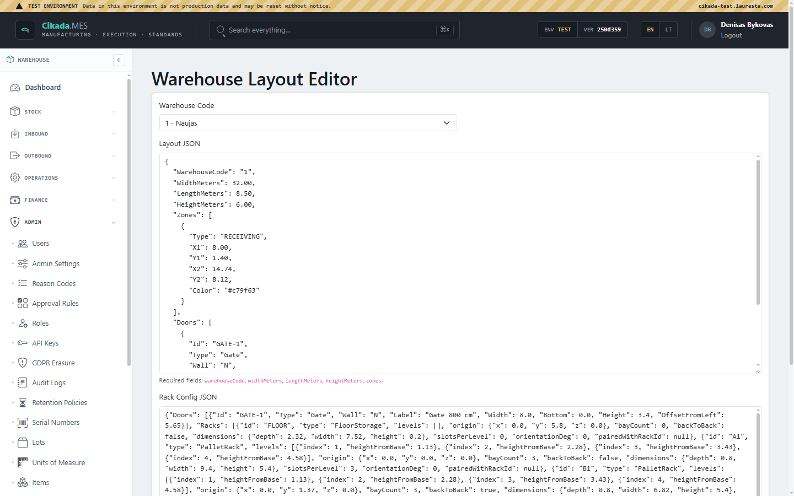

# Sandėliai, sandėlio vietos, slotai ir sandėlio maketas

**Būsena:** veikia

## Kam skirta
Sandėlio modulio (Warehouse) skiltyje `(UI: Admin)` aprašoma fizinė sandėlio struktūra: sandėliai `(UI: Admin > Warehouses)`, sandėlio vietos `(UI: Admin > Locations)`, lentynų slotai `(UI: Admin > Slots)` ir sandėlio maketas `(UI: Admin > Layout Editor)`. Šiuos duomenis naudoja priėmimas, padėjimas į vietas, atsargų ir sandėlio žemėlapio ekranai.

## Prieš pradedant
- Sandėlius, vietas ir slotų priskyrimus kurti bei keisti gali `WarehouseManager` ir `WarehouseAdmin`; peržiūrėti gali ir `Operator`, `QCInspector`.
- Sandėlio maketą (Layout Editor) išsaugoti gali tik `WarehouseAdmin`. Ekranas rodo „Admin role required.", jei stendo konfigūracijoje nėra administratoriaus rolės.
- Eilė tokia: pirmiausia sukurkite sandėlį, tada vietas, tada pagal maketą priskirkite vietas slotams.

## Žingsniai

### 1. Sandėlio sukūrimas
1. Meniu pasirinkite `(UI: Admin > Warehouses)`. Atsidaro puslapis `(UI: Warehouses Management)`.
2. Filtruokite pagal paiešką `(UI: Code, name, description)`, būseną `(UI: Status)` ir varnelę `(UI: Include virtual warehouses)`; paspauskite `(UI: Filter)`.
3. Paspauskite `(UI: Create Warehouse)`. Įveskite `(UI: Code)` ir `(UI: Name)` (abu privalomi), nebūtinai `(UI: Description)`, pasirinkite `(UI: Status)` (`(UI: Active)` arba `(UI: Inactive)`), pažymėkite `(UI: Virtual)` jei tai virtualus sandėlis, ir paspauskite `(UI: Save)`.
4. Sandėliui pakeisti prie eilutės paspauskite `(UI: Edit)`. Kodas redaguojant nekeičiamas.

### 2. Sandėlio vietų kūrimas ir keitimas
1. Meniu pasirinkite `(UI: Admin > Locations)`. Atsidaro puslapis `(UI: Locations Management)`.
2. Filtrai: paieška `(UI: Code or barcode)`, `(UI: Status)` (`(UI: Active)`, `(UI: Blocked)`, `(UI: Maintenance)`), `(UI: Include virtual locations)`, `(UI: Placement Warehouse)`; paspauskite `(UI: Filter)`.
3. Paspauskite `(UI: Create Location)`. Privalomi: `(UI: Code)`, `(UI: Barcode)`, `(UI: Type)` (laisvas tekstas, pagal numatytąją „Bin"). Pasirinktinai: `(UI: Parent Id)`, `(UI: Status)`, `(UI: Max Weight)`, `(UI: Max Volume)`, `(UI: Zone Type)` (`(UI: General)`, `(UI: Refrigerated)`, `(UI: Hazmat)`, `(UI: Quarantine)`), koordinatės `(UI: Coordinate X)`, `(UI: Coordinate Y)`, `(UI: Coordinate Z)`, matmenys `(UI: Width (m))`, `(UI: Length (m))`, `(UI: Height (m))`, adreso dalys `(UI: Aisle)`, `(UI: Rack)`, `(UI: Level)`, `(UI: Bin)`, `(UI: Capacity Weight)`, `(UI: Capacity Volume)` ir `(UI: Virtual)`.
4. Paspauskite `(UI: Save)`.
5. Vietai pakeisti paspauskite `(UI: Edit)`. Virtualios vietos kodas ir brūkšninis kodas užrakinti. Mygtukas `(UI: View Details)` atidaro vietos detalų puslapį.
6. Redagavimo formoje yra skiltis `(UI: Rack Placement)`: pasirinkite `(UI: Placement Warehouse)`, įveskite `(UI: Rack Row Id)`, `(UI: Shelf Level)`, `(UI: Slot Start)`, `(UI: Slot Span)`, pasirinkite `(UI: Location Role)` (`(UI: Cell)`, `(UI: Bulk)`, `(UI: EndCap)`, `(UI: Overflow)`, `(UI: GroundSlot)`). Laukas `(UI: Computed Address)` parodo apskaičiuotą adresą. Lentynų išdėstymas leidžiamas tik tinkamoms nevirtualioms vietoms.

### 3. Slotų priskyrimas
1. Meniu pasirinkite `(UI: Admin > Slots)`. Atsidaro puslapis `(UI: Warehouse Slots)`.
2. Pasirinkite `(UI: Warehouse)`, pagal poreikį `(UI: Address or location)` (pvz., „2-C3-01"), `(UI: Rack)`, `(UI: Level)`, varnelę `(UI: Free only)`. Sąrašas apskaičiuojamas iš lentynų maketo ir faktinio užimtumo; atnaujinimui paspauskite `(UI: Reload)`.
3. Laisvo slot eilutėje paspauskite `(UI: Assign)`, pasirinkite `(UI: Select location)` ir `(UI: Slot span)`, tada `(UI: Assign)`. `(UI: Cancel)` atsisako veiksmo.
4. Užimto slot eilutėje paspauskite `(UI: Clear)`, kad atlaisvintumėte priskyrimą.

### 4. Sandėlio maketo redagavimas
1. Meniu pasirinkite `(UI: Admin > Layout Editor)`. Atsidaro puslapis `(UI: Warehouse Layout Editor)`. Tai ne grafinis redaktorius, o JSON teksto laukai.
2. Pasirinkite `(UI: Warehouse Code)`. Lauke `(UI: Layout JSON)` rodomas esamas maketas. Būtini laukai: `warehouseCode`, `widthMeters`, `lengthMeters`, `heightMeters`, `zones`. Kiekviena zona turi turėti tipą ir spalvą, o koordinatės turi tenkinti `x2 > x1` ir `y2 > y1`.
3. Lauke `(UI: Rack Config JSON)` galima pateikti lentynų struktūros dokumentą; senesniems sandėliams paliekamas tuščias.
4. Paspauskite `(UI: Save Layout)`. Pavyus rodoma „Layout updated successfully." ir `(UI: Last updated at ...)`. `(UI: Reload)` atmeta neišsaugotus pakeitimus ir įkelia išsaugotą maketą.

## Ką reiškia būsenos ir spalvos
- Vietos `(UI: Status)`: `(UI: Active)` - naudojama; `(UI: Blocked)` - užblokuota; `(UI: Maintenance)` - remontas.
- Slotų ekrane `(UI: Status)`: `(UI: Occupied)` - slotas jau priskirtas vietai, `(UI: Free)` - laisvas.

## Dažnos klaidos
- „Field 'code' is required.", „Field 'barcode' is required.", „Field 'type' is required." - nepildytas privalomas laukas.
- „Location code '...' already exists." arba „Location barcode '...' already exists." - kodas ir brūkšninis kodas turi būti unikalūs.
- „Warehouse code '...' already exists." - sandėlio kodas jau naudojamas.
- „Select a placement warehouse before saving rack placement." ir „RackRowId, ShelfLevelIndex, and SlotStart are required for rack placement." - neužpildyta lentynų išdėstymo skiltis.
- „Selected span overlaps an occupied or missing slot." ir „Span must be between 1 and <n> for this slot." - blogai pasirinktas `(UI: Slot span)`.
- „Select a warehouse before saving." arba „widthMeters, lengthMeters, and heightMeters must be greater than zero." - Layout Editor patikros pranešimai.

## Susiję puslapiai
- [P-15 Pagrindinių duomenų valdymas](P-15-pagrindinis-duomenu-valdymas.md)
- [P-32 Prekių pagrindiniai duomenys](P-32-prekiu-pagrindiniai-duomenys.md)
- [P-12 Sandėlio žemėlapis](P-12-sandelio-zemelapis-visualization.md)
