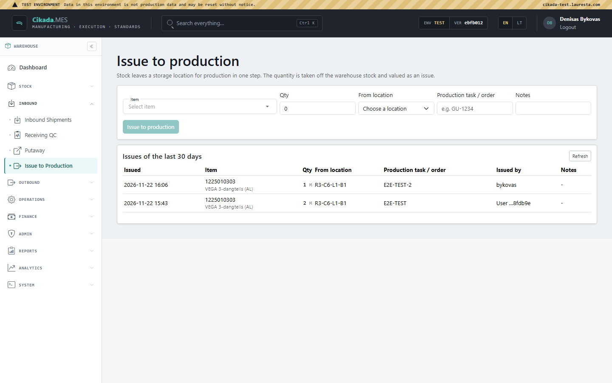

# Išdavimas į gamybą (Issue to Production)

**Būsena:** veikia

## Kam skirta
Ekranas (UI: Issue to Production) skirtas vienu žingsniu išduoti atsargas iš saugojimo vietos į gamybą. Kiekis nurašomas iš sandėlio likučio ir įvertinamas kaip išdavimas, kaip ir išsiuntimas klientui. Išdavimai matomi ataskaitoje [Atsargos pagal tiekėją](P-35-atsargos-pagal-tiekeja.md) stulpelyje (UI: To production).

## Prieš pradedant
- Prieiga: Operator, QCInspector, WarehouseManager, WarehouseAdmin.
- Prekė turi būti fizinėje saugojimo vietoje. Iš virtualių vietų (pvz., `RECEIVING`) į gamybą neišduodama – pirmiau padėkite prekes į vietą, žr. [P-02](P-02-padeti-i-lokacija-putaway.md).
- Kur prekė guli, matote ekrane (UI: Available Stock), žr. [P-24](P-24-atsargu-perziura.md).

## Žingsniai
### 1. Išduoti prekę
1. Meniu pasirinkite (UI: Inbound > Issue to Production).
2. Lauke (UI: Item) suraskite prekę pagal kodą ar pavadinimą.
3. Įveskite (UI: Qty) – kiekį prekės bazės vienetais.
4. Lauke (UI: From location) pasirinkite vietą, iš kurios imate.
5. Lauke (UI: Production task / order) įrašykite gamybos užduoties ar užsakymo numerį (pvz., `GU-1234`). Laukas neprivalomas, bet pagal jį vėliau lengviau rasti išdavimą.
6. Jei reikia, užpildykite (UI: Notes).
7. Spauskite (UI: Issue to production). Sėkmės atveju rodoma žinutė „Issued … to production.“, o eilutė atsiranda lentelėje apačioje.

### 2. Peržiūrėti išdavimus
Lentelėje (UI: Issues of the last 30 days) matote datą, prekę, kiekį, vietą, gamybos užduotį, kas išdavė ir pastabas. Sąrašą atnaujina mygtukas (UI: Refresh).

## Dažnos klaidos
| Pranešimas | Priežastis | Ką daryti |
|---|---|---|
| „Item … at location … has only … available. Cannot issue …“ | Vietoje nėra tiek laisvo kiekio | Patikrinkite likutį ir pataisykite kiekį arba vietą |
| „Stock is issued to production from a physical storage location.“ | Pasirinkta virtuali vieta | Pasirinkite fizinę saugojimo vietą |
| „The PRODUCTION location does not exist.“ | Sandėlyje nėra virtualios vietos `PRODUCTION` | Kreipkitės į administratorių |

## Dar neįgyvendinta
- Išdavimo atšaukti šiame ekrane negalima; klaidą taisykite atsargų koregavimu.
- Partijos (lot) pasirinkimo nėra.
- Senosios sistemos gamybos užduotys su šiuo išdavimu automatiškai nesusiejamos – numeris įrašomas ranka.
