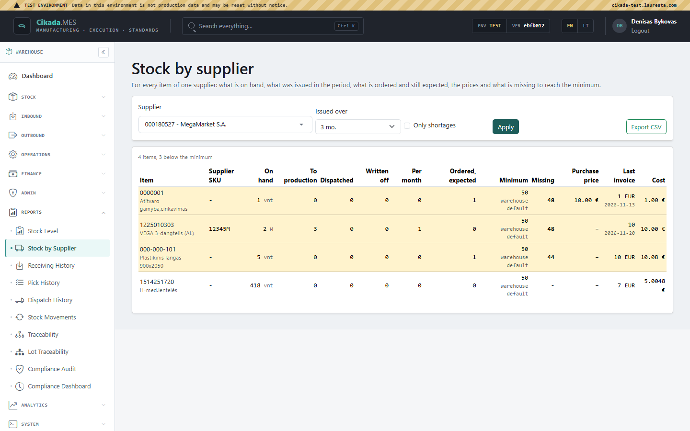

# Atsargos pagal tiekėją (Stock by Supplier)

**Būsena:** veikia

## Kam skirta
Ataskaita (UI: Stock by Supplier) vienam tiekėjui parodo kiekvieną jo prekę: kiek yra sandėlyje, kiek išduota per pasirinktą laikotarpį, kiek užsakyta ir dar laukiama, kainas ir kiek trūksta iki minimalaus kiekio. Ji skirta nuspręsti, ką ir kiek užsakyti.

## Prieš pradedant
- Prieiga: Operator, QCInspector, WarehouseManager, WarehouseAdmin.
- Tiekėjo prekės yra tos, kurios jam priskirtos ekrane (UI: Admin > Supplier Mappings), ir tos, kurios buvo jo pirkimo dokumentuose.
- Minimalus kiekis įvedamas prekės kortelėje: (UI: Admin > Items) > (UI: Edit) > (UI: Minimum quantity), žr. [P-32](P-32-prekiu-pagrindiniai-duomenys.md). Jei jis neįvestas, naudojamas bendras sandėlio užsakymo taškas iš (UI: Admin > Settings).

## Žingsniai
### 1. Parodyti ataskaitą
1. Meniu pasirinkite (UI: Reports > Stock by Supplier).
2. Lauke (UI: Supplier) suraskite tiekėją. Ataskaita įkeliama iškart.
3. Lauke (UI: Issued over) pasirinkite laikotarpį: 1, 3, 6 arba 12 mėnesių, ir spauskite (UI: Apply).
4. Pažymėkite (UI: Only shortages), jei norite matyti tik prekes, kurių trūksta.

### 2. Kaip skaityti stulpelius
| Stulpelis | Ką rodo |
|---|---|
| (UI: Tiekėjo prekės kodas) | Tiekėjo suteiktas prekės kodas |
| (UI: On hand) | Kiekis fizinėse sandėlio vietose |
| (UI: To production) | Išduota į gamybą per laikotarpį, žr. [P-34](P-34-isdavimas-i-gamyba.md) |
| (UI: Dispatched) | Išsiųsta klientams per laikotarpį |
| (UI: Written off) | Nurašyta į broką per laikotarpį |
| (UI: Per month) | Vidutiniškai išduodama per mėnesį (visi trys stulpeliai kartu) |
| (UI: Ordered, expected) | Užsakyta ir dar negauta pagal neuždarytus pirkimo dokumentus, su artimiausia laukiama data |
| (UI: Minimum) | Prekės minimalus kiekis; užrašas „warehouse default“ reiškia bendrą sandėlio reikšmę |
| (UI: Missing) | Kiek trūksta: minimumas minus (sandėlyje + užsakyta). Tokios eilutės paryškintos |
| (UI: Purchase price) | Tiekėjo kainoraščio kaina, o jei jos nėra – prekės pirkimo kaina |
| (UI: Last invoice) | Paskutinės šio tiekėjo sąskaitos vieneto kaina, valiuta ir data |
| (UI: Cost) | Dabartinė atsargų savikaina vienetui |

### 3. Parsisiųsti CSV
Spauskite (UI: Export CSV). Failas vadinasi `supplier-stock-<tiekėjo kodas>-YYYYMMDD.csv`.

## Dažnos klaidos
- „No items for this supplier…“ – tiekėjui nepriskirta nė viena prekė ir nėra jo pirkimo dokumentų. Priskirkite prekes ekrane (UI: Supplier Mappings).
- Stulpelis (UI: Missing) tuščias, nors prekės mažai – prekei neįvestas minimalus kiekis, o likutis viršija bendrą sandėlio užsakymo tašką.

## Dar neįgyvendinta
- Ataskaita rodo vieną tiekėją vienu metu.
- Grąžinimai iš gamybos ar klientų iš išduoto kiekio neatimami.
- Paslaugų tipo prekės į ataskaitą neįtraukiamos.
