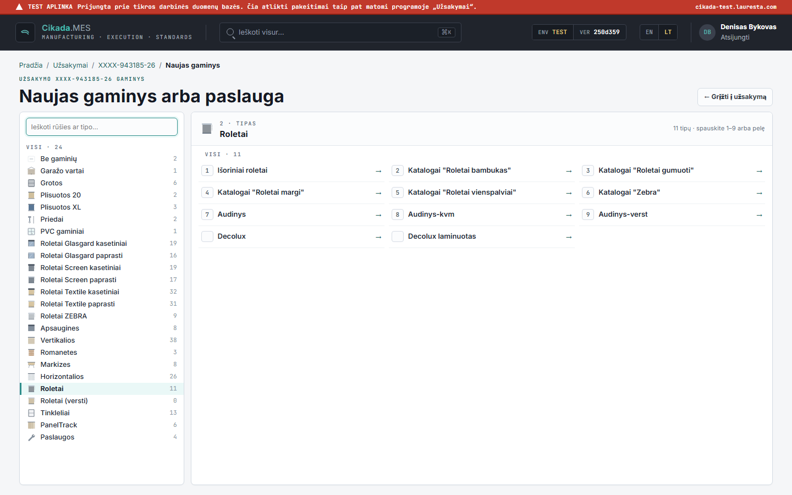
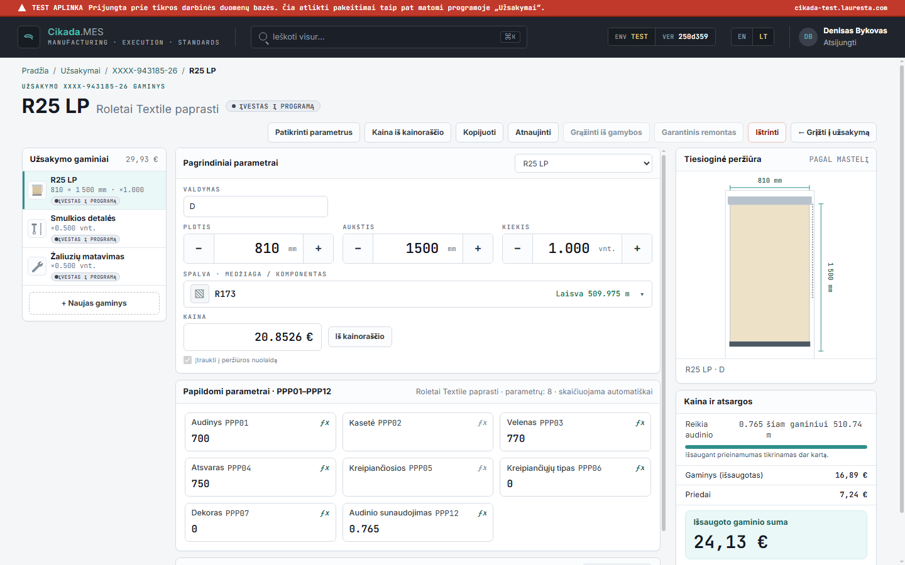

# Gaminiai ir priedai užsakyme

**Būsena:** dalinai

## Kam skirta
Pardavimų modulio užsakymo įvedimo dalis „Gaminiai, paslaugos ir priedai“ (UI: Gaminiai, paslaugos ir priedai) leidžia pridėti gaminį ar paslaugą, nustatyti matmenis, kiekį, spalvą / medžiagą ir kainą, užpildyti papildomus parametrus PPP01–PPP12 bei pridėti priedus. Skaičiavimai ir tikrinimai atliekami pagal senosios sistemos taisykles.

## Prieš pradedant
- Užsakymas jau sukurtas ir atidarytas ([užsakymo įvedimas](uzsakymo-ivedimas.md)); pagrindinių duomenų ir adreso pakeitimai išsaugoti (kitaip: „Prieš pridedami gaminį išsaugokite pagrindinių duomenų pakeitimus.“).
- Užsakymas neanuliuotas (kitaip: „Šis užsakymas anuliuotas. Naujų gaminių pridėti negalima.“) ir leidžiamas rašymas.
- Gaminio tipo kainoraštyje turi būti kaina, arba būtina įvesti vieneto kainą ranka (jei tipas tai leidžia).

## Žingsniai
### 1. Pasirinkti gaminio rūšį ir tipą
1. Užsakymo kortelėje paspauskite (UI: + Pridėti gaminį / paslaugą) arba `N`.
2. Kairėje (UI: 1 · Rūšis) pasirinkite kategoriją; ieškoti galima lauke (UI: Ieškoti rūšies ar tipo). Viršuje rodomos dažniausios rūšys per savaitę (UI: Dažniausiai šią savaitę).
3. Dešinėje (UI: 2 · Tipas) pasirinkite tipą pelės paspaudimu arba skaičiumi `1`–`9`. Neaktyvūs tipai (su žinyno nurodyta priežastimi) pilki.
4. Sukuriama gaminio eilutė ir atsidaro gaminio redagavimas.

### 2. Užpildyti gaminį
Gaminio redagavimo ekrane (UI: Gaminio redagavimas) yra skyriai:
1. (UI: Pagrindiniai parametrai): tipas (galima pakeisti, jei nėra priedų), (UI: Valdymas) (K, D arba kita reikšmė, iki 10 simbolių), (UI: Plotis) ir (UI: Aukštis) milimetrais (mygtukai − / + keičia po 10 mm), (UI: Kiekis), (UI: Spalva – medžiaga / komponentas) (paieška pagal kodą ar pavadinimą; rodoma laisva / rezervuota / gamyboje kiekiai), (UI: Kaina).
2. Kaina: paspauskite (UI: Iš kainoraščio) arba aktyvinkite kainos lauką, kad kaina būtų rasta kainoraštyje pagal medžiagą, matmenis ir užsakymo datą. Ranka kainą įvesti galima tik tada, kai tipas to reikalauja.
3. (UI: Papildomi parametrai · PPP01–PPP12): automatiškai skaičiuojami laukai pažymėti ƒx; įvedus reikšmę ranka, ji pakeičia apskaičiuotąją.
4. (UI: Gaminio informacija): (UI: Pastabos) iki 2048 simbolių; dabartinė būsena.
5. Dešinėje – (UI: Tiesioginė peržiūra) ir (UI: Kaina ir atsargos): reikia audinio, prieinamas kiekis, gaminio suma, priedų suma.
6. Paspauskite (UI: Išsaugoti ir grįžti į užsakymą). Saugant dar kartą tikrinami parametrai ir medžiagos prieinamumas.

### 3. Veiksmai viršuje
- (UI: Patikrinti parametrus) – perskaičiuoja parametrus ir atsargas nesaugant.
- (UI: Kaina iš kainoraščio) – suranda kainą.
- (UI: Kopijuoti) – sukuria gaminio kopiją su priedais (galioja senosios sistemos patikros).
- (UI: Atnaujinti) – įkelia išsaugotas reikšmes iš duomenų bazės; neišsaugoti pakeitimai atmetami po patvirtinimo.
- (UI: Ištrinti) – pašalina gaminį su priedais po patvirtinimo; negalima, jei gaminys turi gamybos istoriją ar yra užrakintoje būsenoje.
- (UI: ← Grįžti į užsakymą) – jei yra neišsaugotų pakeitimų, klausia, ar juos atmesti.

### 4. Pridėti priedą
1. Gaminio redagavime (UI: + Pridėti priedą), užsakymo eilutėje „+“ arba užsakymo skyriuje (UI: + Priedai) (atskira priedo eilutė).
2. Lango paieškoje (UI: Ieškoti priedų) pasirinkite priedą; nurodykite kiekį (pasiūlomas pagal matavimo vienetą ir matmenis) ir vieneto kainą.
3. Paspauskite (UI: Išsaugoti priedą). Priedą redaguoja paspaudimas ant jo pavadinimo; šalina ×.

## Ką reiškia būsenos ir spalvos
Gaminio būsena rodoma žymoje prie pavadinimo. Medžiagos juosta rodo atsargų užtenkamumą: oranžinė – trūksta. Pranešimai: „Trūksta medžiagos. … Įvesti leidžiama su įspėjimu“ (galima išsaugoti, bet patvirtinkite su atsakingu darbuotoju) arba „Gaminys neišsaugotas: nepakanka medžiagos“ (išsaugoti negalima – pasirinkite kitą medžiagą ar sumažinkite kiekį).

## Dažnos klaidos
| Pranešimas | Priežastis | Ką daryti |
|---|---|---|
| „Gaminys neišsaugotas: kainoraštyje nėra kainos šiems parametrams …“ | Nėra kainos | Patikrinkite medžiagą ir matmenis arba paprašykite kainoraščio administratoriaus |
| „Kainoraščio kaina pasikeitė. Prieš išsaugodami ieškokite kainos iš naujo.“ | Kaina pasikeitė | Paspauskite (UI: Iš kainoraščio) |
| „Šiai formulei būtina spalva.“ | Nepasirinkta medžiaga | Pasirinkite spalvą |
| „Pasikeitė skaičiavimo arba kainų duomenys. Prieš išsaugodami peržiūrėkite naują skaičiavimą.“ | Duomenys pasikeitė | Paspauskite (UI: Patikrinti parametrus) ir išsaugokite |
| „Esamos būsenos gaminio redagavimas užrakintas.“ | Gaminys jau patvirtintas gamybai | Redaguoti negalima |
| „Prieš keisdami gaminio tipą pašalinkite susietus priedus.“ | Tipas keičiamas su priedais | Pirma pašalinkite priedus |

## Dar neįgyvendinta
- Mygtukai (UI: Grąžinti iš gamybos) ir (UI: Garantinis remontas) visada neaktyvūs (užuominos: grąžinimas iš gamybos ir garantinis remontas neįtraukti į užsakymo įvedimą).
- Žymimasis langelis (UI: Įtraukti į peržiūros nuolaidą) neaktyvus.
- Lentelėje esantys kiekio ir kainos laukai užsakymo kortelėje tik skaitomi; keiskite juos gaminio redagavime.
- Eskizas „Tiesioginė peržiūra“ yra schematinis (žymima „SCHEMA“, kol nėra matmenų; su matmenimis – „PAGAL MASTELĮ“).
