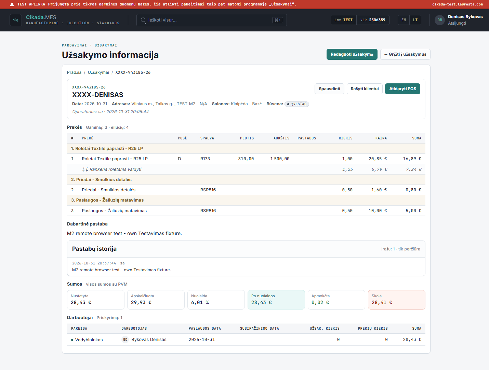

# Užsakymo informacija

**Būsena:** dalinai

## Kam skirta
Pardavimų modulio puslapis „Užsakymo informacija“ (UI: Užsakymo informacija) tik skaitymui rodo vieną užsakymą: antraštę, gaminių eilutes, pastabas, sumas ir atsakingus darbuotojus. Iš jo galima pereiti į užsakymo redagavimą.

## Prieš pradedant
- Užsakymas atidaromas pagal numerį (pvz., `VV-123`), dažniausiai paspaudus numerį [užsakymų sąraše](uzsakymu-sarasas.md).
- Jūsų SQL teisės turi apimti užsakymo saloną; kitaip rodoma „Užsakymas nerastas.“

## Žingsniai
### 1. Perskaityti užsakymą
1. Atidarykite užsakymą iš sąrašo (numerio nuoroda) arba adresu `/sales/orders/{Numeris}`.
2. Viršuje: numeris, klientas, data, adresas, salonas, būsena ir operatorius („Operatorius: vardas · data“).
3. Skyrius (UI: Prekės): gaminių grupės ir eilutės su stulpeliais Prekė, Pusė, Spalva, Plotis, Aukštis, Pastabos, Kiekis, Kaina, Suma. Priedai rodomi eilutėje su „↳“.
4. Skyrius (UI: Dabartinė pastaba) ir pastabų istorija (UI: Pastabų istorija), jei yra.
5. Skyrius (UI: Sumos), visos sumos su PVM: Apskaičiuota, Nustatyta, Nuolaida, Po nuolaidos, Apmokėta, Skola.
6. Skyrius (UI: Darbuotojai): Pareiga, Darbuotojas, Paslaugos data, Susipažinimo data, Užsak. kiekis, Prekių kiekis, Suma.

### 2. Pereiti į redagavimą
1. Paspauskite (UI: Redaguoti užsakymą) – atsidaro [užsakymo įvedimas](uzsakymo-ivedimas.md) tam pačiam užsakymui.
2. Norėdami grįžti, paspauskite (UI: ← Grįžti į užsakymus).

## Ką reiškia būsenos ir spalvos
Būsenos spalvinis ženklelis tas pats kaip sąraše (Įvestas, Patvirtintas, Gaminamas, Pagamintas, Filialui, Atiduotas, Sustabdytas, Anuliuotas). Sumų kortelės spalvos skiriasi pagal rūšį (pvz., skola atskirai paryškinta).

Jei užsakymo pastaba yra „Kliento prašymu anuliuotas“, rodomas privatumo pranešimas ir užsakymo pastabos nerodomos (tik atvaizdavimas; duomenys neištrinami).

## Dažnos klaidos
| Pranešimas | Priežastis | Ką daryti |
|---|---|---|
| „Užsakymas nerastas.“ / „Užsakymas {numeris} nerastas.“ | Numeris neteisingas arba salonas jums neprieinamas | Patikrinkite numerį sąraše |
| „Pardavimų modulis nepasiekiamas.“ / „Nepavyko įkelti užsakymo {numeris}.“ | API klaida | Paspauskite (UI: Bandyti dar kartą) |

## Dar neįgyvendinta
Trys mygtukai antraštėje neturi veiksmų ir nieko nedaro:
- (UI: Spausdinti) – spausdinimo nėra.
- (UI: Rašyti klientui) – el. laiškas nesiunčiamas.
- (UI: Atidaryti POS) – POS neatidaromas.
