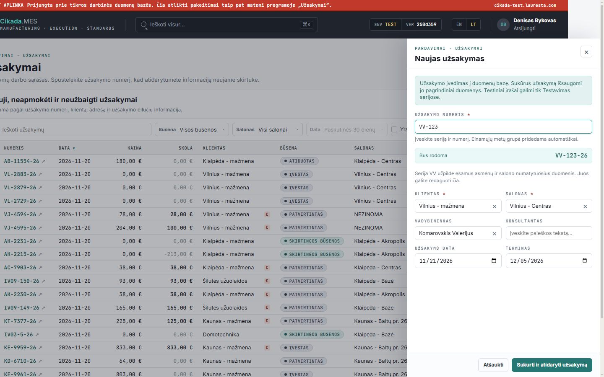
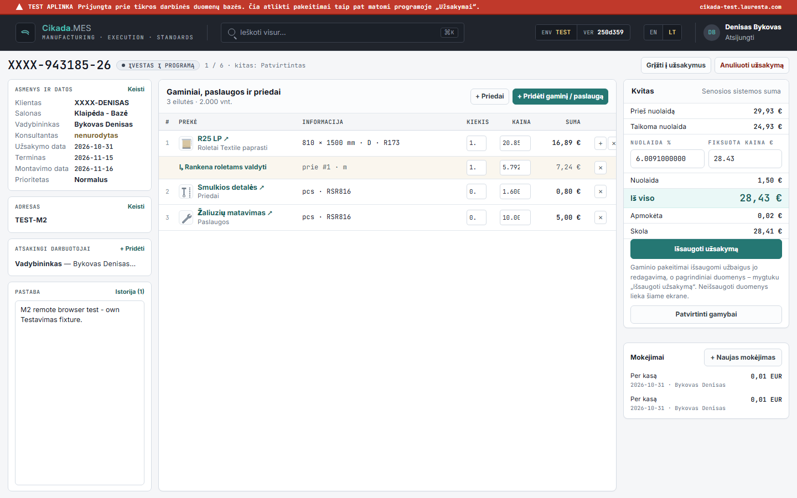

# Naujo užsakymo kūrimas ir užsakymo kortelė

**Būsena:** dalinai

## Kam skirta
Pardavimų modulio ekranas „Užsakymo įvedimas“ (UI: Užsakymo įvedimas) naudojamas sukurti naują užsakymą ir redaguoti esamo užsakymo pagrindinius duomenis: klientą, saloną, vadybininką, datas, adresą, atsakingus darbuotojus, pastabą ir nuolaidą. Gaminiai ir priedai aprašyti [atskirame puslapyje](uzsakymo-gaminiai.md), mokėjimai – [čia](uzsakymo-mokejimai-patvirtinimas.md).

## Prieš pradedant
- Paskyra susieta su senosios sistemos SQL prisijungimu.
- Įrašyti galima tik tada, kai aplinkoje įjungtas užsakymų įvedimas ir užsakymo serija yra leidžiamųjų („Testavimas“) sąraše. Kitu atveju ekrane rodoma „Užsakymą galima tik peržiūrėti…“, o išsaugojimo mygtukai neaktyvūs.
- Serija, klientas, salonas ir darbuotojai turi būti senosios sistemos žinynuose.

## Žingsniai
### 1. Atidaryti langą „Naujas užsakymas“
1. Sąraše paspauskite (UI: + Naujas užsakymas) arba `N`.
2. Lango paaiškinimas: „Užsakymo įvedimas į duomenų bazę. Sukūrus užsakymą išsaugomi jo pagrindiniai duomenys. Testiniai įrašai galimi tik Testavimas serijose.“

### 2. Užpildyti pagrindinius duomenis
1. Lauke (UI: Užsakymo numeris) įveskite seriją ir numerį, pvz. `VV-123` arba `VV-123-A`. Einamųjų metų grupė pridedama automatiškai; po jos galima įvesti ne daugiau kaip du simbolius. Pasiūlymų sąraše (UI: Atitinkančios serijos) pasirinkite seriją; laukelyje (UI: Bus rodoma) matysite galutinį numerį.
2. Pasirinkus seriją, automatiškai užpildomi numatytieji asmenys ir salonas (pranešimas „Serija … užpildė esamus asmenų ir salono numatytuosius duomenis. Juos galite redaguoti čia“).
3. Privalomi laukai pažymėti žvaigždute: (UI: Klientas), (UI: Salonas). Neprivalomi: (UI: Vadybininkas), (UI: Konsultantas), (UI: Užsakymo data), (UI: Terminas). Terminas negali būti ankstesnis už užsakymo datą.
4. Paspauskite (UI: Sukurti ir atidaryti užsakymą). Pasirinkite (UI: Atšaukti) arba `Esc`, jei nenorite kurti.

### 3. Dirbti su užsakymo kortele
Atidarytoje kortelėje viršuje rodomas numeris, būsena ir „x / 6 · kitas: …“ (užsakymo etapas), o pakeitus duomenis – „Neišsaugoti pakeitimai“. Kairėje yra kortelės, viduryje – gaminių eilutės, dešinėje – kvitas ir mokėjimai.
1. (UI: Asmenys ir datos) → (UI: Redaguoti): keiskite Klientas, Vadybininkas, Salonas, Konsultantas, Užsakymo data, Terminas, Montavimo data, Prioritetas (UI: Įprastas / Aukštas / Skubus, tiksli reikšmių eilė imama iš žinyno). Paspauskite (UI: Išsaugoti užsakymą).
2. (UI: Adresas) → (UI: Redaguoti) arba (UI: + Pridėti): lauke (UI: Ieškoti gatvės / adreso) įveskite miestą ar gatvę, paspauskite (UI: Ieškoti), pasirinkite (UI: Gatvės įrašas), užpildykite Namo Nr., Buto Nr., Telefonas, Adreso pastabos ir paspauskite (UI: Išsaugoti adresą). Adresas reikalingas tik pristatymui / montavimui.
3. (UI: Atsakingi darbuotojai) → (UI: + Pridėti): pasirinkite Pareigos, Darbuotojas, Data ir paspauskite (UI: + Pridėti). Priskyrimą pašalina ×.
4. (UI: Pastaba): iki 128 simbolių; (UI: Istorija (n)) atidaro pastabų istoriją (tik peržiūra).
5. Kvite nurodykite (UI: Nuolaida %) (nuo −100 iki 100; neigiama reikšmė reiškia antkainį) arba (UI: Fiksuota kaina) – nustačius fiksuotą galutinę kainą ji išsaugoma ir nuolaida perskaičiuojama. Reikia bent vienos eilutės, kuriai taikoma nuolaida.
6. Paspauskite (UI: Išsaugoti užsakymą). Gaminių pakeitimai išsaugomi užbaigus gaminio redagavimą, o pagrindiniai duomenys – šiuo mygtuku.
7. (UI: Grįžti į užsakymus) grįžta į sąrašą; jei yra neišsaugotų duomenų, klausiama „Išeiti iš šio redaktoriaus? Neišsaugoti duomenys bus prarasti.“

### 4. Išsaugoti ir patikrinti
Po sėkmingo išsaugojimo rodoma „Užsakymas išsaugotas.“ Sumos atnaujinamos pagal serverio skaičiavimą (sąraše „Kvitas“ – „Senosios sistemos suma“).

## Ką reiškia būsenos ir spalvos
Užsakymo būsena rodoma žymoje prie numerio (ta pati rinkinys kaip sąraše). Redagavimas leidžiamas tik tam tikrose būsenose: pavyzdžiui, „Esamos būsenos užsakymo redaguoti negalima“ reiškia, kad užsakymas užrakintas.

## Dažnos klaidos
| Pranešimas | Priežastis | Ką daryti |
|---|---|---|
| „Būtina nurodyti klientą ir saloną.“ | Tušti privalomi laukai | Pasirinkite iš sąrašų |
| „Pasirinkite esamą užsakymų seriją.“ | Serija nerasta | Pasirinkite iš pasiūlymų |
| „Užsakymas pakeistas kitoje sesijoje. Prieš išsaugodami įkelkite jį iš naujo.“ | Kitas naudotojas pakeitė užsakymą | Perkraukite užsakymą |
| „Terminas negali būti ankstesnis už užsakymo datą.“ | Neteisinga data | Pataisykite datas |
| „Šioje aplinkoje …išjungta“ (išsaugojimas, anuliavimas, mokėjimai) | Aplinkos jungiklis išjungtas | Kreipkitės į administratorių |

## Dar neįgyvendinta
- Įrašyti galima tik leidžiamose („Testavimas“) serijose; kitose – tik peržiūra.
- Išsaugoto užsakymo serijos ir numerio keisti negalima.
- Užsakymo spausdinimo, el. laiško ir POS atidarymo čia nėra.
