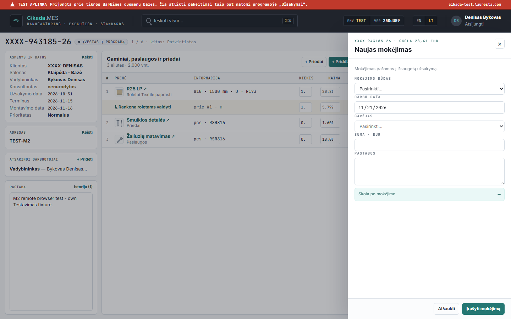

# Mokėjimai, patvirtinimas gamybai ir anuliavimas

**Būsena:** dalinai

## Kam skirta
Pardavimų modulio užsakymo įvedimo ekrano dešinėje pusėje yra trys veiksmai su finansinėmis ir gamybos pasekmėmis: naujo mokėjimo įrašymas (UI: + Naujas mokėjimas), gaminių patvirtinimas gamybai (UI: Patvirtinti gamybai) ir viso užsakymo anuliavimas (UI: Anuliuoti užsakymą). Šie veiksmai rašo į senosios sistemos duomenų bazę ir kiekvienas turi savo aplinkos jungiklį.

## Prieš pradedant
- Užsakymas išsaugotas, nėra neišsaugotų pagrindinių duomenų, adreso ar gaminio pakeitimų (kitaip: „Prieš įrašydami mokėjimą išsaugokite pagrindinių duomenų ir adreso pakeitimus“ / „Prieš tvirtindami gamybą išsaugokite arba atmeskite … pakeitimus“).
- Užsakymas neanuliuotas, serija leidžiama rašymui.
- Atitinkamas funkcijos jungiklis aplinkoje įjungtas (mokėjimai, patvirtinimas gamybai, anuliavimas). Jei išjungtas, mygtukas neaktyvus su užuominą („Šio užsakymo mokėjimai nepasiekiami“, „Šio užsakymo negalima patvirtinti gamybai“) arba rodoma klaida „Šioje aplinkoje … išjungta / neįjungta“.
- Mokėjimo būdai, kasos aparatai ir banko pavedimai ribojami aplinkos sąrašais; neleidžiami būdai pilki.

## Žingsniai
### 1. Įrašyti mokėjimą
1. Skyriuje (UI: Mokėjimai) paspauskite (UI: + Naujas mokėjimas). Antraštėje matote užsakymo numerį ir skolą.
2. Pasirinkite (UI: Mokėjimo būdas). Darbo data (UI: Darbo data) rodoma automatiškai ir nekeičiama.
3. Priklausomai nuo būdo:
   - (UI: PPK serija ir numeris) – įveskite tikrą dešimties simbolių PPK kvito numerį;
   - banko pavedimas – (UI: Ieškoti banko pavedimo) pagal mokėtoją, paskirtį ar datą, paspauskite (UI: Ieškoti pavedimų), pasirinkite pavedimą (UI: Banko pavedimas) (puslapiai Ankstesnis / Kitas). Rodoma nepriskirta suma; pavedimas turi turėti pakankamai nepriskirtos sumos. Banko įraše valiuta nesaugoma, konvertavimas netaikomas;
   - (UI: EKA kasos aparatas) – pasirinkite kasos aparatą; rodomas numatytasis gavėjas.
4. Pasirinkite (UI: Gavėjas) (numatytąjį galima pakeisti), įveskite (UI: Suma – valiuta) ir, jei reikia, (UI: Pastabos) (iki 500 simbolių). Suma teigiama, ne daugiau nei dviem skaitmenimis po kablelio ir neviršijanti leidžiamo maksimumo.
5. Patikrinkite (UI: Skola po mokėjimo) ir paspauskite (UI: Įrašyti mokėjimą). Sėkmės atveju rodoma: „Mokėjimas įrašytas; likučiai atnaujinti.“
6. Jei užsakymas ar likučiai pasikeitė, uždarykite ir iš naujo atidarykite mokėjimo formą.

### 2. Patvirtinti gaminius gamybai
1. Paspauskite (UI: Patvirtinti gamybai). Uždarykite mokėjimo formą, jei atidaryta.
2. Lange pažymėkite gaminius (nuo 1 iki 500): sąraše yra tik išsaugoti gaminami gaminiai su išsaugota kaina ir matmenimis, esantys būsenoje Įvestas arba Sustabdytas.
3. Paspauskite (UI: Patvirtinti pasirinktus (n)). Pasirinkti gaminiai perduodami gamybai; prieš tai tikrinamos senosios sistemos taisyklės, kliento taisyklės ir medžiagų prieinamumas. Sukuriamas gamybos dokumentas, o veiksmo čia atšaukti negalima.
4. Sėkmė: „Gaminiai patvirtinti gamybai.“

### 3. Anuliuoti užsakymą
1. Užsakymo antraštėje paspauskite (UI: Anuliuoti užsakymą). Mygtukas aktyvus tik užsakymui, kurio būsena Įvestas arba Sustabdytas, ir tik jei anuliavimas įjungtas.
2. Patvirtinkite klausimą „Anuliuoti šį išsaugotą užsakymą? Jo istorija liks pasiekiama.“ Prieš tai išsaugokite pakeitimus.

## Ką reiškia būsenos ir spalvos
Mokėjimų sąraše kiekviena eilutė rodo būdą, datą, nuorodą (PPK, pavedimo ar kasos aparato) ir sumą su valiuta. Užsakymo būsena po patvirtinimo pasikeičia į kitą (žr. „x / 6 · kitas“ antraštėje).

## Dažnos klaidos
| Pranešimas | Priežastis | Ką daryti |
|---|---|---|
| „Pasirinkite banko pavedimą ir išvalykite kitų mokėjimo būdų dokumentų nuorodas.“ | Maišomi būdai | Palikite tik vieną dokumentą |
| „Banko pavedime nepakanka nepriskirtos sumos.“ | Per didelė suma | Sumažinkite sumą arba pasirinkite kitą pavedimą |
| „Ši data nepatenka į dabartinės SQL paskyros mokėjimų darbo laikotarpį. Mokėjimas neužregistruotas.“ | Uždarytas laikotarpis | Kreipkitės į buhalteriją |
| „Įveskite vieną galiojantį dešimties ženklų PPK kvitą …“ | Neteisingas PPK | Įveskite tikrą 10 simbolių numerį |
| „Anuliuoti galima tik įvestus arba sustabdytus užsakymus.“ | Užsakymas jau gaminamas | Anuliuoti negalima |
| „Anuliavimas neprieinamas, kol senosios sistemos audito … “ | Žinoma senosios sistemos suderinamumo problema | Užsakymas neanuliuotas; kreipkitės į administratorių |
| „Šioje aplinkoje patvirtinimas gamybai neįjungtas.“ | Jungiklis išjungtas | Kreipkitės į administratorių |

## Dar neįgyvendinta
- Mokėjimų grąžinimai neįjungti (klaida: „…grąžinimai neįjungti“).
- Mokėjimas gali būti įrašytas tik šios dienos darbo data ir tik užsakymo valiuta; valiutų konvertavimo nėra.
- Mokėjimo ištrynimo ar taisymo ekrano nėra; esami mokėjimai rodomi tik sąraše.
