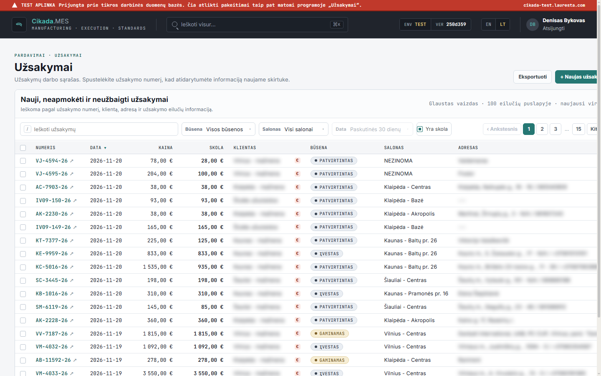

# Užsakymų sąrašas

**Būsena:** dalinai

## Kam skirta
Pardavimų modulio ekranas „Pardavimai · Užsakymai“ (UI: Užsakymai) rodo užsakymų darbo sąrašą su paieška, filtrais pagal būseną, saloną ir skolą. Iš čia atidaromas užsakymo informacijos puslapis arba pradedamas naujo užsakymo įvedimas. Sąrašo antraštė: „Nauji, neapmokėti ir neužbaigti užsakymai“.

## Prieš pradedant
- Prisijunkite per Cikada portalą; paskyra turi būti susieta su senosios sistemos SQL prisijungimu (žr. [apžvalgą](index.md)).
- Matomi tik tų salonų užsakymai, kuriuos leidžia jūsų SQL teisės.

## Žingsniai
### 1. Surasti užsakymą
1. Atidarykite `/sales/`.
2. Lauke (UI: Ieškoti užsakymų) įveskite užsakymo numerį, klientą, adresą arba gaminio tekstą. Paieška įsijungia po ketvirtadalio sekundės nuo paskutinio klavišo.
3. Pasirinkite būseną (UI: Būsena) ir saloną (UI: Salonas) iš sąrašų; sąrašuose rodomos tik tos būsenos ir salonai, kuriems yra užsakymų. Pirmas pasirinkimas „Visos būsenos“ / „Visi salonai“ panaikina filtrą.
4. Norėdami matyti tik neapmokėtus, paspauskite žymimąjį langelį (UI: Yra skola). Jo paaiškinimas: „Rodyti tik neapmokėtus užsakymus“.
5. Puslapiai po 100 eilučių: (UI: Ankstesnis), puslapių numeriai, (UI: Kitas) – viršuje ir apačioje. Apačioje rodoma „Rodomi įrašai X–Y iš Z“. Pakeitus bet kurį filtrą grįžtama į 1 puslapį.

### 2. Atidaryti užsakymą
1. Paspauskite užsakymo numerį (nuoroda su rodykle ↗): [užsakymo informacija](uzsakymo-informacija.md) atsidaro naujame skirtuke, sąrašas lieka kaip buvo.
2. Paspaudus kitur eilutėje, eilutė tik pažymima. Tada atsiranda mygtukas (UI: Redaguoti pasirinktą užsakymą), kuris atidaro [užsakymo įvedimą](uzsakymo-ivedimas.md) (`/sales/entry/{id}`).

### 3. Pradėti naują užsakymą
1. Paspauskite (UI: + Naujas užsakymas) arba klaviatūroje `N`. Mygtukas aktyvus tik kai puslapis visiškai įkeltas.
2. Atsidaro langas „Naujas užsakymas“ – žr. [užsakymo įvedimą](uzsakymo-ivedimas.md).

### 4. Klaviatūros trumpiniai
- `/` – pereiti į paieškos lauką.
- `↑` / `↓` – pažymėti ankstesnę / kitą eilutę; `Enter` – atidaryti pažymėtą užsakymą naujame skirtuke.
- `Esc` – jei yra paieškos tekstas, jį išvalo; kitu atveju panaikina eilutės žymėjimą.
- `N` – naujas užsakymas.
Trumpiniai neveikia, kai rašote į lauką (išskyrus `Esc`).

## Ką reiškia būsenos ir spalvos
Stulpelis „Būsena“ rodo užsakymo būseną (UI: Įvestas, Patvirtintas, Gaminamas, Pagamintas, Filialui, Atiduotas, Sustabdytas, Anuliuotas, Skirtingos būsenos). „Skirtingos būsenos“ reiškia, kad užsakymo eilutės yra skirtingose būsenose.

Stulpelis „Skola“: nulinė skola rodoma neutraliai, teigiama – paryškinta. Žymos (stulpelis be pavadinimo, antraštės užuomina „Žymos“): „€“ – yra skola, „★“ – VIP klientas, „!“ – yra pastaba.

## Dažnos klaidos
| Pranešimas | Priežastis | Ką daryti |
|---|---|---|
| „Pardavimų modulis nepasiekiamas.“ | Nepavyko pasiekti Sales API | Paspauskite (UI: Bandyti dar kartą) arba perkraukite puslapį |
| „Šiuos filtrus atitinkančių užsakymų nėra.“ | Filtrai per griežti | Pasirinkite „Visos būsenos“ / „Visi salonai“, nuimkite „Yra skola“ |
| Paskyra be SQL susiejimo | Cikada paskyra nesusieta su senosios sistemos prisijungimu | Kreipkitės į administratorių |

## Dar neįgyvendinta
- Mygtukas (UI: Eksportuoti) neturi veiksmo – nieko neeksportuoja.
- Datos filtras (UI: Data; reikšmės „Paskutinės 30 dienų“, „Šis mėnuo“, „Nuo metų pradžios“) išjungtas; užuomina: „Datos intervalo filtras bus įjungtas antrajame etape“. Užklausoje data neperduodama.
- Žymimieji langeliai eilučių pradžioje ir antraštėje („Pasirinkti visus“) yra tik vaizdiniai; pažymima viena eilutė, grupinių veiksmų nėra.
- Žymė „pradelsta skola“ šiuo metu niekada neįsijungia: užsakymų užklausa visada grąžina, kad pradelsimo nėra (vėlavimo skaičiavimas tik ataskaitose per AI asistentą).
