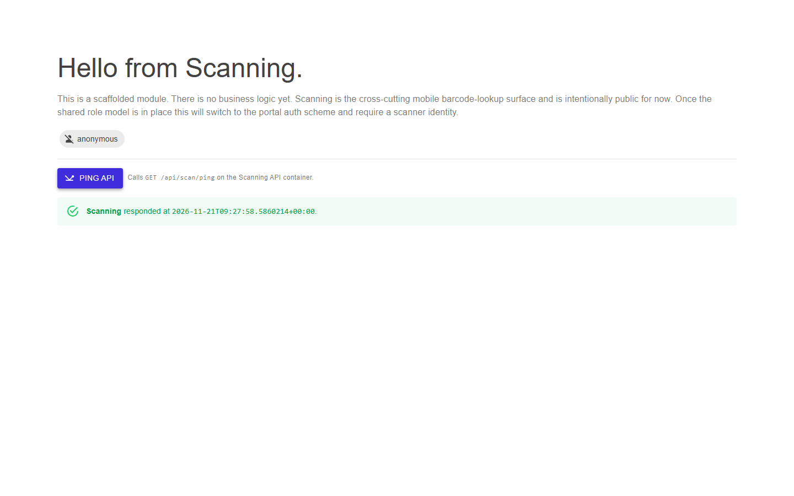

# Skenavimo modulio pradžios puslapis

**Būsena:** laikina (zagluška)

## Kam skirta
Skenavimo modulio (Scanning) pradžios puslapis yra karkaso patikros ekranas. Jis skirtas kūrėjams ir administratoriams, kad patikrintų, ar naršyklės dalis pasiekia modulio serverį. Operatoriui jis nereikalingas.

## Ką rodo ekranas
Puslapis visas anglų kalba, kalbos pasirinkimas jo neveikia. Jame:

1. Antraštė „Hello from Scanning.“
2. Tekstas, kad tai karkasinis modulis be verslo logikos, kad skenavimas yra bendras mobilus brūkšninių kodų paieškos paviršius ir kol kas viešas.
3. Žyma „anonymous“ (neprisijungęs).
4. Mygtukas (UI: Ping API). Jį paspaudus siunčiama užklausa `GET /api/scan/ping`. Užklausos metu mygtuko užrašas pasikeičia į „Pinging…“.

## Žingsniai (patikra)
1. Atidarykite `/scan/`.
2. Paspauskite (UI: Ping API).
3. Sėkmė: žalias pranešimas „Scanning responded at …“ su serverio laiku. Neįrašoma ir nekeičiama jokių duomenų.
4. Klaida: raudonas pranešimas „Ping failed: …“ su HTTP kodu (pvz., „503 Service Unavailable“) arba klaidos tekstu. Reiškia, kad Scanning API neveikia arba nepasiekiamas.

## Dar neįgyvendinta
Visa verslo funkcija: skenavimas, paieška, rezultatai. Žr. [apžvalgą](index.md).
