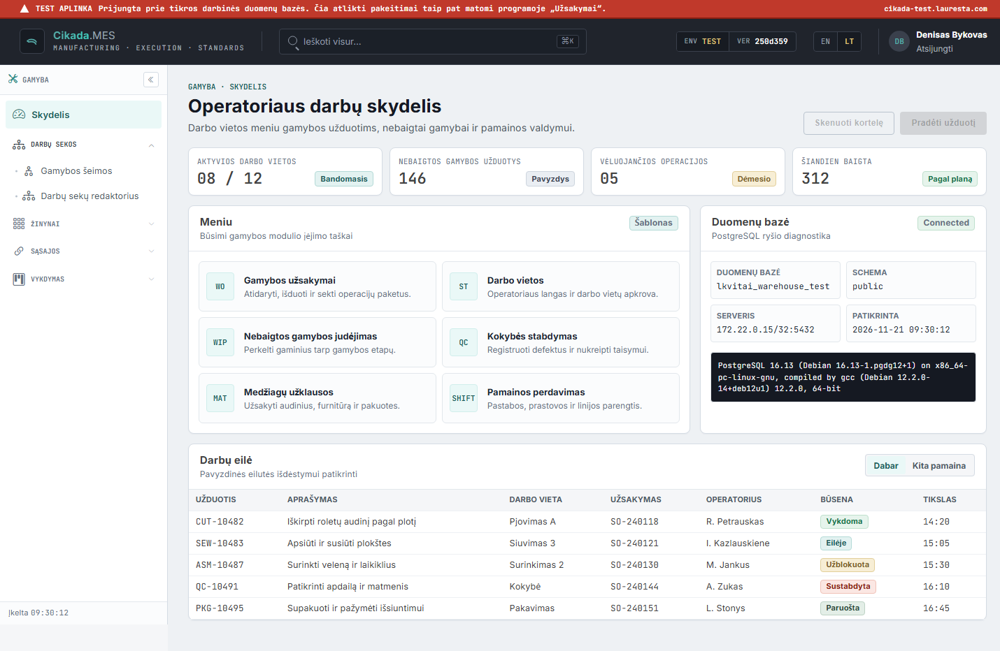

# Skydelis

**Būsena:** laikina (zagluška)

## Kam skirta
Gamybos modulio (Shopfloor) pradžios puslapis (UI: Skydelis) ateityje turi tapti operatoriaus darbų skydeliu. Šiandien tai maketas su pavyzdiniais skaičiais ir išjungtais mygtukais. Realių gamybos duomenų jame nėra, išskyrus vieną langelį apie duomenų bazės ryšį.

## Prieš pradedant
Reikia tik prisijungimo prie Portalo. Rolės nereikalingos.

## Ką rodo ekranas
Gamybos modulio (Shopfloor) puslapis (UI: Skydelis) rodo:

1. Antraštę (UI: Operatoriaus darbų skydelis) su mygtukais (UI: Skenuoti kortelę) ir (UI: Pradėti užduotį). Abu mygtukai išjungti.
2. Keturis rodiklius: (UI: Aktyvios darbo vietos) „08 / 12“, (UI: Nebaigtos gamybos užduotys) „146“, (UI: Vėluojančios operacijos) „05“, (UI: Šiandien baigta) „312“. Tai kode įrašyti pavyzdiniai skaičiai su žyma (UI: Pavyzdys) arba (UI: Bandomasis).
3. Plyteles (UI: Meniu): (UI: Gamybos užsakymai), (UI: Darbo vietos), (UI: Nebaigtos gamybos judėjimas), (UI: Kokybės stabdymas), (UI: Medžiagų užklausos), (UI: Pamainos perdavimas). Visos plytelės išjungtos, ant skydelio užrašyta (UI: Šablonas).
4. Lentelę (UI: Darbų eilė) su penkiomis pavyzdinėmis eilutėmis (CUT-10482, SEW-10483 ir kt.) ir išjungtu perjungikliu (UI: Kita pamaina).
5. Langelį (UI: Duomenų bazė). Tai vienintelė gyva dalis: rodomas duomenų bazės pavadinimas, schema, serverio adresas, patikrinimo laikas ir serverio versija. Jei duomenų bazė nepasiekiama, žyma pasidaro raudona.

## Dar neįgyvendinta
- Visi rodikliai, plytelės ir darbų eilės lentelė naudoja fiksuotus pavyzdinius duomenis.
- Mygtukai (UI: Skenuoti kortelę), (UI: Pradėti užduotį) ir visos meniu plytelės neturi veiksmų.
- Tikrą gamybos eilę žr. [Paruošta gamybai](gamyba-eile-ir-isdavimas.md).
